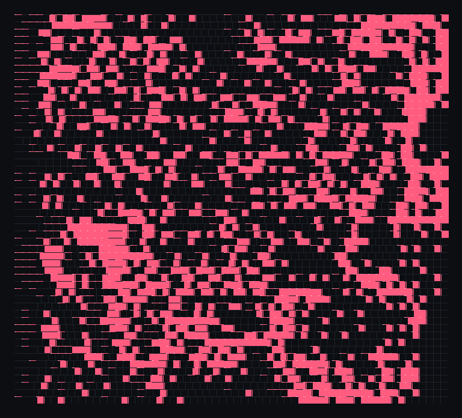
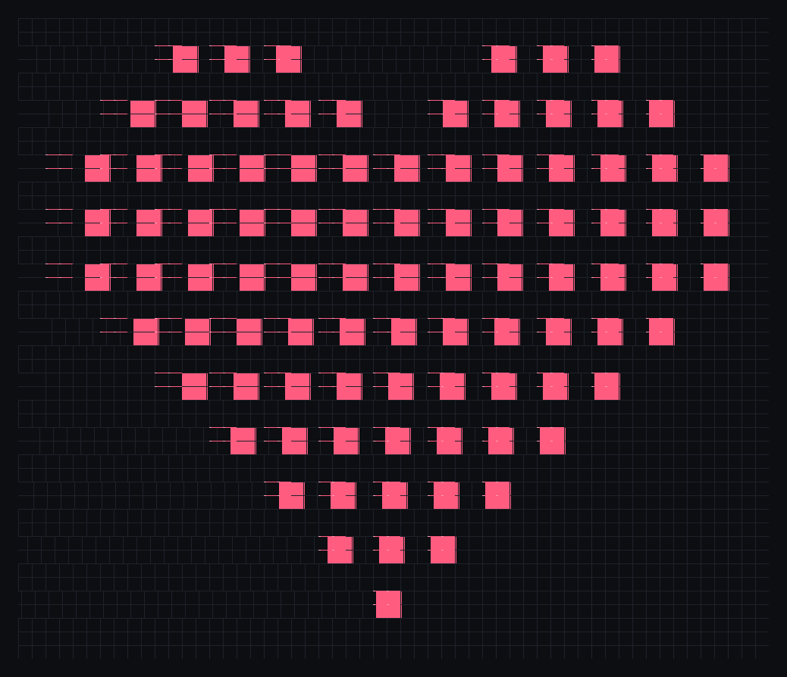

# Conway's Game of Life — a heart from a noise initial state

A course assignment: use Conway's Game of Life to make a heart.

The requirements are that the initial and final images differ, the final image is a
heart, and every pixel follows the Game of Life rule B3/S23.





## Idea

**The final image is a 13 × 11 pixel heart.** Every "pixel" of the drawing is a
2 × 2 block, which is a still life under B3/S23: each cell has exactly three
neighbours, so the block never changes. The heart is 50 × 42 cells with 364 live
cells; it is large and clear, and from generation 1 on it is stable.

**The initial image is not a heart.** It is a 1226-cell noise pattern found by
reverse construction: a SAT solver was asked for a state whose next generation is
exactly the heart, while maximising the number of live cells outside the heart.
The result is a dense, unstructured pattern in which no heart can be seen.

**One generation later the heart appears.** Applying B3/S23 once to the noise
pattern produces exactly the 364-cell heart. Because the heart is a still life,
generation 2 and every later generation are identical to it. The initial and final
images are therefore completely different, while every step uses only the ordinary
Game of Life rule.

The included video shows the transition: four seconds of the noise initial state,
then eight seconds of the stable heart.

## Files

| File | Contents |
|---|---|
| `heart.py` | The complete standalone program: builds the patterns, verifies the transition, writes the images and the video |
| `heart.html` | A self-contained web page with the evolution; it auto-transitions after 2.5 s and has Run, Step and Reset controls |
| `initial.png` | The initial state: a dense noise pattern, not a heart |
| `final.png` | Generation 1: the 364-cell heart |
| `heart.mp4` | The evolution video: noise → heart |
| `initial_cells.json` | The 1226 live cells of the initial state |
| `heart_cells.json` | The 364 live cells of the heart |
| `edit-mode-notes.md` | How the pattern was written into the viewer with the editing-mode API |
| `edit_mode_record.json` | The machine-readable session and transaction record |

## Run

```bash
python3 heart.py
```

The script needs only Python 3.9+ and its standard library for the images and the
verification. Encoding `heart.mp4` additionally needs `ffmpeg` on `PATH`; the
included video was made that way. The script prints:

```
initial cells: 1226
heart cells:   364
generation 1 equals the heart: True
the heart is stable: True
initial image differs from final image: True
```

To view the web version, open `heart.html` in a browser (or serve this folder with
any static file server).

## Rule

Every cell looks at its eight neighbours:

- a live cell with 2 or 3 live neighbours survives;
- a dead cell with exactly 3 live neighbours is born;
- everything else dies or stays dead.

That is **B3/S23**. The `step()` function in `heart.py` is a direct implementation
of this rule; no extra rule or manual edit is applied between generations.
