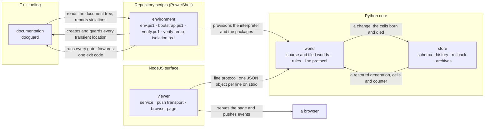

# MODULE_FLOW_GUIDE — cross-module entry and dependency map

> **Derived discovery surface.** Navigation only. Module promises are owned by
> [model/](model/); version state by [plan/VERSIONS.md](plan/VERSIONS.md).

## Current implementation

Arrow meaning: `A --> B` reads "A produces an input that B consumes". The edges
are one-directional in effect:

* the viewer drives the world and never computes a generation itself — the core
  is the authority for the rule;
* the store consumes what a step reports and hands back a restored state; the
  world does not know a history exists, which is why the modules share a *shape*
  (`(M, 2)` coordinates, a generation counter) rather than an import;
* the environment scripts decide where a tool is allowed to write, and no tool
  edits them;
* the gate reads the document tree and reports; it changes nothing.

## Boundaries that do not exist

* The viewer does not import the core, read its memory, or link against it. Its
  only contact is the line protocol, whose authority is
  [model/world/interfaces.md](model/world/interfaces.md).
* The core does not know a browser exists. It serves a line protocol on standard
  input and output and has no notion of a viewport owner.
* No module imports another module's private categories. A cross-module call
  goes through the facade named in that module's `interfaces.md`.

## Planned implementation

The next change with a cross-module effect is the tiled bit-parallel
representation, which is internal to `world` and therefore not drawn: the viewer
sees the same protocol either way. A push transport replaces the viewer's frame
polling; that is a change to the same edge, not a new one.

## Boundary summary

| Module | Consumes | Produces |
|---|---|---|
| [environment](model/environment/overview.md) | a shell, uv, Node.js, CMake and a C++ compiler | environment variables, directory skeleton, an isolation verdict, one exit code for every gate |
| [documentation](model/documentation/overview.md) | the repository document tree, the module catalog | a violation report and an exit code |
| [world](model/world/overview.md) | a world size, coordinates, rule requests | generations, viewports, frames encoded as cells or as a bitmap, and a change record |
| [viewer](model/viewer/overview.md) | the core's line protocol, browser requests | an HTTP surface, a pushed event stream, and a page that renders and edits a viewport |
| [store](model/store/overview.md) | a change record, a world's live set, connection options | a restored generation, a timeline, and a portable archive file |
