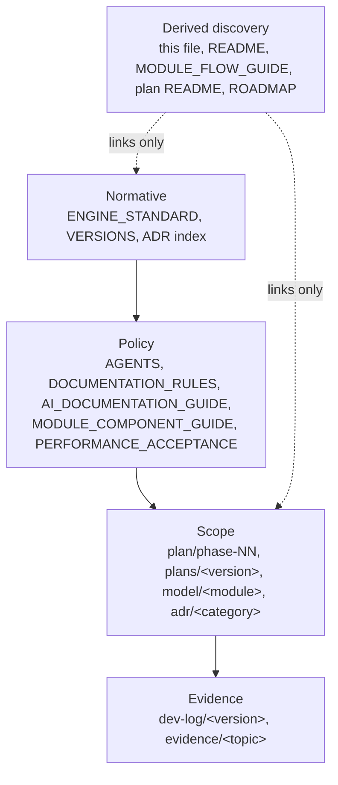

# docs — documentation entry point

> **Derived discovery surface.** Navigation only. Never a source of precise
> version state — that lives in [plan/VERSIONS.md](plan/VERSIONS.md).

## Start here

| If you want to know | Read |
|---|---|
| what this project is and what it will never compromise on | [../ENGINE_STANDARD.md](../ENGINE_STANDARD.md) |
| how to work in this repository | [../AGENTS.md](../AGENTS.md) |
| how documents are structured, owned and coupled | [DOCUMENTATION_RULES.md](DOCUMENTATION_RULES.md) |
| what a document must contain, and what counts as evidence | [AI_DOCUMENTATION_GUIDE.md](AI_DOCUMENTATION_GUIDE.md) |
| what the modules are | [model/module-catalog.json](model/module-catalog.json) |
| where the modules connect | [MODULE_FLOW_GUIDE.md](MODULE_FLOW_GUIDE.md) |
| which decisions were taken and why | [adr/README.md](adr/README.md) |
| which version is which | [plan/VERSIONS.md](plan/VERSIONS.md) |
| what the editing mode will be, and the decisions behind it | [plan/phase-04-editing-mode/overview.md](plan/phase-04-editing-mode/overview.md) |
| what was actually executed | [../dev-log/](../dev-log/) |

## Layers

Arrow meaning: `A --> B` reads "B derives its authority from A". Dashed arrows
mean "reads and links, owns nothing".

## Directory map

| Path | Contents |
|---|---|
| `adr/` | decisions, one file per decision, five categories |
| `model/` | module contracts and the module catalog |
| `plan/` | version authority, roadmap, machine profiles, phases and focused plans |
