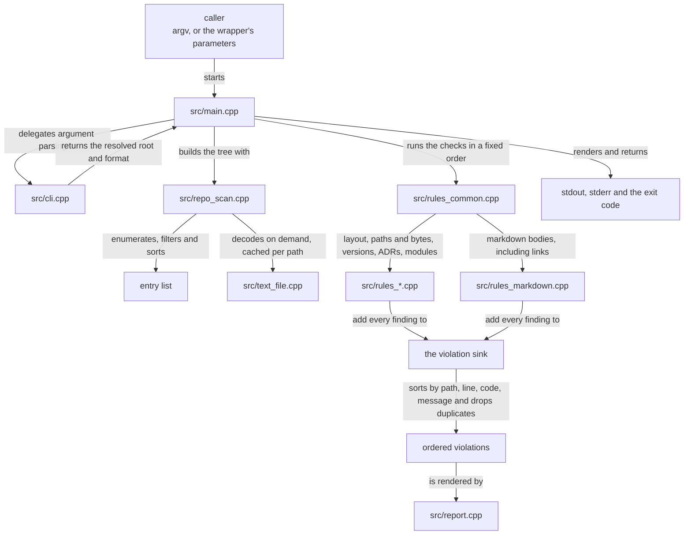
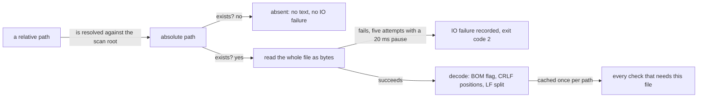

# documentation — data flow

> **Owner of the module's flow diagrams.** This file owns the producer and
> consumer paths, the runtime flow, the lifetime of every piece of data and the
> failure, rollback and recovery paths. The component boundaries are owned by
> [internal-components.md](internal-components.md); the public surface by
> [interfaces.md](interfaces.md); version state by
> [VERSIONS.md](../../plan/VERSIONS.md).

Status: Implemented

## 1. Ownership model

| Data | Producer | Consumer | Where it lives | How long | Owner of the value |
|---|---|---|---|---|---|
| The scan root | the caller, as `--root` or the process's working directory | the traversal | memory, one absolute normalised path | the run | the caller |
| The entry list (relative path plus directory flag) | the traversal in [src/repo_scan.cpp](../../../tools/documentation/src/repo_scan.cpp) | every check that needs to know which paths exist | memory, one sorted vector | the run | the scanner |
| Raw file bytes | [src/repo_scan.cpp](../../../tools/documentation/src/repo_scan.cpp) | the decoder | memory, then discarded after decoding | the read | the scanner |
| Decoded text: the raw bytes, the split lines, the BOM flag, the CRLF count and the first CRLF line | [src/text_file.cpp](../../../tools/documentation/src/text_file.cpp) | the path, markdown, version, ADR and module checks | the scanner's text cache, one entry per path | the whole run | the scanner |
| The IO-failure list | [src/repo_scan.cpp](../../../tools/documentation/src/repo_scan.cpp) | the entry point, which prints it and forces exit `2` | memory | the run | the scanner |
| Violations: severity, code, path, line, message | every check, through the sink in [src/model.hpp](../../../tools/documentation/src/model.hpp) | the ordering step, then the renderer | memory, one vector | the run | the check that added it |
| Promoted severities | the `--strict` step at the entry point | the renderer and the counts | memory, in place | the run | the caller's option |
| The rendered report | [src/report.cpp](../../../tools/documentation/src/report.cpp) | the caller, a log, the dev-log entry a human writes | stdout | the run | the caller |
| The summary line | [src/report.cpp](../../../tools/documentation/src/report.cpp) | the same | stderr, or stdout under `--quiet` | the run | the caller |
| The exit code | [src/main.cpp](../../../tools/documentation/src/main.cpp), forwarded by the wrapper | the shell, a human, the gate runner ([scripts/verify.ps1](../../../scripts/verify.ps1)) | the process exit status | the run | the caller |
| Build intermediates and the executable | [build.ps1](../../../tools/documentation/build.ps1), driven by [CMakeLists.txt](../../../tools/documentation/CMakeLists.txt) | the wrapper, the test runner, a human | `tools/documentation/build/` | until a human removes it | the repository |
| The fixture trees | [tests/make-fixtures.ps1](../../../tools/documentation/tests/make-fixtures.ps1) | the test runner, and a human reproducing one code by hand | `tools/documentation/tests/fixtures/` | until the generator is run again | the repository |

Two properties follow and are part of the contract:

* **The scanned tree is read-only.** The module produces no file below the scan
  root, so there is nothing in the tree to roll back. The only files it creates
  anywhere are the build outputs and the fixture trees listed in §1, and those
  live under the two ignored prefixes of [interfaces.md](interfaces.md) §6. The
  test runner writes no files at all: it compares the decoded stdout text in
  memory.
* **The verdict is not persisted by the tool.** Console output and the exit code
  are the whole product; the version dev-log is the evidence owner
  ([AI_DOCUMENTATION_GUIDE.md](../../AI_DOCUMENTATION_GUIDE.md) §4).

## 2. Producer and consumer paths

| Path | Producer | Consumer | Crossing |
|---|---|---|---|
| `docguard.exe` | [build.ps1](../../../tools/documentation/build.ps1) | [validate-documentation.ps1](../../../tools/documentation/validate-documentation.ps1), [tests/run-tests.ps1](../../../tools/documentation/tests/run-tests.ps1), a human | a process launch |
| Command-line arguments | the caller, or the wrapper's parameters | [src/cli.cpp](../../../tools/documentation/src/cli.cpp) | one process's `argv` |
| The absolute scan root | [src/cli.cpp](../../../tools/documentation/src/cli.cpp), through UTF-8 and native path conversion | the traversal | memory |
| Every scanned file | the repository | the checks | one read per tracked text file, cached for the run |
| The violation list | the checks | the renderer | memory, after one ordering-and-deduplication step |
| Text and JSON reports | the renderer | stdout | a stream, binary mode, so LF is never translated |
| The summary line | the renderer | stderr, or stdout under `--quiet` | a stream |
| The exit code | the entry point | the wrapper, then the shell | the process exit status |
| The check-code set | [tools/documentation/README.md](../../../tools/documentation/README.md), asserted by the fixture suite | any consumer that reacts to a code | a document plus a test, not a file |

Nothing in this module crosses a module boundary through a private file of
another module. The one inbound dependency is the environment contract: the
three scripts that can start a tool or a build dot-source
[scripts/env.ps1](../../../scripts/env.ps1), and the `environment` module's
isolation proof invokes
[build.ps1](../../../tools/documentation/build.ps1) as a workload step
([../environment/data-flow.md](../environment/data-flow.md)).

## 3. Runtime flow

### 3.1 One gate run (current state)

Arrow meaning: `X -->|"label"| Y` reads "X reaches Y by the mechanism named on
the arrow". This diagram is current state only. The check order is fixed and is
not the report order: the report order is decided by the ordering step, which is
why the two can be changed independently.

### 3.2 Reading a file (current state)

Arrow meaning as in §3.1. A path that does not exist is deliberately not an IO
failure: whether it must exist is the layout rule's business.

### 3.3 How the gate runner consumes this flow

The gate runner ([scripts/verify.ps1](../../../scripts/verify.ps1)) runs every
gate of the repository in one process and reports a single exit code. Two of its
gates are this module's: it invokes
[validate-documentation.ps1](../../../tools/documentation/validate-documentation.ps1)
with `-Quiet`, and [tests/run-tests.ps1](../../../tools/documentation/tests/run-tests.ps1),
each in its own child PowerShell process, in a fixed order, and it consumes
their exit codes unchanged.

That makes this module's exit code one input of an aggregate verdict, and the
aggregate has to preserve the `1` versus `2` distinction of
[interfaces.md](interfaces.md) §4, because a documentation run that could not
complete must not be reported as a documentation failure. The runner's own flow
is owned by the `environment` module's documents, not by this file.

## 4. Lifetime and retention

| Class | Retention contract |
|---|---|
| Process memory (entry list, text cache, violations) | Ends with the process. Peak size is proportional to the tree, because the cache holds every decoded text file for the whole run; see [performance.md](performance.md) §7 |
| Decoded text cache | One entry per path, never evicted, never shared between runs |
| Reports on stdout and stderr | Not persisted by the tool. Redirect them yourself if a record is needed |
| Exit code | The run only |
| `tools/documentation/build/` | Persists until a human removes it or `build.ps1 -Clean` runs. The scanner ignores it |
| `tools/documentation/tests/fixtures/` | Regenerated by `make-fixtures.ps1`; ignored by the repository scan, so a broken fixture can never change the repository verdict |
| The scanned documents | Untouched. The tree has the same content before and after a run |

## 5. Failure, rollback and recovery

| Failure | State after the failure | Rollback | Recovery |
|---|---|---|---|
| A command-line argument is wrong | Nothing was scanned; usage text on stderr; exit `2` | None needed | Correct the argument and re-run |
| The scan root is not a directory or cannot be enumerated | Nothing was scanned; the reason is on stderr; exit `2` | None needed | Correct `--root`, or fix the permission that stopped the enumeration |
| A file that exists cannot be read | The file is absent from the text cache and recorded as an IO failure; every other file is still checked; the violations found are printed and the exit code is `2` | None needed | Release the lock or fix the permission, then re-run; the retry loop already covers a transient sharing violation |
| A path a rule requires is missing | A violation of that rule; the run still completes | None needed | Create the path, or change the rule — by decision, not by suppressing the code |
| A check code fires | The report lists it; exit `1` | None needed: the tool does not modify the tree | Fix the document, then re-run. The failed run stays in the record ([AI_DOCUMENTATION_GUIDE.md](../../AI_DOCUMENTATION_GUIDE.md) §2) |
| The executable is missing | The wrapper builds it, or exits `2` with `-SkipBuild` | None needed | Build with [build.ps1](../../../tools/documentation/build.ps1), or remove `-SkipBuild` |
| The build fails | The wrapper exits `2`; a partially configured build directory remains | None: [build.ps1](../../../tools/documentation/build.ps1) never deletes unless `-Clean` is given | Read the compiler output, fix the cause, rebuild; `-Clean` is the supported reset |
| The process is interrupted mid-run | No file below the scan root was written, so the tree is unchanged; a partially written report may reach the console | None needed | Re-run: the tool is stateless and a repeated run over an unchanged tree produces the same bytes |
| A fixture is wrong | The assertion fails and the test runner exits `1` | The fixture tree can be regenerated from scratch | Run [tests/make-fixtures.ps1](../../../tools/documentation/tests/make-fixtures.ps1) and re-check |

One property follows and is part of the contract: **the module never needs to
repair state it created in the tree, because it creates none there.** The only
state it owns anywhere is its build directory, and that is disposable.
