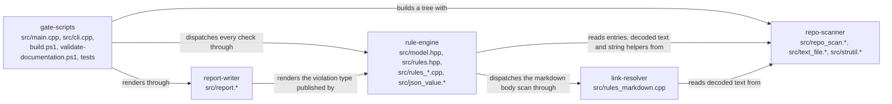

# documentation — internal components

> **Owner of the module's component view.** This file owns the component list,
> the exact source paths of each component, the allowed dependency direction and
> the current-state component flow. The component rules and the central index
> are owned by [MODULE_COMPONENT_GUIDE.md](../../MODULE_COMPONENT_GUIDE.md); the
> module's public surface by [interfaces.md](interfaces.md); the build layout by
> [implementation.md](implementation.md) §1.

Status: Implemented

## 1. Component list

The module has five components. The names below are the names used by the
central component index
([MODULE_COMPONENT_GUIDE.md](../../MODULE_COMPONENT_GUIDE.md) §4).

| Component | Files that make it up | What it owns |
|---|---|---|
| `repo-scanner` | [src/repo_scan.cpp](../../../tools/documentation/src/repo_scan.cpp), [src/repo_scan.hpp](../../../tools/documentation/src/repo_scan.hpp), [src/text_file.cpp](../../../tools/documentation/src/text_file.cpp), [src/text_file.hpp](../../../tools/documentation/src/text_file.hpp), [src/strutil.cpp](../../../tools/documentation/src/strutil.cpp), [src/strutil.hpp](../../../tools/documentation/src/strutil.hpp) | the one traversal of the tree, the ignore list, the cached decode of a text file (BOM, CRLF, LF split, fenced-code state), the UTF-8 to native path conversion and the ASCII string primitives every other component reuses |
| `rule-engine` | [src/model.hpp](../../../tools/documentation/src/model.hpp), [src/rules.hpp](../../../tools/documentation/src/rules.hpp), [src/rules_common.cpp](../../../tools/documentation/src/rules_common.cpp), [src/rules_layout.cpp](../../../tools/documentation/src/rules_layout.cpp), [src/rules_text.cpp](../../../tools/documentation/src/rules_text.cpp), [src/rules_version.cpp](../../../tools/documentation/src/rules_version.cpp), [src/rules_adr.cpp](../../../tools/documentation/src/rules_adr.cpp), [src/rules_module.cpp](../../../tools/documentation/src/rules_module.cpp), [src/json_value.cpp](../../../tools/documentation/src/json_value.cpp), [src/json_value.hpp](../../../tools/documentation/src/json_value.hpp) | the violation model and the check-code constants, the fixed check order and the dispatch, the layout, path-and-byte, version, ADR and module checks, and the dependency-free JSON reader the module-catalog check needs |
| `link-resolver` | [src/rules_markdown.cpp](../../../tools/documentation/src/rules_markdown.cpp) | the markdown body scan: inline link extraction and target resolution against the tree, status declarations, forbidden marker words, and the absolute-path warning, all sharing one line pass and one fenced-code state |
| `report-writer` | [src/report.cpp](../../../tools/documentation/src/report.cpp), [src/report.hpp](../../../tools/documentation/src/report.hpp) | rendering an ordered violation list as text, as JSON and as the summary line; nothing else |
| `gate-scripts` | [CMakeLists.txt](../../../tools/documentation/CMakeLists.txt), [build.ps1](../../../tools/documentation/build.ps1), [validate-documentation.ps1](../../../tools/documentation/validate-documentation.ps1), [src/main.cpp](../../../tools/documentation/src/main.cpp), [src/cli.cpp](../../../tools/documentation/src/cli.cpp), [src/cli.hpp](../../../tools/documentation/src/cli.hpp), [tests/run-tests.ps1](../../../tools/documentation/tests/run-tests.ps1), [tests/make-fixtures.ps1](../../../tools/documentation/tests/make-fixtures.ps1), [README.md](../../../tools/documentation/README.md) | the runnable surface: the executable's front end (arguments, orchestration, process exit code), the gate entry point, the build definition with its timestamp freshness check, the fixture generator, the test runner with its direct-invocation harness, and the tool's own README |

Three placements deserve a sentence each, because they are choices and not
accidents:

* `src/main.cpp` and `src/cli.cpp` are listed with `gate-scripts` rather than
  with `report-writer`. The front end is the executable counterpart of the
  PowerShell entry points — it turns arguments into a run and a run into an exit
  code — while `report-writer` owns only the rendering of a violation list.
* `src/model.hpp` and `src/rules.hpp` are listed with `rule-engine` because that
  is where the contract is published: the code constants, the violation type and
  the declaration of every check. Every other component reads that header; none
  of them owns it.
* `src/rules_markdown.cpp` carries four line-level rules that share one pass.
  The component is named `link-resolver` by the central index because link
  resolution is the only one of the four that needs the tree, and it is the
  responsibility a reader looks for; the other three are named here so that the
  name is not read as a complete description.

### 1.1 Structure tree

```
tools/documentation/
  CMakeLists.txt                  gate-scripts
  README.md                       gate-scripts
  build.ps1                       gate-scripts
  validate-documentation.ps1      gate-scripts
  src/
    main.cpp                      gate-scripts
    cli.cpp / cli.hpp             gate-scripts
    model.hpp                     rule-engine  (published contract)
    rules.hpp                     rule-engine  (published contract)
    rules_common.cpp              rule-engine
    rules_layout.cpp              rule-engine
    rules_text.cpp                rule-engine
    rules_version.cpp             rule-engine
    rules_adr.cpp                 rule-engine
    rules_module.cpp              rule-engine
    json_value.cpp / json_value.hpp  rule-engine
    rules_markdown.cpp            link-resolver
    report.cpp / report.hpp       report-writer
    repo_scan.cpp / repo_scan.hpp    repo-scanner
    text_file.cpp / text_file.hpp    repo-scanner
    strutil.cpp / strutil.hpp        repo-scanner
  tests/
    run-tests.ps1                 gate-scripts
    make-fixtures.ps1             gate-scripts
    fixtures/                     generated by gate-scripts, input to nothing else
  build/                          generated by gate-scripts; not a component
```

There is no public/private category split to draw: the module is a tool, not a
package, so there is no `__init__.py` facade and no importable surface. The
public surface is the executable and the four PowerShell entry points, and it is
owned by [interfaces.md](interfaces.md).

## 2. Allowed dependency direction

Arrows point from the caller to the callee. Only these call dependencies are
allowed:

| From | To | Mechanism |
|---|---|---|
| `gate-scripts` | `repo-scanner` | the entry point builds a `RepoTree`; the option parser converts the root with the scanner's path helper |
| `gate-scripts` | `rule-engine` | `run_all_checks` is called from the entry point; the fixture runner invokes the built executable |
| `gate-scripts` | `report-writer` | the entry point calls the text, JSON and summary renderers |
| `rule-engine` | `link-resolver` | the dispatcher in `rules_common.cpp` calls the single markdown entry point |
| `rule-engine` | `repo-scanner` | the checks read the entry list, the decoded text and the shared string helpers |
| `link-resolver` | `repo-scanner` | it reads decoded text and the same helpers |
| `report-writer` | `rule-engine` | it renders the violation type and the severity label published by `model.hpp` |
| `repo-scanner` | — | it is the leaf: it depends on nothing else in this module |

One direction needs explaining rather than forbidding. `link-resolver` includes
`src/rules.hpp` and `src/model.hpp`, which are owned by `rule-engine`, so the
compile-time graph has a reference in both directions between those two
components. It is a reference to a **declaration**, not to behaviour: the call
edge exists only from the dispatcher to the check, and a check never calls the
dispatcher, the renderer or another check. The rule below is what keeps it that
way.

Forbidden, and prevented by review rather than by a checker:

* `repo-scanner` including any rule, report or command-line header. It is the
  leaf; a scanner that needed a check would invert the whole module.
* Any check calling another check. The only fan-out is `run_all_checks`; two
  checks that called each other would make the report order depend on the call
  graph instead of on the ordering step.
* `link-resolver` reaching the dispatcher or the renderer. It returns findings
  through the sink it was given.
* `report-writer` inspecting the tree or running a check. It renders the list it
  is handed, in the order it is handed.
* `gate-scripts` rendering anything itself, or re-deciding an exit code: it
  forwards what the process returned.
* Any component writing below the scan root, or creating a file outside
  `tools/documentation/build/`.
* Promoting a component to a module without an accepted ADR and a named version
  ([MODULE_COMPONENT_GUIDE.md](../../MODULE_COMPONENT_GUIDE.md) §1).
* Adding a sixth component, splitting one of the five, or renaming one without
  changing the central index in the same work item.

## 3. Current-state component flow

Visualisation trigger: five components participate in one relationship
([DOCUMENTATION_RULES.md](../../DOCUMENTATION_RULES.md) §8). This file owns that
diagram; [overview.md](overview.md) carries only the context view and
[data-flow.md](data-flow.md) owns the runtime flow.



Arrow meaning: `X -->|"label"| Y` reads "X reaches Y by the mechanism named on
the arrow". The direction is always caller to callee, with the single
declaration-only reference explained in §2. This diagram is current state only.

### 3.1 Planned component state

No component is planned, merged, split or promoted for this module. A planned
component diagram is therefore not drawn, and a diagram that mixes current and
target state is not permitted
([DOCUMENTATION_RULES.md](../../DOCUMENTATION_RULES.md) §8). Adding or moving a
component requires:

1. this file, [implementation.md](implementation.md) and, when flow changes,
   [data-flow.md](data-flow.md) to change in the same work item;
2. the central index in
   [MODULE_COMPONENT_GUIDE.md](../../MODULE_COMPONENT_GUIDE.md) §4 to change in
   the same work item;
3. the phase `tasks.md`, `acceptance.md` and `risks.md` entries that name it;
4. an ADR when the change alters authority or the public direction.

The candidates in [performance.md](performance.md) §8 that change the *inside*
of a component — streaming reads, a single-pass link scanner, parallel rule
application — do not change this component set as long as the call direction of
§2 holds. A candidate that needed a new component would need all four steps
above first.

## 4. What each component may not do

| Component | May not |
|---|---|
| `repo-scanner` | skip a path unless its prefix is on the published ignore list; treat an unreadable file as an absent one; repair or retry an IO failure beyond the five short attempts; decode a file with an extension outside the tracked set for the encoding rules; depend on any other component |
| `rule-engine` | reorder the checks without a reading of the ordering promise; let a check call another check; add a violation without a code from the published set; silently drop a violation; mutate the decoded text it was handed |
| `link-resolver` | resolve a target by touching the filesystem outside the scan root; change a fence state across files; accept a link because the check is inconvenient; write, rename or delete anything |
| `report-writer` | reorder or de-duplicate a list it was handed; print a violation without its code; choose the exit code; read the tree |
| `gate-scripts` | swallow an exit code; treat a missing executable as a pass; build outside `tools/documentation/build/`; run the gate against a tree it did not name; write below the scan root; ship a fixture into the repository verdict |

The equivalents for the module as a whole are in
[responsibilities.md](responsibilities.md) §4.

## 5. Component boundary versus module boundary

* None of the five components is a module: none has a package directory under
  `src/lifegame/`, none is importable, and none may be depended on by Python or
  Node code ([ADR 0003](../../adr/governance-and-build/0003-cpp-is-tooling-only.md)).
* The module's public promise is exactly what [interfaces.md](interfaces.md)
  states. Everything in this file is internal: a component-internal change may
  alter headers, function names and file placement as long as the command line,
  the reports, the check codes and the exit codes keep their contract.
* A change to the component set is a change to the central index and to this
  file, not to the module's public surface — unless the surface changes with it,
  in which case the coupling matrix of
  [DOCUMENTATION_RULES.md](../../DOCUMENTATION_RULES.md) §10 applies in full.
* The module boundary against its peers is stated once, in
  [responsibilities.md](responsibilities.md) §2; this file does not restate it.
