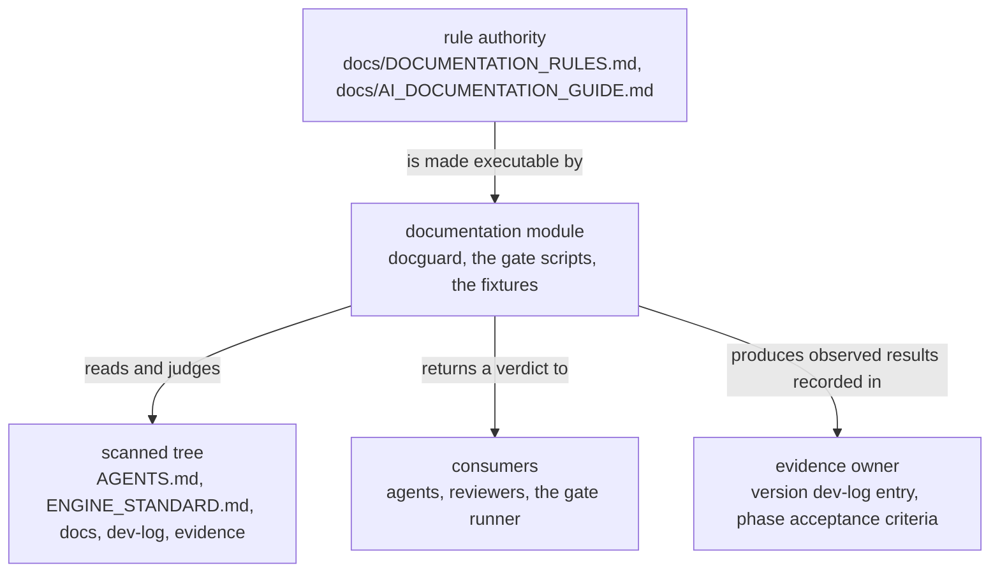

# documentation — overview

> **Owner of the documentation module contract.** This file and the eight files
> beside it own what the `documentation` module promises. The rules the module
> enforces are owned by [DOCUMENTATION_RULES.md](../../DOCUMENTATION_RULES.md)
> and [AI_DOCUMENTATION_GUIDE.md](../../AI_DOCUMENTATION_GUIDE.md); version state
> is owned by [VERSIONS.md](../../plan/VERSIONS.md); the component index is owned
> by [MODULE_COMPONENT_GUIDE.md](../../MODULE_COMPONENT_GUIDE.md) §4.

Status: Implemented

## Purpose

The `documentation` module turns the mechanically decidable half of this
repository's documentation rules into an executable gate. It is a C++20
command-line tool named `docguard`, plus the PowerShell scripts that build it,
run it and prove it. Given a repository tree it walks every non-ignored path,
applies fifteen check codes over paths, bytes, markdown bodies, version
identifiers, ADRs and module directories, and returns a deterministic report and
an exit code: `0` when nothing fired, `1` when at least one check code fired, `2`
when the run itself could not be completed. It never edits the tree it reads.

The module exists because a documentation rule that only a reviewer can enforce
is invisible when it is broken. The claim it makes is narrow on purpose: it
decides exactly what is mechanically decidable and says so in
[tools/documentation/README.md](../../../tools/documentation/README.md), which
lists the codes and the interpretation decisions behind them.

## Where the module sits

The module is repository infrastructure, not product behaviour. It sits beside
the Python core, the NodeJS service and the UI, and below every document: it
reads `AGENTS.md`, `ENGINE_STANDARD.md` and everything under `docs/`, `dev-log/`
and `evidence/`, and nothing imports it. Its consumers are agents and humans
who change a document, and the gate runner
([scripts/verify.ps1](../../../scripts/verify.ps1)), which runs every gate of
the repository in one command and consumes this module's exit codes.

Its source layout is the tooling form of
[DOCUMENTATION_RULES.md](../../DOCUMENTATION_RULES.md) §5: one directory per
tool under `tools/`, built by CMake, with no package under `src/lifegame/` and
no importable surface for Python or Node code. That placement is a decision, not
an accident; see [ADR 0003](../../adr/governance-and-build/0003-cpp-is-tooling-only.md).

## Current state

| Surface | State | Code entry point |
|---|---|---|
| Deterministic repository traversal and cached text decoding | Implemented | [src/repo_scan.cpp](../../../tools/documentation/src/repo_scan.cpp), [src/text_file.cpp](../../../tools/documentation/src/text_file.cpp) |
| The violation model, the check order and fifteen check codes | Implemented | [src/model.hpp](../../../tools/documentation/src/model.hpp), [src/rules_common.cpp](../../../tools/documentation/src/rules_common.cpp) |
| Layout, encoding, version, ADR and module-catalog checks | Implemented | [src/rules_layout.cpp](../../../tools/documentation/src/rules_layout.cpp), [src/rules_text.cpp](../../../tools/documentation/src/rules_text.cpp), [src/rules_version.cpp](../../../tools/documentation/src/rules_version.cpp), [src/rules_adr.cpp](../../../tools/documentation/src/rules_adr.cpp), [src/rules_module.cpp](../../../tools/documentation/src/rules_module.cpp) |
| Markdown body checks, including link resolution | Implemented | [src/rules_markdown.cpp](../../../tools/documentation/src/rules_markdown.cpp) |
| Text, JSON and summary rendering | Implemented | [src/report.cpp](../../../tools/documentation/src/report.cpp) |
| Command line and exit codes | Implemented | [src/main.cpp](../../../tools/documentation/src/main.cpp), [src/cli.cpp](../../../tools/documentation/src/cli.cpp) |
| Release build of a self-contained executable behind a timestamp freshness check | Implemented | [CMakeLists.txt](../../../tools/documentation/CMakeLists.txt), [build.ps1](../../../tools/documentation/build.ps1) |
| Gate entry point that builds the executable when it is missing | Implemented | [validate-documentation.ps1](../../../tools/documentation/validate-documentation.ps1) |
| Fixture generator and asserting test runner | Implemented | [tests/make-fixtures.ps1](../../../tools/documentation/tests/make-fixtures.ps1), [tests/run-tests.ps1](../../../tools/documentation/tests/run-tests.ps1) |

### Validation state

Validation is scoped, and it is stated claim by claim rather than as one word
([AI_DOCUMENTATION_GUIDE.md](../../AI_DOCUMENTATION_GUIDE.md) §3.1).

| Claim | State | Deciding record |
|---|---|---|
| The fixture suite reaches every check code and passes | `Validated` at the revisions the entries name, and re-observed on 2026-10-10 at the revision that carries the current runner | [dev-log/v0.1.0.md](../../../dev-log/v0.1.0.md) row A5: `ALL PASSED (61 assertion(s))`, 17 fixture trees; [dev-log/v0.1.0fix1.md](../../../dev-log/v0.1.0fix1.md) for the runner rework; the re-observation is in [testing.md](testing.md) §5 |
| The gate exits `0` on the delivered repository tree | recorded by the version dev-log entries and by the baseline commit message; not restated here | [acceptance.md](../../plan/phase-01-foundation/acceptance.md) A4 and A8 |
| The output is byte-identical across two runs | `Validated` at the revisions the entries name, and re-observed by the same three runs | [dev-log/v0.1.0.md](../../../dev-log/v0.1.0.md) row A6, and [testing.md](testing.md) §5 |
| Everything else on this page | `Implemented`, in the sense of §3 of the guide: the code entry point can be named | the sources and the fixture suite |

The version-boundary evidence for the suite was recorded before this contract
directory existed, so it is stale for the exact revision of this file. That is a
record-keeping caveat, not a behavioural one: the suite runs the executable over
fixture trees and never reads `docs/model/`. It must be repeated when the
revision changes, and a dated re-observation of the current runner is kept in
[testing.md](testing.md) §5.

Two dated observations of this revision are kept in [testing.md](testing.md) §5
and [performance.md](performance.md) §6.0. Neither is a version-boundary result.

## Owner

* **Contract owner.** This directory, `docs/model/documentation/`. A change to
  what the module promises is a change to these files, synchronised with the
  sources in the same work item
  ([DOCUMENTATION_RULES.md](../../DOCUMENTATION_RULES.md) §10).
* **Operating owner.** The repository maintainer. The agent-facing rule that
  makes the gate mandatory is [AGENTS.md](../../../AGENTS.md) §4.
* **Evidence owner.** The version dev-log entry named by
  [phase-01-foundation/acceptance.md](../../plan/phase-01-foundation/acceptance.md).

## Dependencies

### In (what this module needs)

| Dependency | Why | Failure behaviour |
|---|---|---|
| A C++20 compiler and CMake | The executable is compiled; there is no interpreter path | The build fails and [validate-documentation.ps1](../../../tools/documentation/validate-documentation.ps1) exits `2` |
| GCC 16.1.0 from the portable `w64devkit` distribution and CMake 4.4.2 | The versions the build was prepared against; both are absolute paths inside [build.ps1](../../../tools/documentation/build.ps1) | The script throws before configuring ([risks.md](risks.md) DOC-04) |
| Windows PowerShell ≥ 5.1 | The three wrapper scripts declare `#Requires -Version 5.1` | The scripts do not start |
| [scripts/env.ps1](../../../scripts/env.ps1) | Build and gate scripts dot-source it so no build intermediate leaves the repository tree | Missing script: the scripts continue, and the isolation rule is not applied to the build |
| A readable repository tree | Every check reads files below the scan root | An unreadable file is reported on stderr and forces exit code `2` |
| The standard filesystem library | Traversal, existence tests and path conversion | Compile-time only; there is no runtime fallback |

### Out (who depends on this module)

| Consumer | What it takes | Coupling |
|---|---|---|
| Every agent and human changing a document | The verdict of the gate | [AGENTS.md](../../../AGENTS.md) §4 makes the gate a mandatory check |
| [phase-01-foundation acceptance criteria](../../plan/phase-01-foundation/acceptance.md) | The deciding command for A4, A5, A6 and A8 | The criteria name the commands; the results live in the dev-log |
| The gate runner ([scripts/verify.ps1](../../../scripts/verify.ps1)) | One exit code per gate, in a fixed order; here it takes the wrapper's `-Quiet` result and the test runner's result | It adds no parameter and reinterprets no exit code ([interfaces.md](interfaces.md) §10) |
| The `environment` module's isolation proof | The tool build as one real workload that must leave no artifact outside the repository tree | `scripts/verify-temp-isolation.ps1` invokes [build.ps1](../../../tools/documentation/build.ps1) as a workload step; see [../environment/overview.md](../environment/overview.md) |
| [docs/MODULE_FLOW_GUIDE.md](../../MODULE_FLOW_GUIDE.md) | Reads this module's entry points; owns nothing | Derived discovery |

## What the module deliberately does not do

Even though it technically could:

* It does **not** edit, move, create or delete anything below the scan root.
  There is no auto-fix mode, no rewrite mode and no `--fix` option.
* It does **not** verify content hashes, and it emits no manifest and no hash
  receipt. That mechanism was considered and declined by the user; see
  [ADR 0001](../../adr/governance-and-build/0001-single-authority-documentation-system.md).
* It does **not** decide judgement-bearing rules: whether a diagram trigger
  fired, whether a claim has one owner, whether an acceptance criterion is
  measurable. Those stay reviewer duties, and
  [tools/documentation/README.md](../../../tools/documentation/README.md) says so.
* It does **not** own the rules it enforces, the status vocabulary, the content
  obligations or version state. It reads them and links to them.
* It does **not** become an importable dependency: nothing under `src/` or in
  Node code may import or shell out to it as a library
  ([ADR 0003](../../adr/governance-and-build/0003-cpp-is-tooling-only.md)).
* It does **not** persist evidence. The console report and the exit code are the
  whole output; the dev-log is written by whoever ran the gate.
* It does **not** follow symbolic links out of the tree, and it does not read
  the ignored cache, build and fixture directories listed in
  [interfaces.md](interfaces.md) §6.

## Decisions that shaped it

| Decision | Where it is recorded | What it fixed |
|---|---|---|
| A single-authority documentation system with an executable gate, and no hash or receipt mechanism | [ADR 0001](../../adr/governance-and-build/0001-single-authority-documentation-system.md) | Why the gate exists, what it may check, and why content hashing is out of scope |
| Every transient artifact stays inside the repository tree | [ADR 0002](../../adr/governance-and-build/0002-confine-transient-artifacts-to-repository.md) | Why the build directory lives under `tools/documentation/build/`, inside the repository tree |
| C++ is a tooling language only | [ADR 0003](../../adr/governance-and-build/0003-cpp-is-tooling-only.md) | Why the tool has no importable surface and no runtime boundary |

Structural choices that would otherwise be ADR material — the hand-rolled
markdown scanner, the dependency-free JSON reader, the single-pass rule order —
are recorded with their rejected alternatives in
[implementation.md](implementation.md) §6.

## Minimal current-state diagram

Visualisation trigger: more than three participants hold one relationship (rule
authority, module, scanned tree, consumer, evidence owner), so the minimum
sufficient diagram is required
([DOCUMENTATION_RULES.md](../../DOCUMENTATION_RULES.md) §8). Component internals
are owned by [internal-components.md](internal-components.md); runtime flow by
[data-flow.md](data-flow.md). This is a context view only.

Arrow meaning: `X -->|"label"| Y` reads "X is related to Y by the label written
on the arrow". This diagram is current state only.

## Document map

| File | Owns |
|---|---|
| [responsibilities.md](responsibilities.md) | claims, peer boundaries, failure behaviour, prohibited behaviour |
| [interfaces.md](interfaces.md) | arguments, output contract, exit codes, the check-code set, compatibility policy |
| [data-flow.md](data-flow.md) | producer/consumer paths, runtime flow, lifetime, failure and recovery |
| [implementation.md](implementation.md) | layout, build, algorithms and complexity, rejected alternatives |
| [performance.md](performance.md) | the admission floor, the oracle, the measurement method, what is unmeasured |
| [testing.md](testing.md) | what is tested and not tested, how to run it, the last recorded result |
| [risks.md](risks.md) | module risks with trigger, impact, mitigation and owning version |
| [internal-components.md](internal-components.md) | component list, allowed dependency direction, component flow |
