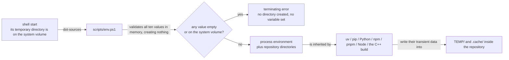
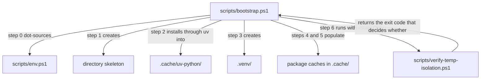
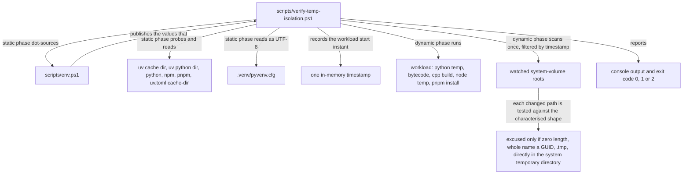
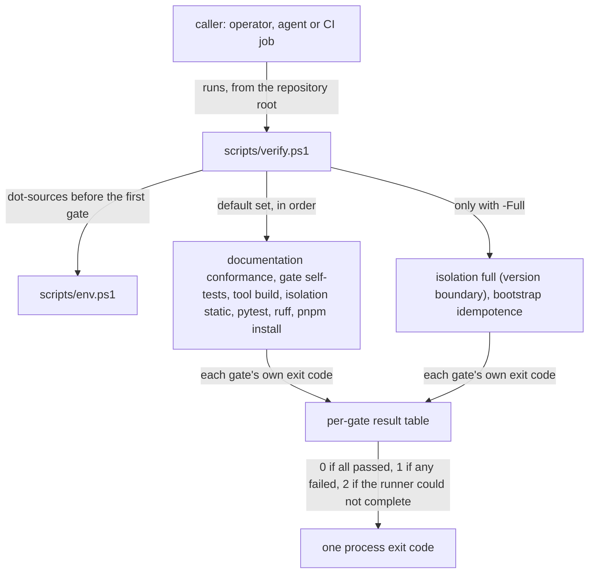

# environment — data flow

> **Owner of the module's flow diagrams.** This file owns the producer/consumer
> paths, the runtime flow, the lifetime of every piece of data and the failure,
> rollback and recovery paths. Component boundaries are owned by
> [internal-components.md](internal-components.md); version state by
> [VERSIONS.md](../../plan/VERSIONS.md).

Status: Implemented

## 1. Ownership model

| Data | Producer | Consumer | Where it lives | How long | Owner of the value |
|---|---|---|---|---|---|
| Process environment variables listed in [interfaces.md](interfaces.md) §2.3 | [scripts/env.ps1](../../../scripts/env.ps1) | every toolchain process started from that shell | the process environment block | until the shell exits | the session that dot-sourced the script |
| Directory skeleton (`TEMP`, `data`, `dev-log`, `evidence`, `.cache\*`, `docs\*`, `src\lifegame`, `tests`, `tools\documentation`) | [scripts/bootstrap.ps1](../../../scripts/bootstrap.ps1) step 1, plus the six directories `env.ps1` creates during its apply loop | every tool | the repository tree, on the repository volume | until a human removes it | the repository |
| `uv`-managed interpreter payload | `uv python install` under `UV_PYTHON_INSTALL_DIR` | `.venv`, `uv run`, the check script | `.cache/uv-python/` | until a human removes it | the repository (`uv` decides which payload it resolves) |
| Virtual environment and its `pyvenv.cfg` | `uv venv` (bootstrap step 3) | Python, tests, lint, the check script | `.venv/` | until a human removes it | the repository; `home` records the payload path |
| Package caches and stores | `uv`, pip, npm, pnpm | the same tools on the next run | `.cache/uv/`, `.cache/pip/`, `.cache/npm/`, `.cache/pnpm-store/`, `.cache/pnpm-cache/` | disposable; a human may remove any of them | the tool that wrote it |
| Python bytecode cache | any Python process started with `PYTHONPYCACHEPREFIX` set | the next Python process | `.cache/pycache/` | disposable | the Python process |
| Temporary files of the toolchain | `uv`, pip, Python, npm, pnpm, Node, the C++ build | the producing process only | `TEMP/` | the duration of the operation, normally | the producing process |
| Isolation probe files (`lifegame-isolation-probe`) | the dynamic phase of [scripts/verify-temp-isolation.ps1](../../../scripts/verify-temp-isolation.ps1) | nobody; the script removes each one in the same step | `TEMP/` | milliseconds | the check script |
| Workload start instant | the dynamic phase | the time filter that decides the check | one in-memory timestamp | the run | the check script |
| Environmental-class shape test result (which changed files match the characterised shape) | the dynamic phase, per changed file | the decision to excuse a file and the printed list | memory only | the run | the check script |
| Scan result (paths whose modification time is at or after the workload start, and the number of files scanned) | the dynamic phase | the pass/fail decision and the printed counts | memory only | the run | the check script |
| Check output and exit code | all four scripts | the operator, the agent, the version dev-log | the terminal, then the evidence layer | the run | the caller |
| Aggregate gate result (one line and one exit code per gate, plus the run's own exit code) | [scripts/verify.ps1](../../../scripts/verify.ps1), from the gates' own exit codes | the operator, an agent, a future CI job | the terminal, then the evidence layer | the run | the caller |
| Harness per-command temporary directory | the DSH harness | the command the harness starts | the system volume | the harness decides | the harness, not this project |

Nothing the module produces is written outside the repository, with one
external input it explicitly excludes: the per-command temporary directory the
harness creates on the system volume
([responsibilities.md](responsibilities.md) §3.3).

## 2. Producer and consumer paths

| Path | Producer | Consumer | Crossing |
|---|---|---|---|
| Environment variables | `env.ps1` | every tool process of the session | process environment, inherited by children |
| `LIFEGAME_ROOT` | `env.ps1` | scripts and tools that need the repository root | process environment |
| `PIP_CONFIG_FILE` | `env.ps1` | pip and `uv pip` | process environment; overrides the user-level pip configuration |
| `.venv\pyvenv.cfg` `home` | `uv venv` | CPython start-up, the check script | file read inside the repository, decoded as UTF-8 |
| `uv.toml`, `.npmrc`, `pnpm-workspace.yaml`, `scripts\pip.ini` | the repository (version control) | `uv`, npm, pnpm, pip | file read from the repository root or from the working directory; the declared cache paths are checkout-relative, and the absolute values `env.ps1` exports take precedence |
| `.python-version` | the repository (version control) | `uv` interpreter resolution | file read from the repository root |
| Package and interpreter caches | `uv`, pip, npm, pnpm | the same tools | files inside `.cache/` |
| Check results | `verify-temp-isolation.ps1` | the operator, the version dev-log, `verify.ps1` (as an exit code) | stdout and exit code |
| Gate exit codes | `verify.ps1` | the operator, an agent, a future CI job | stdout summary and one process exit code; the gates' own output is passed through with `Out-Host` and never parsed |

No data crosses a module boundary through a private file of another module. The
`documentation` module reads repository files but neither reads nor writes this
module's state; the module writes no file that a peer consumes.

## 3. Runtime flow

### 3.1 Session start and tool run (current state)

Arrow meaning: `X -->|"label"| Y` reads "X is related to Y by the label on the
arrow". This diagram is current state only.

### 3.2 Provisioning (current state)

Arrow meaning as in §3.1. A skipped step is announced, never silent; a failing
step terminates the bootstrap ([responsibilities.md](responsibilities.md) §3.2).

### 3.3 Verification (current state)

Arrow meaning as in §3.1. The watched roots and the workload are enumerated in
[interfaces.md](interfaces.md) §4.3. The dynamic phase does **not** take a
before-and-after snapshot: creation and modification both leave a modification
time at or after the instant the workload started, so a single post-run
enumeration filtered by that instant detects both. The scan is `O(F)` in the
number of files below the watched roots, and §7 of
[implementation.md](implementation.md) states why the second pass was removed.

The exclusion is a per-path test applied to the scan's result, not a step of its
own: a changed path is excused when it matches the characterised shape and is
reported as a violation otherwise. Nothing is re-derived at run time, and every
excused path is printed. The class is characterised once in
[evidence/windows-temporary-artifact-class.md](../../../evidence/windows-temporary-artifact-class.md);
the design that replaced is [testing.md](testing.md) §6 row 11.

### 3.4 Verification entry point (current state)

Arrow meaning as in §3.1. The entry point never parses a gate's output: it
records the process exit code and, for a gate that threw, records `2` for that
gate and keeps going. The gate set and its order are in
[interfaces.md](interfaces.md) §3.6.

The working directory is the one the caller had. The cache and temporary
locations do not care, because `env.ps1` exports them as absolute paths; the
`python tests` gate does, and starting the entry point from a subdirectory makes
it exit `5` — the residue recorded as [risks.md](risks.md) ENV-08.

### 3.5 Planned flow change

Planned for the entry point: fixing the working directory to the repository
root before the first gate, which closes ENV-08; and widening the harness
exclusion pattern from one `dsh-` family to all of them, which closes the
residue of ENV-04. Both are owned by the version that names M01 in
[VERSIONS.md](../../plan/VERSIONS.md); the flow diagram for that milestone is
owned by the phase documents, not by this file.

## 4. Lifetime and retention

| Class | Retention contract |
|---|---|
| Process environment | Ends with the shell. Re-source `env.ps1` in every new shell; a session that skipped it hands every tool a system-volume temporary directory |
| Repository directories | Persist. Created by `bootstrap.ps1` (skeleton) and `env.ps1` (the six redirected directories: `TEMP`, `.cache\uv`, `.cache\uv-python`, `.cache\pip`, `.cache\npm`, `.cache\pycache`); never removed by the module |
| Interpreter payload, virtual environment | Persist across runs. `bootstrap.ps1` reuses them; it re-installs only when `uv python find 3.14` is missing or resolves outside the repository |
| Package caches and bytecode cache | Disposable. Safe for a human to delete; the next tool run repopulates them inside the repository |
| The cache paths declared in committed configuration files | Static for the life of the checkout. Because they are relative, a copy of the repository inherits the same values and they resolve inside the **copy**, not inside the checkout the copy came from |
| Temporary files | Normally end with the operation. A killed process may leave files in `TEMP/`; the module does not clean them, and a human decides |
| Caches of superseded versions inside `.cache/uv-python/` | **No retention contract today**: two payload directories and a `.temp` staging directory were observed, and `.venv\pyvenv.cfg` binds to one of them ([risks.md](risks.md) ENV-07) |
| Check output | Not persisted by the scripts. The version dev-log is the evidence owner |

## 5. Failure, rollback and recovery

| Failure | State after the failure | Rollback | Recovery |
|---|---|---|---|
| A guarded value is empty or resolves to the system volume | `env.ps1` throws from the guard loop; because the guard runs before the apply loop, no directory has been created and no variable has been set | None needed; the script is refused before it has any effect | Correct the checkout location or the offending value; re-source the script; record the failure |
| `scripts\pip.ini` is missing | `env.ps1` throws from the guard loop, before any directory is created and before any variable is set | None needed | Restore the file from version control; re-source |
| `env.ps1` could not run at all (blocked by the execution policy) | The session looks normal; every tool uses its default locations on the system volume (phase risk R02) | None | Re-run the session preamble, then run the isolation check; the check is what makes the silent case visible |
| A tool ignores a redirected variable | The tool writes outside the repository | None | The dynamic phase reports the files; fix the tool's configuration or the environment entry; re-run |
| A tool is started from a subdirectory of the checkout | `uv` or pip resolves the relative declared `cache-dir` against that subdirectory and creates a second cache tree there, still inside the checkout; pnpm resolves its store against the workspace root and is unaffected | None | Start the command from the repository root ([AGENTS.md](../../../AGENTS.md) §1), or rely on `UV_CACHE_DIR` and `PIP_CACHE_DIR`, which are absolute for the running checkout ([risks.md](risks.md) ENV-06) |
| A second checkout is created by `git clone` or `git worktree` | The copy carries no declaration that names another tree; once provisioned, its caches land under its own `.cache/` | None | None needed. Running the isolation check inside the copy confirms every resolved path, which is what the cold-clone run does ([testing.md](testing.md) §5.4) |
| A bootstrap step fails | Earlier steps remain applied; later steps do not run | None; the script never deletes | Re-run `bootstrap.ps1`; every step is idempotent |
| The isolation check reports a violation | The run ends with exit code `1` and the file list | None | Read the list, fix the cause, re-run; the failed run stays in the record |
| The isolation check cannot complete | The run ends with exit code `2`, distinct from a violation; no pass/fail claim is made | None | Re-run after fixing the environment; treat an unexplained `2` as "not decided", never as a violation |
| A non-project process writes a file of another shape into a watched location during the workload window | The path does not match the characterised shape, so it is reported as a violation and the run exits `1`, even though no project tool wrote it. Observed once, inside `verify.ps1 -Full`, and not reproduced in four later runs | None | Read the reported path before treating it as a project artifact; the harness families and one third-party writer are named in [responsibilities.md](responsibilities.md) §3.3, and the residue is [risks.md](risks.md) ENV-04 |
| The entry point is started from a subdirectory of the checkout | The gates run with that working directory. The cache and temporary locations are unaffected, because the environment exports absolute paths; the `python tests` gate exits `5` for "no tests ran" and the run reports `1 of 6 gate(s) failed` | None | Start the command from the repository root ([AGENTS.md](../../../AGENTS.md) §1); the fix is planned as [risks.md](risks.md) ENV-08 |
| One gate of the entry point fails | That gate's exit code is recorded, the remaining gates still run, and the run exits `1` after naming the failing gates | None | Read the per-gate table; the failing gate's own output was passed through unchanged |
| A gate throws, or a gate's tool is missing | The gate is recorded with exit code `2` for that gate, the remaining gates still run, and the run exits `1` | None | Treat that gate as not decided, never as passed; fix the toolchain and re-run |
| The environment contract cannot be sourced by the entry point | The top-level `trap` exits `2` before the first gate; no gate result is claimed | None | Fix the environment, then re-run; a suite that ran under a degraded environment is not evidence |
| The process is interrupted mid-run | Partial downloads may remain in `.cache/`; a probe file may remain in `TEMP/` if the step was killed between create and remove | None | Re-run; `uv` and pnpm reuse or refetch their caches. Cleanup of leftovers is a human decision |
| A file is found on the system volume | The file stays where it is; the module cannot remove it because it does not touch the system volume | None | A human removes it after the finding is recorded; the fix is a configuration change |

Two properties follow and are part of the contract:

* **No rollback is required, because the module writes only inside the
  repository.** A checkout that itself lives on the system volume is refused
  before anything is created, which is why the guard loop precedes the apply
  loop ([testing.md](testing.md) §6 records the revision on which that order
  was fixed).
* **Failure is visible, not repaired.** The module reports; the human decides.
