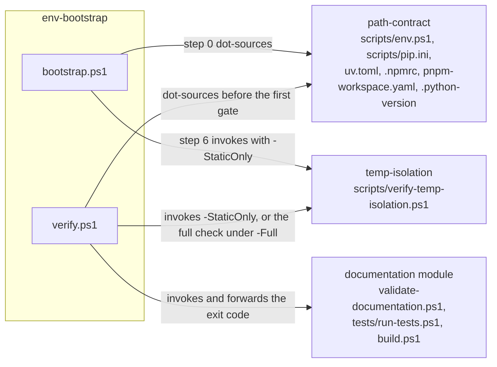

# environment — internal components

> **Owner of the module's component view.** This file owns the component list,
> the exact source paths of each component, the allowed dependency direction
> and the current-state component flow. The component rules and the central
> index are owned by [MODULE_COMPONENT_GUIDE.md](../../MODULE_COMPONENT_GUIDE.md);
> the module's public surface by [interfaces.md](interfaces.md).

Status: Implemented

## 1. Component list

The module has three components. The names below are the names used by the
central component index
([MODULE_COMPONENT_GUIDE.md](../../MODULE_COMPONENT_GUIDE.md) §4), and they are
the only names this module uses for its internals.

| Component | Files that make it up | What it owns |
|---|---|---|
| `path-contract` | [scripts/env.ps1](../../../scripts/env.ps1), [scripts/pip.ini](../../../scripts/pip.ini), [uv.toml](../../../uv.toml), [.npmrc](../../../.npmrc), [pnpm-workspace.yaml](../../../pnpm-workspace.yaml), [.python-version](../../../.python-version) | the definition of every transient location, the guard that validates all ten published values before anything is created or set, and the interpreter, cache and store configuration that the tools read by themselves. The declared cache paths are checkout-relative, so a copy of the repository writes into its own tree; [.npmrc](../../../.npmrc) belongs to the component but declares no settings, because the npm cache is owned by `npm_config_cache` |
| `env-bootstrap` | [scripts/bootstrap.ps1](../../../scripts/bootstrap.ps1), [scripts/verify.ps1](../../../scripts/verify.ps1) | making a checkout usable and deciding whether it is healthy. Provisioning: directory skeleton, interpreter payload, virtual environment, package sync, and the self-check it runs last. Verification entry point: one command that sources the environment itself, runs every gate — including the two owned by other modules — and reports a single exit code |
| `temp-isolation` | [scripts/verify-temp-isolation.ps1](../../../scripts/verify-temp-isolation.ps1) | the executable isolation proof: the static check of resolved locations, the shape test that excuses the characterised environmental class, and the dynamic check of files created below the watched system-volume locations |

[pyproject.toml](../../../pyproject.toml) and [package.json](../../../package.json)
are **not** components of this module. They are build and packaging inputs that
the module depends on; their ownership is stated in
[responsibilities.md](responsibilities.md) §2.

### 1.1 Structure tree

```
scripts/
  env.ps1                     path-contract
  pip.ini                     path-contract
  bootstrap.ps1               env-bootstrap (provisioning)
  verify.ps1                  env-bootstrap (verification entry point)
  verify-temp-isolation.ps1   temp-isolation
uv.toml                       path-contract
.python-version               path-contract
.npmrc                        path-contract (declares no settings)
pnpm-workspace.yaml           path-contract
TEMP/                         location created by path-contract
.cache/                       locations created by path-contract and filled by the toolchain
.venv/                        created by env-bootstrap, records its interpreter in pyvenv.cfg
```

There is no public/private category split to draw: the module has no package
directory and no import surface. Its only public surface is the scripts and
configuration files documented in [interfaces.md](interfaces.md).

## 2. Allowed dependency direction

Arrows point from the caller to the callee. Only these dependencies are
allowed:

| From | To | Mechanism |
|---|---|---|
| `env-bootstrap` | `path-contract` | `bootstrap.ps1` dot-sources `scripts/env.ps1` as its step 0 |
| `env-bootstrap` | `path-contract` | `verify.ps1` dot-sources `scripts/env.ps1` before the first gate, so a caller cannot forget the preamble |
| `env-bootstrap` | `temp-isolation` | `bootstrap.ps1` invokes `scripts/verify-temp-isolation.ps1` with `-StaticOnly` as its step 6 |
| `env-bootstrap` | `temp-isolation` | `verify.ps1` invokes the static phase in its default set and the full check under `-Full` |
| `env-bootstrap` | the `documentation` module | `verify.ps1` invokes `tools/documentation/validate-documentation.ps1`, its `tests/run-tests.ps1` and its `build.ps1`, and forwards their exit codes without judging documentation rules itself |

The last row is the only edge that leaves the module. It is a call, not a
dependency on the peer's internals: the entry point runs the commands the
`documentation` module publishes and reports their exit codes, and it owns no
documentation rule.

Forbidden, and prevented by review rather than by a checker:

* `path-contract` calling either other component. It is the leaf: it sets
  values and returns. A guard that needed the checker would be circular, and a
  path contract that ran the gates would make the environment depend on the
  result of checking it.
* `temp-isolation` calling `env-bootstrap`. The checker must not repair the
  state it is checking, and it must not become the thing it is checking.
* A gate calling `verify.ps1`. The entry point is the top of the call graph;
  a gate that re-entered it would multiply the run and hide which gate failed.
* Any cycle, including a future "self-heal" step in either direction.
* A component reading another component's private state through a path that is
  not part of [interfaces.md](interfaces.md). The configuration files are read
  by the external tools, not by another component.
* Promoting a component to a module without an accepted ADR and a named version
  ([MODULE_COMPONENT_GUIDE.md](../../MODULE_COMPONENT_GUIDE.md) §1).

## 3. Current-state component flow

Visualisation trigger: three components and one peer module participate in one
dependency relationship ([DOCUMENTATION_RULES.md](../../DOCUMENTATION_RULES.md)
§8). This file owns that diagram; [overview.md](overview.md) carries only the
context view and [data-flow.md](data-flow.md) owns the runtime flow.



Arrow meaning: `X -->|"label"| Y` reads "X reaches Y by the mechanism named on
the arrow". The direction is always caller to callee. This diagram is current
state only.

### 3.1 Planned component state

No component is planned, merged, split or promoted for this module. A planned
component diagram is therefore not drawn, and a diagram that mixes current and
target state is not permitted
([DOCUMENTATION_RULES.md](../../DOCUMENTATION_RULES.md) §8). Adding a component
requires:

1. this file, [implementation.md](implementation.md) and, when flow changes,
   [data-flow.md](data-flow.md) to change in the same work item;
2. the central index in
   [MODULE_COMPONENT_GUIDE.md](../../MODULE_COMPONENT_GUIDE.md) §4 to change in
   the same work item;
3. the phase `tasks.md`, `acceptance.md` and `risks.md` entries that name it;
4. an ADR when the change alters authority or the public direction.

## 4. What each component may not do

| Component | May not |
|---|---|
| `path-contract` | create a directory or set a variable before every published value has passed the guard; delete anything; change a machine- or user-scoped setting; mutate `$ErrorActionPreference`, `$ProgressPreference` or the strict mode when dot-sourced; define a location that is not in its variable table; call another component |
| `env-bootstrap` | skip its step 0 guard; continue after a failed step; re-download or re-create work that is already present; run the full dynamic check as part of provisioning; delete anything; report a gate as passed when it did not run; run the gates in a process that has not sourced the environment contract first; decide a gate's result itself instead of forwarding its exit code; re-enter itself from a gate |
| `temp-isolation` | repair the state it checks; suppress a failure to make a run pass; count a skipped workload as a passing check; report a completed check when it could not complete one; treat an incomplete run as a violation, or a violation as an incomplete run; ignore a created file because it is inconvenient; excuse a file whose shape is not the characterised, evidenced one; excuse a file inside a cache, build, bytecode or package location |

## 5. Component boundary versus module boundary

* None of the three components is a module: none has a package directory under
  `src/lifegame/`, and none may be imported by another module.
* The module's public promise is what [interfaces.md](interfaces.md) lists; a
  component-internal detail may change as long as that promise holds.
* A change to the component set is a change to the component index and to this
  file, not a change to the module's public surface — unless the surface
  changes with it, in which case the coupling matrix of
  [DOCUMENTATION_RULES.md](../../DOCUMENTATION_RULES.md) §10 applies in full.
