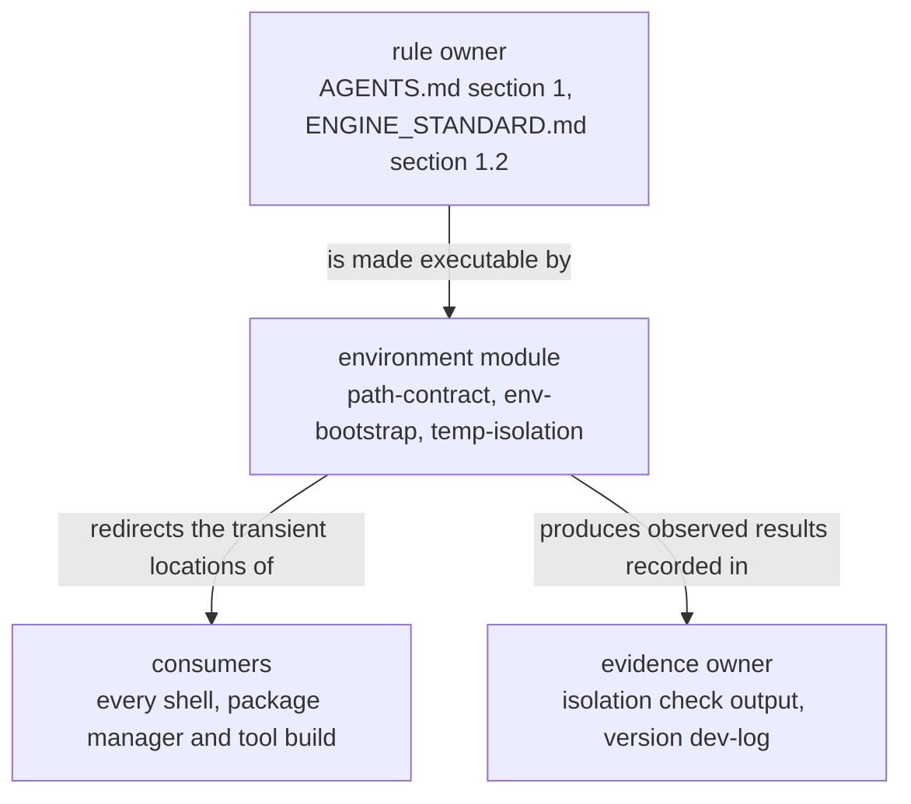

# environment — overview

> **Owner of the environment module contract.** This file and the eight files
> beside it own what the `environment` module promises. The rule itself is
> owned by [AGENTS.md](../../../AGENTS.md) §1 and
> [ENGINE_STANDARD.md](../../../ENGINE_STANDARD.md) §1.2; version state is
> owned by [VERSIONS.md](../../plan/VERSIONS.md); the component index is owned
> by [MODULE_COMPONENT_GUIDE.md](../../MODULE_COMPONENT_GUIDE.md) §4.

Status: Implemented

## Purpose

The `environment` module turns one rule into an executable, checkable
repository contract: **no temporary file, no package cache, no bytecode cache
and no build intermediate may be written to the `C:` volume**. The rule is not
satisfied by a shell snippet that a developer remembers to type; it is
satisfied when a script defines every transient location, a second script
refuses to continue when any of them points at `C:`, a third script proves by
observation that a representative workload creates nothing outside the
repository tree, and a fourth runs the whole gate set from one command so that
the first three cannot be skipped by forgetting a preamble.

## Where the module sits

The module is infrastructure, not product behaviour. It sits below every other
module: the Python core, the NodeJS service and UI, and the C++ tooling all
inherit the locations it defines. Nothing imports it as a library — it is a set
of PowerShell entry points plus the configuration files the toolchain reads,
and its consumers are shells, package managers and tool builds.

## Current state

| Aspect | State | Code entry point |
|---|---|---|
| Declares every transient location and refuses to continue on a `C:` target | Implemented | [scripts/env.ps1](../../../scripts/env.ps1) |
| Provisions the environment from a clean checkout, idempotently | Implemented | [scripts/bootstrap.ps1](../../../scripts/bootstrap.ps1) |
| Static phase of the isolation proof (resolved locations) | Implemented | [scripts/verify-temp-isolation.ps1](../../../scripts/verify-temp-isolation.ps1) |
| Dynamic phase of the isolation proof (time-filtered scan of the system-volume fallback locations) | Implemented | [scripts/verify-temp-isolation.ps1](../../../scripts/verify-temp-isolation.ps1) |
| Python interpreter contract (`uv`-managed CPython 3.14, payload in-repo) | Implemented | [uv.toml](../../../uv.toml), [.python-version](../../../.python-version), [pyproject.toml](../../../pyproject.toml) |
| Checkout-relative cache declarations, so a clone or worktree keeps its own caches | Implemented | [uv.toml](../../../uv.toml), [pnpm-workspace.yaml](../../../pnpm-workspace.yaml), [scripts/pip.ini](../../../scripts/pip.ini) |
| Node cache and store redirection | Implemented | [scripts/env.ps1](../../../scripts/env.ps1) (`npm_config_cache`), [pnpm-workspace.yaml](../../../pnpm-workspace.yaml) (`storeDir`, `cacheDir`), [package.json](../../../package.json); [.npmrc](../../../.npmrc) declares no settings |
| pip configuration redirection | Implemented | [scripts/pip.ini](../../../scripts/pip.ini) |
| One command runs every gate, sources the environment itself and reports a single exit code | Implemented | [scripts/verify.ps1](../../../scripts/verify.ps1) |

### Validation state

The module's own claim — "no project artifact reaches the system volume" — has
been decided by observation, not by argument, on the current revision: the
static check, the full check and a cold-clone run are recorded, with their exact
commands and observed results, in [testing.md](testing.md) §5 and
[performance.md](performance.md) §7, and the version-boundary record for the
acceptance criteria that name this module (A1, A2, A3, A7, A10, A11) is
[dev-log/v0.1.0.md](../../../dev-log/v0.1.0.md). Whether those criteria count as
`Validated` at a version boundary is version state, and version state is
recorded only in [VERSIONS.md](../../plan/VERSIONS.md). Everything in the table
above is `Implemented` in the sense of §3 of
[AI_DOCUMENTATION_GUIDE.md](../../AI_DOCUMENTATION_GUIDE.md): the code entry
point can be named.

## Owner

* **Contract owner.** This directory, `docs/model/environment/`. A change to
  what the module promises is a change to these files, synchronised with the
  sources in the same work item
  ([DOCUMENTATION_RULES.md](../../DOCUMENTATION_RULES.md) §10).
* **Operating owner.** The repository maintainer; the agent-facing rules that
  invoke this module are [AGENTS.md](../../../AGENTS.md) §1.
* **Evidence owner.** The version `dev-log` entry named by
  [phase-01-foundation/acceptance.md](../../plan/phase-01-foundation/acceptance.md).

## Dependencies

### In (what this module needs)

| Dependency | Why | Failure behaviour |
|---|---|---|
| Windows PowerShell ≥ 5.1 (`#Requires -Version 5.1`) | All four scripts are PowerShell; the declarations in the header are enforceable only there | Script does not start |
| A process-scope execution-policy bypass | The machine policy is `RemoteSigned` and these scripts are unsigned | Dot-sourcing `env.ps1` fails; caches fall back to the system volume ([phase-01-foundation/risks.md](../../plan/phase-01-foundation/risks.md) R02) |
| `uv` on `PATH` | interpreter payload, virtual environment, package sync, `uv cache dir` / `uv python dir` probes | `bootstrap.ps1` throws on the failing step; `verify-temp-isolation.ps1` reports a failing check |
| Node.js and pnpm on `PATH` (optional) | npm/pnpm cache, store and cache-directory checks, the Node workload step, `pnpm install` | `-SkipNode` skips them; without the switch a missing tool produces a failing check |
| git | not required by the module; repository hygiene only | Not applicable to the module |
| An existing repository tree | Every path is resolved relative to the script location | Directory creation is confined to `env.ps1` and `bootstrap.ps1` |

### Out (who depends on this module)

| Consumer | What it takes | Coupling |
|---|---|---|
| Every shell session in this repository | `LIFEGAME_ROOT`, `TEMP`, `TMP`, `TMPDIR`, `PIP_CONFIG_FILE` and the five cache variables | [AGENTS.md](../../../AGENTS.md) §1 makes dot-sourcing `env.ps1` the first action of a session |
| `uv`, pip, Python, npm, pnpm, Node | The redirected cache and temporary directories | Absolute values exported by [scripts/env.ps1](../../../scripts/env.ps1); checkout-relative declarations in [uv.toml](../../../uv.toml), [pnpm-workspace.yaml](../../../pnpm-workspace.yaml) and [scripts/pip.ini](../../../scripts/pip.ini); [.npmrc](../../../.npmrc) declares nothing |
| `scripts/bootstrap.ps1` | The isolation guard, then the directory skeleton and the static check | Step 0 and step 6 |
| [scripts/verify.ps1](../../../scripts/verify.ps1) | The environment contract, the isolation checks, and the exit codes of the gates it runs | It dot-sources `env.ps1` first and forwards each gate's exit code unchanged |
| Future Python, NodeJS and C++ tooling | A repository-internal interpreter, cache and temporary area | Adding a tool obliges the same change to extend the guard list and [interfaces.md](interfaces.md) |
| The documentation gate | It does not re-check isolation; the paths it reads stay reachable | The entry point calls it and forwards its exit code |

## What the module deliberately does not do

Even though it technically could:

* It does **not** change `$ErrorActionPreference` or call `Set-StrictMode`, and
  it does **not** touch `$ProgressPreference`. `env.ps1` is dot-sourced into a
  shared session, so mutating caller state would leak into unrelated commands.
  The three scripts that run standalone set their own preference locally,
  because they end the process.
* It does **not** delete, move or clean anything. A stale directory, a duplicate
  interpreter payload or a polluted system-volume location is a human decision.
* It does **not** change machine or user settings. The execution-policy bypass
  is process-scoped only.
* It does **not** install or configure a tool that is not named in
  [interfaces.md](interfaces.md). Silence about a tool is not coverage.
* It does **not** judge a peer's result. The entry point
  [scripts/verify.ps1](../../../scripts/verify.ps1) runs the gates and reports
  their exit codes; what a documentation finding means stays with the
  `documentation` module
  ([responsibilities.md](responsibilities.md) §2).
* It does **not** ship a Python or Node package; there is no importable
  `lifegame.environment` module and no `src/lifegame/environment/` package.
* It does **not** own the package manifests. [pyproject.toml](../../../pyproject.toml)
  and [package.json](../../../package.json) are build inputs it depends on, not
  files it defines.
* It does **not** decide version state. It links to
  [VERSIONS.md](../../plan/VERSIONS.md).

## Decisions that shaped it

Two accepted decisions constrain this module, and the index is
[docs/adr/README.md](../../adr/README.md)
([DOCUMENTATION_RULES.md](../../DOCUMENTATION_RULES.md) §9):

* [ADR 0002](../../adr/governance-and-build/0002-confine-transient-artifacts-to-repository.md)
  — every transient artifact stays inside the repository tree, and the
  environment script refuses to continue when one does not.
* [ADR 0004](../../adr/governance-and-build/0004-cache-locations-are-checkout-relative.md)
  — the cache locations declared in committed configuration files are
  repository-relative, so a clone or a worktree cannot write into another
  checkout. It supersedes the absolute-path clause of ADR 0002 and leaves its
  central decision in force.

The remaining structural choices, with their rejected alternatives, are
recorded in [implementation.md](implementation.md) §6 and §7.

## Minimal current-state diagram

Visualisation trigger: more than three participants hold one relationship
(rule owner, module, consumers, evidence), so the minimum sufficient diagram is
required ([DOCUMENTATION_RULES.md](../../DOCUMENTATION_RULES.md) §8). Component
internals are owned by [internal-components.md](internal-components.md); flow by
[data-flow.md](data-flow.md). This diagram is a context view only.

Arrow meaning: `X -->|"label"| Y` reads "X is related to Y by the label
written on the arrow". This is current state only.

## Document map

| File | Owns |
|---|---|
| [responsibilities.md](responsibilities.md) | claims, peer boundaries, failure behaviour, prohibited behaviour |
| [interfaces.md](interfaces.md) | parameters, switches, environment variables, output format, exit codes, compatibility policy |
| [data-flow.md](data-flow.md) | producer/consumer paths, runtime flow, lifetime, failure and recovery |
| [implementation.md](implementation.md) | layout, algorithms and complexity, configuration, relocation, rejected alternatives |
| [performance.md](performance.md) | the admission floor, the oracle, the measurement method, measured results, what is unmeasured |
| [testing.md](testing.md) | what is tested and not tested, how to run it, the last recorded result, the record of defects found and fixed in this version |
| [risks.md](risks.md) | the risks that are still open, with trigger, impact, mitigation and owning version |
| [internal-components.md](internal-components.md) | component list, allowed dependency direction, current component flow |
