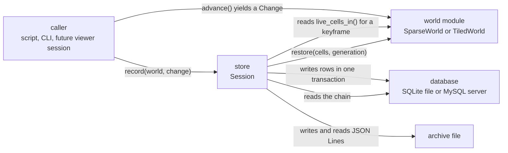
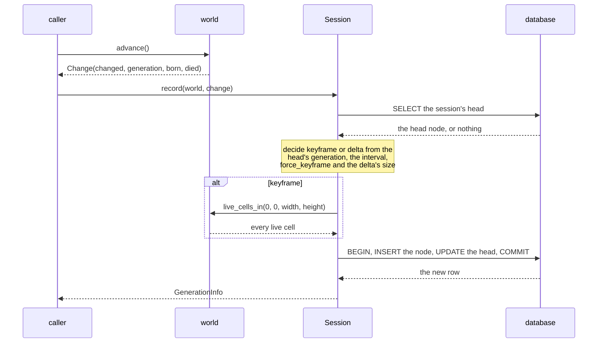
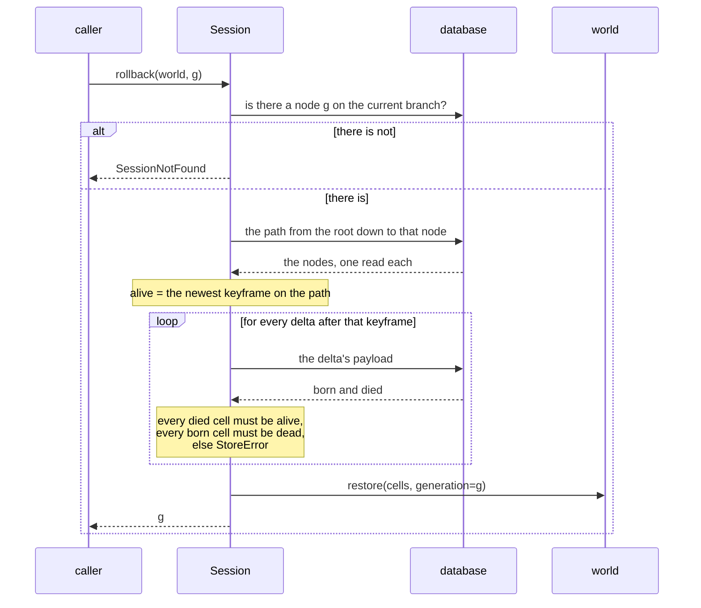
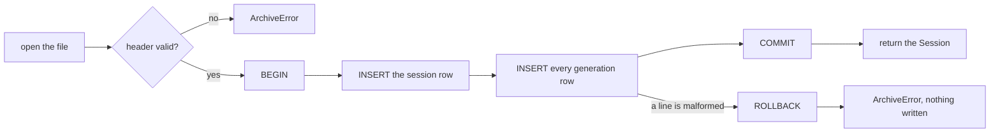

# store — data flow

> This file owns the producer and consumer paths, the runtime flow, who owns each
> piece of data and for how long, and the failure, rollback and recovery paths.
> The flows here are current state only; anything not built is separated, as
> [DOCUMENTATION_RULES.md](../../DOCUMENTATION_RULES.md) §8 requires. The public
> surface is owned by [interfaces.md](interfaces.md); the component boundaries by
> [internal-components.md](internal-components.md).

## 1. What is owned, and for how long

| Data | Produced by | Owner while it lives | Lifetime |
|---|---|---|---|
| The world and its live cells | the caller, through the world module | the caller | until the caller drops it |
| A `Change` — which cells were born and which died | `world.advance(count, record=True)` | the caller, between `advance` and `record` | one generation. It is not stored; the coordinates inside it are copied into the payload |
| A generation row | `Session.record`, `amend_head`, or the archive reader | the database | until the session is dropped from the database, which nothing does today |
| The rule in force at a node | the same three writers | the database column | same as the row; it is provenance and no replay reads it |
| The session's rule, and whether it was stated | `create_session` (from the world), `set_rule`, or the archive reader | the database column | until the next `set_rule`; a session's `info` snapshot holds the value it was read with |
| The keyframe/delta payload bytes | `record`, from either a full read of the world or the `Change` | the database column | same as the row |
| A `SessionInfo`, `GenerationInfo` | a query | the caller | a snapshot; it does not update when the row does |
| A `Session` | `create_session`, `session`, `import_archive` | the caller, but only while its `Store` is open | the store's lifetime |
| An archive file | `Session.archive` | the filesystem, then whoever the caller sends it to | outlives the database by design |
| The store's database file | `Store.open` on first use | the filesystem | the session's real lifetime |
| A MySQL cursor | the backend, per statement | the statement | closed explicitly on the `query` path, released by the driver otherwise |

The one that matters is the `Change`. It is the only datum whose lifetime is a
single call: the world produces it, the store copies its coordinates into a
payload, and after that the store holds bytes and the caller holds a value it can
drop. The world's own documentation owns what is in it
([world/change.py](../../../src/lifegame/world/change.py)).

## 2. Producers and consumers



Arrow meaning: `A -->|"label"| B` reads "A is related to B by the label written
on the arrow". Every arrow is a call or a file operation, and the two arrows into
`World` are the store calling methods on an object it was handed
([responsibilities.md](responsibilities.md) §2.1). The module does import one name
from the world module — the rule authority, so a rule text is parsed and spelled
by the world rather than by a second grammar — but that is a library dependency
rather than a path through which a world is moved, and it is not an arrow in this
view.

The `Caller` box is deliberately one box with three possible occupants. The
module cannot tell them apart, and does not try.

## 3. Runtime flow

### 3.1 Recording one generation



Two things in that sequence are the design.

*The kind is decided after reading the head, not from the caller's intent.* A
delta is a claim about a transition, and the claim is only checkable if the node
before it is present. So `record` asks where the session is, and answers with a
keyframe when the answer is "not the parent", when the interval is due, or when
the difference stopped being smaller than the snapshot.

*Recording appends, and the insert and the head update are one transaction.* The
new node's parent is the head the session was on, and anything that already
descends from that head is kept: looking at an older state and then editing is how
a second branch is made. The head moves onto the new node in the same transaction,
so a crash between the two cannot leave a session pointing at a row that does not
exist.

### 3.2 Rolling back



The existence check is first, and it is the difference between a refusal and the
worst failure available to a rollback: without it, the replay would stop at the
newest generation at or below the target and return *that* world while claiming
to describe the one asked for. The caller cannot tell the difference, because
what it receives is a real world. The check is against the **current branch**,
because a generation number is a label and two branches may hold one; a node that
exists only on another branch is refused rather than guessed at.

The validation loop is why the replay runs forward. A delta is a statement —
these cells died, these were born — so it can be checked against the state it
claims to act on. An inverted delta would have to be trusted.

`restore` is called only after the whole chain has been validated. There is no
path in which a world is half-restored.

**The rule takes no part in a replay.** A stored delta says which cells were born
and which died, so a rollback is a set operation; the rule columns are provenance
and are never consulted to restore a state. That is why a history recorded across
a rule change still replays exactly, and it is decided by
[test_history.py](../../../tests/store/test_history.py)
`test_a_history_recorded_across_a_rule_change_replays_bit_for_bit`.

**A rollback reads; a `select` works.** `rollback` leaves the session's head where
it was, so looking at an older state cannot destroy newer work. The wire's
`select` calls `Session.checkout`, which moves the world *and* the head onto the
node, and that is what makes the next record a sibling branch instead of an
append.

### 3.3 Writing an archive

The session's rows are read in generation order, the header is written, and one
line is written per generation. Each payload is base64 of exactly the bytes the
database column holds — the archive is not a fourth encoding of a world. The rule
travels in two places: the header carries the rule the session is running now and
whether it was stated or assumed, and every generation line carries the rule that
was in force for that generation, so the change points survive the file.

The file is opened with `newline="\n"` and `encoding="utf-8"`, so an archive
written on Windows and read on Linux is the same file. A partially written
archive is still valid up to its last complete line, which is why the format is
line-oriented rather than one JSON document.

### 3.4 Reading an archive



The validation and the writing are inside one transaction, so a file that is
valid for nine hundred lines and malformed on the nine hundred and first leaves
the store exactly as it was. That is the behaviour
[test_archive.py](../../../tests/store/test_archive.py)
`test_a_failed_import_leaves_no_half_session` decides.

### 3.5 Migrating an older store

A store written by an older schema is read and rebuilt before anything else on it
runs, and the order is not an implementation detail: it is the difference between
a store that opens and one that dies on start-up with `too many levels of trigger
recursion` ([testing.md](testing.md) §7.7).

```
the version row says "older"
  -> read every row with the reader for that version
  -> PRAGMA foreign_keys = OFF, outside any transaction, and read back;
     refuse unless the value in force is 0
  -> BEGIN
       DROP the old tables, then CREATE the current ones under their final names
       INSERT the sessions, then the nodes, then each head
       INSERT the version row
       PRAGMA foreign_key_check; any row in the result -> ROLLBACK and refuse
     COMMIT
  -> PRAGMA foreign_keys = ON, read back and assert
```

Enforcement has to be off for the drop, because `DROP TABLE` performs an implicit
delete and the self-referential `ON DELETE CASCADE` on `parent_id` fires as an
internal trigger; it has to be **read back**, because SQLite ignores the pragma
inside a transaction and says nothing. The copy runs in the same transaction as
the drop, so no state exists in which the old tables are gone and the new ones are
not written, and the check runs before the commit, so a rebuilt store that would
hold a dangling reference is a rollback rather than an opened store. The reasoning
is [implementation.md](implementation.md) §3.6, and §5.2 below is what a caller
sees on each path.

## 4. Configuration and relocation

| What | Where it comes from | Notes |
|---|---|---|
| The SQLite file | the `path` argument to `Store.open`, or the CLI's `<db>` | The module creates the parent directory. Where the file *should* live is the repository's policy, not this module's ([ADR 0002](../../adr/governance-and-build/0002-confine-transient-artifacts-to-repository.md)) |
| MySQL connection | keyword arguments to `Store.open`, or `MySqlBackend` directly | Defaults: `127.0.0.1`, port 3306, user `lifegame`, database `lifegame`, a five-second connect timeout. No environment variables and no configuration file are read |
| The archive path | the `path` argument | The module creates the parent directory |
| `KEYFRAME_INTERVAL` | a module constant, 64 | `Session` accepts `keyframe_interval` but `Store` does not expose it, so nothing sets it today |

Nothing in this module reads the filesystem environment or a configuration file.
A caller that wants the store somewhere else passes a different path, and that is
the whole of the relocation story.

## 5. Failure, rollback and recovery

### 5.1 What is atomic

| Operation | Atomicity |
|---|---|
| `record` | One transaction: the insert of the node and the update of the session's head |
| `amend_head` | One transaction: the rewrite of the head row, or an insert when the head has children |
| `set_rule` | One transaction: the session's rule and its stated marker |
| `checkout` | One transaction for the head update; the world is restored before it |
| `truncate_after` | One transaction: the keyframe rewrite of each surviving branch, the deletes and the head update together |
| `mark_archived` | One transaction |
| `import_archive` | One transaction spanning the session row and every generation row |
| Schema creation | One transaction spanning the DDL and the version row. The connection pragmas are applied when the connection is opened, deliberately outside any transaction |
| A migration | One transaction spanning the drop, the new DDL, every rebuilt row, the foreign-key check and the version row. Enforcement is turned off outside it and read back, and restored in a `finally` afterwards |
| `state_at` | Read-only. Nothing to roll back, and nothing is applied to a world |
| `rollback` | The world is touched only after the chain has been fully validated |

### 5.2 What happens when each one fails

| Failure | State afterwards |
|---|---|
| A database error during `record` | The transaction is rolled back; the chain is unchanged |
| A database error during `truncate_after` | The transaction is rolled back; the tree and the head are unchanged, including every row the call would have rewritten as a survivor |
| A database error during `import_archive` | Rolled back; no session row, no generation rows |
| A malformed line in an archive | Rolled back at the first malformed line; nothing written |
| An archive whose rule this build cannot parse | `ArchiveError` naming the file, before any row is written |
| A chain that fails validation | `StoreError` naming the generation and the cell. Nothing is applied, and the **stored chain is not repaired** — the module reports, it does not guess |
| A newer schema | The store is not opened. `Store.open` closes the backend before raising |
| An older schema | The store is migrated instead of failing; a migration that cannot complete rolls back and leaves the old tables as they were. A rebuilt store that would hold a dangling reference is refused the same way, so the file is left as it was: still the old schema, the same tables and the same rows |
| A damaged store whose rows already violate its keys | Refused on open, unchanged. `salvage(source, target)` copies it with `VACUUM INTO`, opens the copy with `repair_dangling=True`, clears the dangling links and returns the open copy with the cleared row ids; the source is never written to, and a branch whose ancestry was lost refuses a replay by name |
| Foreign-key enforcement could not be established as off | `StoreError` naming the reason the rebuild refuses to start, and **nothing is written**: the check happens before the transaction opens, because a pragma issued inside one is ignored. It is the guard that keeps the trigger-depth failure from returning — the rebuild either runs with enforcement off or does not run at all |
| Enforcement did not come back on after a successful rebuild | `StoreError` telling the caller to close and reopen the store. The data **is** migrated — the commit happened — and every later `Store.open` re-applies the pragmas; what cannot be trusted is the connection that ran the rebuild, so the message says which one |
| A second writer holding the lock | `StoreLocked` naming the path. The caller retries or gives up; nothing is written |
| A missing MySQL driver | `StoreError` naming the extra to install. No connection is attempted |

### 5.3 What a consumer has to do

* **A caller that records must advance and record together.** One `advance()` per
  `record()` gives a gap-free chain and therefore deltas. Stepping ten times and
  recording once gives a keyframe, which is correct but stores the whole
  population.
* **A caller that rolls back must expect the world's generation counter to
  change.** `rollback` sets it deliberately; a caller that tracked the counter
  itself must re-read it.
* **A caller that wants to detect a broken chain must call `state_at` and handle
  `StoreError`.** The module does not validate on write, because a delta written
  from a real step is correct by construction; validation exists for the chain
  that has been damaged since.
* **A caller that changes the world's rule must tell the session.** `set_rule`
  moves the session's rule and nothing else; the next node written carries it, and
  `rule_changes` is where the change becomes visible. A caller that changes the
  world and not the session leaves a session reporting a rule the core is not
  running, which is the failure [test_rule_provenance.py](../../../tests/store/test_rule_provenance.py)
  exists for.
* **A caller that inspects history must know which call moves the working point.**
  `rollback` reads and leaves the head alone; `checkout` moves the world and the
  head, and the next record after it becomes a sibling of the node's existing
  children.
* **A caller that imports must know the session arrives as a working session.**
  The reader writes `archived=0`, so a freshly imported session appears in
  `sessions(include_archived=False)`; whether a caller should be able to archive
  it on import is open in [risks.md](risks.md) STO-07.
* **A caller that reads a migrated session must read `rule_known`.** A rule filled
  in for a file or a session that stated none is marked as an assumption, and a
  migration of a schema-2 session that changed its rule cannot recover the change
  point ([risks.md](risks.md) STO-14).
* **A caller that needs a world of the session's size must check it.** Nothing in
  the module compares the two ([risks.md](risks.md) STO-04).

## 6. What is not built

Recorded separately, as required. None of this exists in the tree.

| Flow | State | When it would exist |
|---|---|---|
| A viewer session recording while the world runs | Not built. The viewer's service drives the world's line protocol; the core holds the session and offers `history`, `select`, `rollback`, `archive` and `open`, but nothing records a generation the service asked for | Not scheduled |
| A per-generation record command on the wire | Not built. There is no `record` command; the protocol's `export` and `import` move a whole world, and its timeline commands open, read, select from and write a history that the core records as it steps | Not scheduled |
| Streaming a migration | Not built. A migration reads the whole history into memory before rebuilding the tables | Owned by no version yet ([implementation.md](implementation.md) §3.6) |
| Retrying or waiting for a locked store | Not built. A second writer is told `StoreLocked` and nothing waits, queues or retries for it | Owned by no version yet ([risks.md](risks.md) STO-12) |
| Deleting a session | Not built on the facade. The declared `ON DELETE CASCADE` is enforced and asserted; what is absent is an operation that asks for it. It is a design item rather than a missing call: a delete that cascades along a parent chain deeper than SQLite's trigger limit meets the limit the migration used to meet ([risks.md](risks.md) STO-16) | Not scheduled |
| Streaming an archive | Not built. `write_archive` builds each line in memory and the reader reads the whole file before parsing it | Not scheduled; it would matter for a very large archive |
