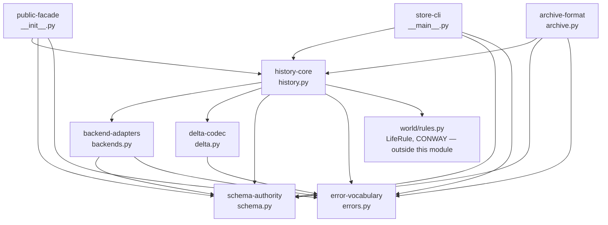
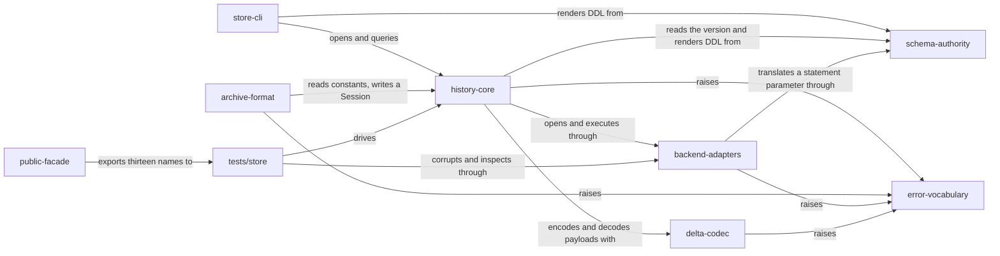

# store — internal components

> This file owns the component list, the allowed dependency direction between
> components and the current component flow, as required by
> [MODULE_COMPONENT_GUIDE.md](../../MODULE_COMPONENT_GUIDE.md) §2. The central
> index is owned by that guide's §4; this file is the detail it links to. The
> module's public contract is owned by [interfaces.md](interfaces.md).

## 1. Components

| Component | Source | Responsibility |
|---|---|---|
| `error-vocabulary` | [src/lifegame/store/errors.py](../../../src/lifegame/store/errors.py) | The one base exception and the three subclasses a caller might branch on. It owns which failures are distinguishable, and nothing else |
| `schema-authority` | [src/lifegame/store/schema.py](../../../src/lifegame/store/schema.py) | The logical schema — tables, columns, constraints, keys, indexes — and its rendering for each dialect: physical types, the inline auto key, the DDL, and the translation of `?` into the dialect's parameter spelling. It also declares the connection pragmas, because their spelling is a dialect fact |
| `backend-adapters` | [src/lifegame/store/backends.py](../../../src/lifegame/store/backends.py) | The `Backend` shape and the two adapters. SQLite is standard-library only and applies the connection pragmas when it opens a connection; MySQL resolves its driver lazily so that importing the adapter never fails on an installation without the extra. It also supplies the two seam methods a table rebuild needs — turning foreign-key enforcement off and reporting the value actually in force, and reporting whether the stored rows violate a declared key — because how each dialect spells and answers both is a dialect fact |
| `delta-codec` | [src/lifegame/store/delta.py](../../../src/lifegame/store/delta.py) | Coordinates to and from the bytes a generation is stored as, including the refusal of a payload that is not a whole number of cells |
| `history-core` | [src/lifegame/store/history.py](../../../src/lifegame/store/history.py) | `Store`, `Session`, `SessionInfo`, `GenerationInfo`, `NodeInfo`, the keyframe policy, forward replay with validation, rollback, rewind, checkout, truncation, the rule each node ran and the session's own rule, and the schema migrations that bring an older store to the current one — including the rebuild order: enforcement off outside any transaction and read back, one transaction for the drop and the copy, a foreign-key check before the commit, and enforcement restored on every path |
| `archive-format` | [src/lifegame/store/archive.py](../../../src/lifegame/store/archive.py) | The JSON Lines file format: what a header carries, what a generation line carries including its rule, the stated-or-assumed marker, every refusal, and the transaction that makes a failed import leave nothing behind |
| `store-cli` | [src/lifegame/store/__main__.py](../../../src/lifegame/store/__main__.py) | The six commands, their output rendering and their exit codes |
| `public-facade` | [src/lifegame/store/__init__.py](../../../src/lifegame/store/__init__.py) | The documented import surface: re-exports thirteen names and defines `__all__` |

Every file under `src/lifegame/store/` belongs to exactly one component, and every
component is named for a responsibility rather than for a file. There are eight
of each, which is a coincidence rather than a rule: the world module has seven
components across nine files, because two of its files answer one question.

The facade is a component because it owns something real — which names are public
— and not merely because it exists. It is also where the module's one interface
asymmetry lives: `ARCHIVE_VERSION` is re-exported and `ARCHIVE_FORMAT` is not
([risks.md](risks.md) STO-06).

### 1.1 What each component must not do

| Component | Must not |
|---|---|
| `error-vocabulary` | Import anything else in this module, or grow a subclass without a producer. `StoreLocked` is the one that already violates the second half ([risks.md](risks.md) STO-05) |
| `schema-authority` | Know which database is in use at run time, hold a connection, or read a configuration value. It renders and it declares, and it does not connect |
| `backend-adapters` | Own a schema, spell a table name, or write a statement. It supplies a connection, a dialect name, a parameter translation, transaction control and the two foreign-key seam methods, and nothing else. It applies the pragmas the schema authority declares, on every connection, and it does not choose them; where a caller asks it to change one, it reports the value **in force** rather than the value it asked for |
| `delta-codec` | Know about the protocol or the archive. It converts coordinates to bytes and back; base64 belongs to whoever needs text, and validation of the length belongs here |
| `history-core` | Import `archive-format` at module level, know a file format, or know a representation. It stores rows and replays chains. It also must not spell a rule itself: the parser and the default notation come from the world's rule authority, because a second grammar here is exactly the drift the provenance columns exist to prevent |
| `archive-format` | Own a payload layout, or write a row outside the transaction that makes a failed import atomic. It also must not interpret a rule: the text a file states is canonicalised by `history-core`, and a value that comes back refused is a refusal, not something to repair |
| `store-cli` | Hold logic the library does not have. Its one exception is rendering, and it must not open a world |
| `public-facade` | Contain logic. It re-exports and nothing else |

The prohibition that matters most is `history-core`'s: the module's central claim
is that a chain can be replayed and checked, and that claim is decided entirely
inside that component. A second implementation of the replay anywhere else —
including in a test helper — would make the load-bearing test evidence about the
helper rather than about the module.

## 2. Allowed dependency direction



Arrow meaning: `A --> B` reads "A may import B". This is current state only.

| Allowed edge | Why it exists |
|---|---|
| `public-facade` to `history-core`, `schema-authority`, `error-vocabulary` | The facade re-exports the thirteen public names, which come from those three |
| `store-cli` to `history-core`, `schema-authority`, `error-vocabulary` | The CLI opens a store, renders DDL and catches `StoreError` |
| `history-core` to `backend-adapters` | It opens a backend and issues statements through it |
| `history-core` to `delta-codec` | A keyframe is encoded from coordinates and a delta is decoded into them |
| `history-core` to `schema-authority` | It reads the current schema version and renders the DDL that creates the tables |
| `history-core` to `error-vocabulary` | It raises `SessionNotFound` and `StoreError` |
| `history-core` to the world module's rule authority | It canonicalises a stored rule through the world's own parser and takes `DEFAULT_RULE` from `CONWAY`, so the store cannot hold a spelling the simulation would refuse and the default cannot drift. **This is the module's only edge out of itself**, and it is an edge to a rule library rather than to a representation |
| `archive-format` to `history-core` | It reads the format constants and the `Session` type it writes from, and it canonicalises a file's rule text through `history-core` |
| `archive-format` to `schema-authority` | It reads the timestamp helper `now` for a header that states no `created_at`; the import is inside the method that needs it |
| `archive-format` to `error-vocabulary` | It raises `ArchiveError` |
| `backend-adapters` to `schema-authority` | The MySQL adapter translates `?` into `%s` through the schema authority, and the SQLite adapter applies the pragmas it declares. The imports are inside the methods that need them |
| `backend-adapters` to `error-vocabulary` | It raises `StoreError`, including for a missing driver, and `StoreLocked` for a held write lock |
| `delta-codec` to `error-vocabulary` | It raises `ArchiveError` for a payload that is not a whole number of cells |
| `schema-authority` and `error-vocabulary` to nothing | Both are leaves, and every other component may depend on them. `world/rules.py` is outside the module and is a leaf here for the same purpose: nothing in this module is imported back into the world |

**There is no edge from `history-core` to `archive-format`, and that is the
structural decision in this diagram.** A session must be able to write and read
an archive, and the archive needs the chain, so the naive shape is a cycle.
Instead the direction is one-way at import time — `archive-format` depends on
`history-core` — and the two methods that go the other way import inside their
bodies:

```python
def import_archive(self, path, *, label=None) -> Session:
    from lifegame.store.archive import read_archive
    return read_archive(self, path, label=label)
```

The deferred import is deliberate and is the reason the byte-format layer can
depend on the history layer rather than the two being merged into one file. The
cost is that the edge is invisible in the import block, which is why it is
written down here.

### 2.1 One coupling this file recorded, and the fix that closed it

`archive-format` used to import a **private** function from another component:

```python
from lifegame.store.history import _now  # local: keeps the import graph one-way
```

It worked, it was deliberate, and it was still a cross-component reach into a name
the other component did not export: `history.py`'s `__all__` does not contain
`_now`, and the leading underscore said the same thing. The comment in the source
justified the *local* placement of the import, not the private name.

**Fixed**, exactly where this file said the fix belonged: the timestamp helper
lives in `schema-authority` as `schema.now`, `history-core` reads `now` from there,
and `archive-format` imports it from the same place rather than reaching through
`history-core`. `history.py` keeps a private `_now` wrapper as a named reminder,
and nothing imports it. The edge it uses is the plain one in §2, kept inside the
method that needs it, which is the pattern `backend-adapters` already uses for its
two schema imports.

This is the third component-level coupling this repository has found by asking
which file owns a name. The world module recorded one (a routed error import,
since fixed) and the viewer module recorded three (a DOM id contract, a storage
key and a palette variable name). The pattern is the same in all four cases: the
edge is real, it works, and it is invisible unless someone writes it down.

## 3. Component flow

This is how one recorded generation and one rollback move through the
components. Producer and consumer paths are owned by
[data-flow.md](data-flow.md).



Arrow meaning: `A -->|"label"| B` reads "A relates to B by the label written on
the arrow". Current state only.

The arrow from `Tests` to `Backends` is worth naming: tests reach through the
public `Store.backend` property to write a forged delta straight into the
database, to read the schema version back, to read a pragma's effective value and
to force a write lock. That is why `backend` is public surface rather than a
private field ([interfaces.md](interfaces.md) §2.2), and it is the only place in
the module where a test uses an interface a normal caller would not.

### 3.1 Which tests exercise which component

| Component | Tests |
|---|---|
| `error-vocabulary` | [test_history.py](../../../tests/store/test_history.py) (each raised type and its message), [test_archive.py](../../../tests/store/test_archive.py) (`ArchiveError`), [test_delta.py](../../../tests/store/test_delta.py) (`ArchiveError` from the codec) |
| `schema-authority` | [test_schema.py](../../../tests/store/test_schema.py) in full; [test_backends.py](../../../tests/store/test_backends.py) for the MySQL rendering, the parameter translation and the pragmas taking effect |
| `backend-adapters` | [test_backends.py](../../../tests/store/test_backends.py), including the pragma values, the enforced cascade, `StoreLocked`, the read-back of the foreign-key switch, the dangling-reference check and both adapters' conformance to the protocol; and every test that opens a store exercises the SQLite adapter |
| `delta-codec` | [test_delta.py](../../../tests/store/test_delta.py), including the assertion that its layout matches the world module's independent implementation |
| `history-core` | [test_history.py](../../../tests/store/test_history.py) in full, including the migration of a chain deeper than SQLite's trigger limit and the refusal of a store whose own links dangle, the rule provenance, and the session half of [test_rule_provenance.py](../../../tests/store/test_rule_provenance.py) |
| `archive-format` | [test_archive.py](../../../tests/store/test_archive.py) in full, including the rule round trip and the assumed-rule marking |
| `store-cli` | **Not covered by a test.** The CLI is exercised by hand; see §4 |
| `public-facade` | Every test, since every one imports through it |

The `store-cli` row is the module's largest coverage gap that is not an
environment limitation. It is recorded here rather than in
[testing.md](testing.md) §6 because it is a component-level statement: one of
eight components has no automated coverage at all.

## 4. Planned component state

Recorded separately, as required
([DOCUMENTATION_RULES.md](../../DOCUMENTATION_RULES.md) §8). Nothing in this
section exists in the tree.

**No component of this module is planned.** Eight exist and eight are listed in
§1. The schema migrations that were the largest item here are now implemented
inside `history-core`, which is where this file predicted they would land, and the
`StoreLocked` producer is in `backend-adapters`, likewise. One open item is still
considered for a component-shaped home and is recorded where it belongs instead,
because naming a component before knowing whether it owns a responsibility would
be a plan without a shape:

| Open item | Why it is not a component | Where it is recorded |
|---|---|---|
| A CLI test | Not a component. `store-cli` exists and is uncovered; the test would belong to `tests/store` | [testing.md](testing.md) §6 and §3.1 above |
