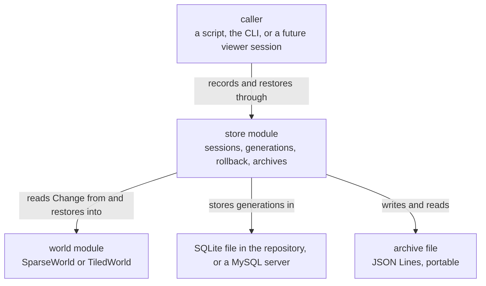

# store — overview

> **Owner of the store module contract.** This file and the eight files beside
> it own what the `store` module promises. The structural decisions behind it are
> owned by the accepted ADRs linked under *Decisions that shaped it*; version
> state is owned by [VERSIONS.md](../../plan/VERSIONS.md); the component index is
> owned by [MODULE_COMPONENT_GUIDE.md](../../MODULE_COMPONENT_GUIDE.md) §4.

Status: Implemented

## Purpose

The `store` module is the history layer. It records a world generation by
generation, restores any recorded generation on request, and writes a session to
a portable text file that leaves the machine.

It exists because a simulation that cannot be rewound is a demo. The world module
can step and edit, and it deliberately does not persist
([world/overview.md](../world/overview.md)); this module is what makes a *session*
outlive the process that produced it.

The design turns on one observation: a Life generation usually changes a small
fraction of its population. A generation is therefore stored as the cells that
were **born** and the cells that **died** relative to the one before it, which is
a few dozen bytes, rather than as a keyframe of every live cell, which is eight
bytes per live cell. A keyframe is still written every
:data:`~lifegame.store.KEYFRAME_INTERVAL` generations, so a rollback walks a
bounded number of deltas rather than the whole chain.

Rollback replays deltas **forward** from the nearest keyframe at or before the
target, never backward by inverting them. That is a correctness decision: a delta
is a statement about what happened, so replaying it can be checked — every cell
that dies must be alive, and every cell that is born must be dead — and a
corrupted chain is caught where it is corrupted instead of producing a plausible
world that never existed.

## Where the module sits

The module is a peer of the world module rather than a layer on top of it. It
records *from* a world and restores *into* a world, and between those two moments
it holds the only durable copy of the session.

Arrow meaning: `X -->|"label"| Store` reads "X is related to Store by the label
written on the arrow". This is a context view only: producer and consumer paths
are owned by [data-flow.md](data-flow.md), component flow by
[internal-components.md](internal-components.md). It is current state only.

There is deliberately **no arrow from `store` to a representation in the import
graph**. The module does not import a world: it reads `width`, `height`, `rule`,
`population`, `generation`, `advance()`, `live_cells_in()` and `restore()` off
whatever object it is handed. The coupling is mostly a shape, which is what lets
one session's history restore into either representation
([implementation.md](implementation.md) §7). The one import it does take from the
world module is the rule authority in
[world/rules.py](../../../src/lifegame/world/rules.py), so that a stored rule is
spelled by the world's own parser and `DEFAULT_RULE` cannot drift from the rule it
names ([responsibilities.md](responsibilities.md) §2.1).

## Current state

| Aspect | State | Code entry point |
|---|---|---|
| Logical schema, rendered per dialect, with `?` translated to the dialect's parameter spelling | Implemented | [src/lifegame/store/schema.py](../../../src/lifegame/store/schema.py) |
| SQLite backend, standard library only, default everywhere | Implemented | [src/lifegame/store/backends.py](../../../src/lifegame/store/backends.py) |
| MySQL backend behind an optional driver extra, opening lazily | Implemented | [src/lifegame/store/backends.py](../../../src/lifegame/store/backends.py) |
| Coordinate payload codec, the same bytes the protocol's `cells` frames carry | Implemented | [src/lifegame/store/delta.py](../../../src/lifegame/store/delta.py) |
| Sessions, the keyframe policy, forward replay with validation, rollback and rewind | Implemented | [src/lifegame/store/history.py](../../../src/lifegame/store/history.py) |
| The recorded history as a tree: a row id per node, parent links, a head, branches, `select`/`checkout`, and a truncation that keeps a sibling branch it was not asked to discard | Implemented | [src/lifegame/store/history.py](../../../src/lifegame/store/history.py) |
| Rule provenance: the rule in force written on every generation, the session's rule with its stated-or-assumed marker, and the change points | Implemented | [src/lifegame/store/history.py](../../../src/lifegame/store/history.py) |
| Schema migration: a store written by schema 1 or schema 2 is read, rebuilt and written as the current schema on open | Implemented | [src/lifegame/store/history.py](../../../src/lifegame/store/history.py) |
| Salvage of a store whose own rows violate its keys: a copy is repaired, the cleared rows are reported, and the source is left byte-identical | Implemented | [src/lifegame/store/history.py](../../../src/lifegame/store/history.py) |
| JSON Lines archive, written and read, with a failed import rolled back | Implemented | [src/lifegame/store/archive.py](../../../src/lifegame/store/archive.py) |
| Command line: `schema`, `sessions`, `show`, `rollback`, `archive`, `import` | Implemented | [src/lifegame/store/__main__.py](../../../src/lifegame/store/__main__.py) |
| Error vocabulary: one base type and three subclasses | Implemented | [src/lifegame/store/errors.py](../../../src/lifegame/store/errors.py) |
| Public facade and `__all__` | Implemented | [src/lifegame/store/__init__.py](../../../src/lifegame/store/__init__.py) |
| A viewer session that records while it runs | Future Goal | not scheduled; the viewer's service does not drive this module yet |

Everything above the last row is `Implemented` in the sense of
[AI_DOCUMENTATION_GUIDE.md](../../AI_DOCUMENTATION_GUIDE.md) §3: the code entry
point can be named.

### Validation state

The module's load-bearing claim has been decided by observation. A world
restored to generation *g* is compared, cell for cell, against a world that was
stepped to *g* independently, for **every** generation of a recorded chain, and
again across a keyframe boundary and across a representation change
([testing.md](testing.md) §5). A weaker check would not do: a chain that stored
the wrong deltas still produces *a* world.

The SQLite path is executed end to end. The MySQL path's schema rendering,
parameter translation and SQL generation are executed by tests that need no
server; **the MySQL round trip has not been executed**, because no MySQL server
exists in this environment — no client, no service, no listening port and no
driver. That scope is stated rather than implied in [testing.md](testing.md) §8,
with the command that would close it. The decision behind the split is
[ADR 0011](../../adr/data-and-formats/0011-sqlite-default-mysql-supported.md).

Four properties of the store are asserted rather than assumed, because each was
once false or unreachable and each is cheap to re-check. They are recorded in
[testing.md](testing.md) §1, §7.2, §7.7 and §7.8 and in
[performance.md](performance.md) §4.1 and §5:

* the SQLite pragmas the schema module declares — WAL journaling and foreign-key
  enforcement — are applied on connection open, outside any transaction, which is
  the only place SQLite honours them. A test reads each pragma's effective value
  back, so the declared and the executed sets cannot drift apart again;
* a store whose parent chain is deeper than SQLite's trigger limit still migrates:
  the case builds a 1300-node history, compares every rebuilt row element for
  element, and then records and replays on top of it. A store whose own links
  already dangle is refused with its file unchanged, which is the other half of the
  same rebuild;
* the cost of recording a generation is a measured quantity rather than a claim,
  and the figures are in [performance.md](performance.md) §4.1 and §5;
* a truncation keeps a branch it did not name: the surviving node becomes a root
  keyframe and its own descendants still replay, measured by a case that asserts
  both states cell for cell ([testing.md](testing.md) §7.8).

Whether those claims count as `Validated` or `Unvalidated` at a version boundary
is version state, and version state is recorded only in
[VERSIONS.md](../../plan/VERSIONS.md).

## Owner

* **Contract owner.** This directory, `docs/model/store/`. A change to what the
  module promises is a change to these files, synchronised with the sources in
  the same work item ([DOCUMENTATION_RULES.md](../../DOCUMENTATION_RULES.md) §10).
* **Operating owner.** Whoever operates the database. For the default backend
  that is the repository maintainer, because the store file is inside the
  repository; for MySQL it is the operator who runs the server, and the DDL to
  apply is printed by `python -m lifegame.store schema --dialect mysql`.
* **Evidence owner.** The `dev-log` entry of the version that delivers this
  module, named by [VERSIONS.md](../../plan/VERSIONS.md).

## Dependencies

### In (what this module needs)

| Dependency | Why | Failure behaviour |
|---|---|---|
| Python 3.14 | The language level the package is written against | Import fails |
| numpy | The coordinate arrays crossing the boundary with the world, and the payload codec | Import fails ([ADR 0006](../../adr/simulation-core/0006-numpy-is-the-vectorised-substrate.md)) |
| `sqlite3`, from the standard library | The default backend. It is the reason the default adds no dependency at all | `StoreError` naming the path when the file cannot be opened |
| A MySQL driver (`pymysql`, or the official connector), **optional** | Only when the MySQL backend is used. It is declared as an extra, so an installation that never uses it installs nothing new | `StoreError` naming `uv sync --extra mysql`, never a bare `ImportError` |
| A world object with the documented shape | The module reads and restores through it. It does not import a representation | `AttributeError` from the caller's own object; see [responsibilities.md](responsibilities.md) §2 for why this is not wrapped |
| The `Change` value produced by `advance()` | It carries which cells were born and which died | A caller that passes a hand-built `Change` with empty arrays gets a keyframe instead of a delta, which is correct rather than silent |

### Out (who depends on this module)

| Consumer | What it takes | Coupling |
|---|---|---|
| `tests/store/` | The public facade, plus `store.backend` for the tests that corrupt a chain, read a pragma value and force a write lock directly | The backend property is public surface and is documented in [interfaces.md](interfaces.md) §2 |
| The command line | The same public facade | It is a client of the module, not a second implementation of it |
| A future viewer session | The public facade | Not scheduled; the viewer's service does not drive this module yet |
| [world/overview.md](../world/overview.md) | Nothing. The world module does not know this module exists | The dependency is one-way: this module reads the world's shape, and the world is unaware |

## What the module deliberately does not do

Even though it technically could:

* It does **not** import a world representation and does **not** own a world. It
  records from a world and restores into one; the world keeps its own
  representation and its own rule. The one name it imports from that module is the
  rule authority, so a stored rule is spelled the way the simulation spells it
  ([implementation.md](implementation.md) §7).
* It does **not** decide **when** to record. A consumer that steps ten
  generations and records once has a ten-generation gap; the store notices and
  writes a keyframe rather than a delta that would claim a parent it never saw.
  A gap-free timeline costs one `advance()` per generation, and that is the
  price of the feature rather than a defect to be hidden.
* It does **not** migrate a schema by guessing at it. Opening a store written by
  an older schema rebuilds its tables as the current one, in a single transaction,
  and the value the old schema cannot supply — what an individual generation ran
  before per-generation rules existed — is filled from the only surviving source
  and the inference is stated in [implementation.md](implementation.md) §3.6
  instead of being left to a column default. Foreign-key enforcement is turned off
  before the rebuild, outside any transaction, and read back; the rebuilt rows are
  checked against the declared keys before the commit, and a check that fails rolls
  the whole thing back rather than opening a store whose links point nowhere. That
  order is also why the depth of a parent chain cannot decide whether a store
  opens. A newer schema is still refused.
* It does **not** keep a world alive between processes. Only generations are
  stored; a caller that wants to resume opens a world and rolls back into it.
* It does **not** check that the world it restores into has the size the session
  declares. See [risks.md](risks.md) STO-04: a mismatch is usually silent.
* It does **not** delete a session. Generations are discarded when a generation
  is re-recorded, and a session can be marked archived, but nothing removes a
  session row.
* It does **not** claim MySQL works. It claims MySQL is implemented, that its SQL
  is verified, and that no generation has been written to or read from a MySQL
  server by this project ([testing.md](testing.md) §8).
* It does **not** own a wire format. The archive is a file format, and the line
  protocol belongs to the world module; the bytes a generation is stored as are
  shared with the protocol's `cells` frames, and a test asserts the two agree
  rather than a comment claiming it.
* It does **not** decide version state. It links to
  [VERSIONS.md](../../plan/VERSIONS.md).

## Decisions that shaped it

One accepted decision constrains this module, and the index is
[docs/adr/README.md](../../adr/README.md)
([DOCUMENTATION_RULES.md](../../DOCUMENTATION_RULES.md) §9):

* [ADR 0011](../../adr/data-and-formats/0011-sqlite-default-mysql-supported.md)
  — SQLite is the default history backend and MySQL is a supported one. The
  schema is the single authority and each dialect supplies spelling; SQLite is
  the default because it is in the standard library and keeps the history inside
  the repository; the MySQL driver is an optional extra; and what is verified
  where is stated rather than implied, including the round trip that is not.

Further decisions live in the module rather than in an ADR, because they constrain
a file rather than the system: storing a generation as a difference rather than a
snapshot; replaying forward with validation rather than inverting backward;
writing the rule in force on **every** generation rather than inheriting it from
the nearest ancestor that states one; and rebuilding the tables to migrate rather
than altering them in place. Each is argued in
[implementation.md](implementation.md) §6 and §7, and the first two are the reason
the load-bearing test is rollback equivalence rather than a round trip of one
value.

## Document map

| File | Owns |
|---|---|
| [responsibilities.md](responsibilities.md) | claims, peer boundaries, failure behaviour, prohibited behaviour |
| [interfaces.md](interfaces.md) | the public Python surface, the archive format and the command line, in full |
| [data-flow.md](data-flow.md) | producer and consumer paths, runtime flow, lifetime, failure and recovery |
| [implementation.md](implementation.md) | layout, algorithms and complexity, environment, configuration, rejected alternatives |
| [performance.md](performance.md) | the measured cost of recording and rolling back, the oracle, and what is unmeasured |
| [testing.md](testing.md) | what is tested and not tested, how to run it, the last recorded result, the verified defects |
| [risks.md](risks.md) | the risks that are still open, with trigger, impact, mitigation and owning version |
| [internal-components.md](internal-components.md) | component list, allowed dependency direction, current component flow |
