# viewer — data flow

> This file owns the producer and consumer paths, the runtime flow, who owns
> each piece of data and for how long, and the failure, rollback and recovery
> paths. The shapes of the surfaces are owned by [interfaces.md](interfaces.md);
> component boundaries by [internal-components.md](internal-components.md).
>
> Every diagram in §3 is **current state**, including the two that are drawn after
> §4 and §5 because the tree they belong to ends there. The planned flow is
> recorded in [internal-components.md](internal-components.md) §4 and is drawn
> nowhere, because it is not designed yet.

## 1. Ownership and lifetime

| Data | Produced by | Owned by | Lifetime |
|---|---|---|---|
| The world's state | The core | The core, and only the core | Until the core process ends |
| A reply line (`ok`, `error`, `message`, `id`, and the command's fields) | The core | The core; the bridge holds the parsed object only until the caller's promise settles | One request |
| The `knownPopulation` the admission rule uses | The core, via any reply carrying `population` | The service, as one number per session runtime | Until the next reply that carries a population |
| A frame payload (`format`, `data`, `w`, `h`, `x0`, `y0`) | The core's encoder | The core for the bytes; the page for its decoded form | One request; the page keeps only the last frame |
| The decoded frame (absolute coordinates, or a bitmap) | The page's decoder | The page | Until the next frame replaces it |
| The rendered pixels | The page | The page's canvas | Until the next paint |
| The viewport (`x0`, `y0`, `span`) | The page, from gestures and zoom bounds | The page | Until the page is reloaded |
| The default view a canvas opens with | The page, from the canvas' own measured width | The page, and one declaration in [public/viewport.mjs](../../../src/viewer/public/viewport.mjs) | Recomputed on every canvas change **until** the person pans or zooms; the person's view then owns it for the life of the page |
| The preview's own viewport, and whether the person has moved it | The history page, from the preview's gestures | The history page | Until the page is reloaded or another node is selected |
| The world point the world page was last looking at | The world page, rounded to whole world coordinates | The browser's storage, under `FOCUS_STORAGE_KEY` for `main` and `FOCUS_STORAGE_KEY.<session>` for a created session | Until the storage is cleared or evicted; read once per selection by the same session's history page, or shared into another session by a `?focus=x,y` link |
| The live set a preview centres on | The core's `export`, wrapped by `GET /api/cells` | The service for the length of one reply; the page for the length of one centring decision | One request, taken once per selection. It is never scanned per frame and never cached across selections |
| Run state, tick rate, rule notation, generation, population | The core | The page holds a mirror, refreshed from every reply | The mirror lasts until the next reply |
| The child's stderr | The core | The bridge, as a bounded 8192-character tail | Rolling window; never part of the protocol |
| The explicit theme choice, if any | A person, through the theme control | The browser's storage, under one key | Until the storage is cleared, or until the entry is evicted by the browser |
| The grid line width | A person, through the width control | The browser's storage, under a second key | The same |
| The theme in effect | The page, from `resolveTheme(stored, system preference)` | The page, and the `data-theme` attribute on the document element | Until the next change, by the person or by the system preference |
| The canvas palette | The stylesheet, read back through `getComputedStyle` | The page's `palette` cache | Until the next theme change; the three colours are the only CSS the canvas reads |
| An open event stream, and the subscription it carries | The service, on `GET /api/events` | The service's hub, one record per open connection | Until the client goes away, the service shuts down, or the connection drops. The record holds a rectangle, an in-flight flag and a coalescing flag, and nothing else |
| The `clientId` that names a stream | The hub, on connect | The page, for the life of that stream | Until the stream is replaced or lost; it is not persisted and is not a session |
| The exported payload of a representation switch | The core, through `export` | The service, for the length of one switch | One switch. It is handed straight back as `import` and is not retained, written or cached |
| The population the hub's admission rule reads | The core, through any reply carrying one, and the service | The hub, as one number | Until the next reply that carries a population. The hub takes the larger of its own and the service's |
| The service's sessions | The service: `main` at start-up, and one per `POST /api/sessions` | The service's registry | Until the service stops, or a created session is closed. The registry is **not persisted** |
| A created session's core process and history store | The service, through `CoreBridge` | The session runtime; the store file is the core's | Until the session is closed or the service stops. The store file outlives the process; the registry entry does not |
| The pattern library | The data file [patterns.json](../../../src/viewer/patterns.json), read once | The service | The life of the service process. It is data, not state |
| The representation a session runs | The core, and the service's choice from the live set | The session runtime | Until the core is switched, replaced, or the session closes |

Nothing in this table outlives the browser tab or the service process, with two
exceptions and one that belongs to the core:

* **Four strings in the browser's storage** outlive the tab, so a person's theme,
  grid width and language survive a reload, and the world point the world page was
  last looking at survives it too, so the history preview opens where the person
  was working rather than at a corner of the world.
* **The core's history store** outlives both, and it is the core's: the service
  passes the path, the core writes the generations, and neither the service nor
  the page reads the file. It is the one thing in this module's world that is
  still there after the process that produced it has gone, and the reason the
  timeline can offer a generation from a previous run.
* There is still **no cache of the world's state** in the service and no store of
  the service's own. The pattern library is read once, but it is data rather than
  a copy of anything the core owns.

The **session registry** is the third lifetime, and it is deliberately the
shortest: a session exists so two cores can run at once, it holds no world of its
own, and it is forgotten when the service stops. A created session's **history
store** is a file the core wrote, and closing the session stops the core without
deleting it — the store outlives the process, the session does not.

The values both runtimes share — the frame budget, the admission rule that uses
it, the live-set cap and the core's declared limits — are not data that flows
anywhere: they are one declaration in
[public/shared.mjs](../../../src/viewer/public/shared.mjs) that both sides import,
and nothing copies them at run time. The **default view is not one of them**, and
that is deliberate: it is a function of the canvas a page was given, so it lives
with the viewport arithmetic in
[public/viewport.mjs](../../../src/viewer/public/viewport.mjs) and has no
service-side counterpart ([implementation.md](implementation.md) §3.7, §3.12).

## 2. Producer and consumer paths

| Producer | Consumer | What crosses |
|---|---|---|
| The core process | The bridge | One JSON object per line on standard output; replies carry `id`, unsolicited events do not |
| The bridge | The service | The reply object for one request, or a `CoreUnavailableError` / `CoreTimeoutError` |
| The service | The page, or any HTTP client | A JSON body: either the core's reply unchanged, or one of the service's own `{ok:false, error, message}` bodies |
| The page's decoder | The page's renderer | Absolute coordinates or a bitmap, both derived only from a `frame` reply |
| The page | The service | `GET /api/state`, `GET /api/frame?...`, and `POST /api/command` with the command's own fields |
| The history page | The service | `GET /api/cells`, once per selected node, to decide what the preview is centred on |
| The service's `/api/cells` reply | The history page's centring rule | Either the core's live set, or the population and the core's `bounds` when the set is above the cap. The page renders the difference as a sentence rather than hiding it |
| The world page | The history page, through the browser's storage | The world point the view was centred on, as `"x,y"`. It is the one value one route leaves for another, and it crosses as text because the two pages may disagree about their canvas |
| A person | The page | Pointer gestures and keystrokes |
| The page | `theme-logic` | What was stored, and the device pixel ratio |
| `theme-logic` | The page | The theme in effect, a parsed colour or `null`, a clamped width, and per-line geometry |
| The stylesheet | The page's palette cache | Three custom property values, read back because the canvas cannot inherit CSS |
| The service's hub | Every open stream | One event at a time: `hello`, then a `frame` per change, plus `tick`, `state`, `ping` and `error` |
| The core's `tick` event | The hub, through the bridge's event subscription | A generation, a population and a changed count, forwarded to every subscriber and otherwise ignored |
| A REST mutation | The hub, through `invalidate()` | The fact that the world changed. The hub turns it into a fresh `frame` per client rather than the route pushing one |
| The page | The service | `POST /api/subscription` when a gesture moves the viewport while a stream is open, and `POST /api/representation` when the storage control changes |
| The page's viewport module | The page | A span, a rectangle, a cell, and whether a press was a click. No state crosses back |

No producer in this table talks to a consumer two steps away: the page never
speaks the line protocol, and the core never learns that a browser exists.

## 3. Runtime flow

Arrow meaning throughout: `A -->|"label"| B` reads "A causes or hands data to B
by the label written on the arrow".

### 3.1 A click toggles a cell

```mermaid
flowchart LR
  Click["pointer press and release<br/>moved at most 4 px"] --> Screen["screenToWorld<br/>pixel to world cell"]
  Screen --> Cmd["POST /api/command<br/>cmd=toggle"]
  Cmd --> Svc["http-service<br/>body validated, cmd forwarded"]
  Svc --> Br["process-bridge<br/>queued, one in flight"]
  Br --> Core["world core<br/>toggle(x, y)"]
  Core --> Reply["reply: ok, alive, population, id"]
  Reply --> Svc2["http-service<br/>reply returned unchanged"]
  Svc2 --> Absorb["page absorb(): population mirrored"]
  Absorb --> Refresh["refreshFrame()"]
  Refresh --> Frame["GET /api/frame"]
  Frame --> Draw["render(frame)"]
```

A press that moves more than four pixels is a pan instead, and issues no
request. A click therefore costs one command and one frame; nothing is drawn
from the click itself.

### 3.2 The push loop while running, and the polling fallback

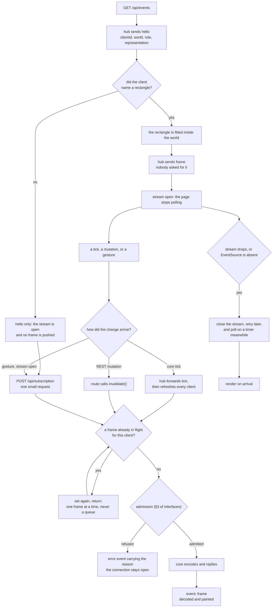

Five properties of this loop are contracts rather than implementation detail.
The page sends no request to find out whether anything happened while the stream
is open; a slow subscriber is coalesced rather than queued, so one frame is in
flight per client however fast the core runs; a rectangle the encoder would
refuse becomes an `error` event on the open connection rather than a dropped
stream; a lost stream downgrades the page to the polling path instead of leaving
it blank; and **a stream that has not named a rectangle is shown nothing at all**.
The fallback is the previous version's loop, unchanged.

That last property is a behaviour change and not a detail. The rectangle a page
opens with is derived from its own canvas
([implementation.md](implementation.md) §3.7), which the service cannot measure,
and the superseded behaviour here was to substitute a fixed page-sized rectangle
for a client that had named none — so every connection was pushed one frame of a
view the page was not looking at, and the page then told the service where it
really was. Now the sequence is: `hello`, `POST /api/subscription`, first frame.
The subscription route accepts **all four parameters or none**: a partial
rectangle is a `400`, and a body with no rectangle is not a request for a
standard one. A subscription that *is* named is still fitted to the world, and
this is the only path where naming nothing and naming something impossible
differ — there is nothing to fit when there is nothing to fit it to.

### 3.3 The view a canvas opens with, and who owns it afterwards

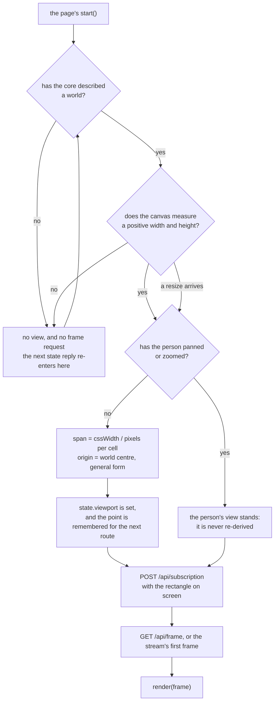

The two gates before the derivation are the point of the diagram. A request made
before they pass is a request for a guessed rectangle, derived from a canvas
nobody has laid out or from a world nobody has described — and the first thing a
person would then see is the guess. `wide` is the state that makes the second
gate non-obvious: the canvas is in the document and has zero width, so the check
is the canvas' **measured** rectangle rather than the size the element reports.

The branch at `Moved` is what keeps a resize from throwing away the person's
place. Until they pan or zoom, every canvas change re-derives the span, which is
what makes a rotated phone or a resized window show one cell per sixty CSS pixels
rather than the previous window's scale. After the first gesture the view is
theirs, and only a reload re-derives it. The history preview follows the same
rule under its own flag, with one difference worth stating: its span is frozen the
same way, but its **centring** is still re-derived when it is resized, because the
point it is centred on is the selection's rather than a gesture's.

### 3.4 A rectangle refused by admission

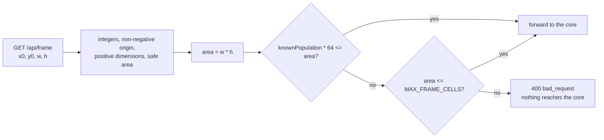

The refusal path is the reason the service knows the encoder's rule at all: the
`cells` path is safe at any area, and the `bits` path is not. The rule, its
bound and its one duplicated constant are specified in
[interfaces.md](interfaces.md) §3.

### 3.5 The core dies and is restarted

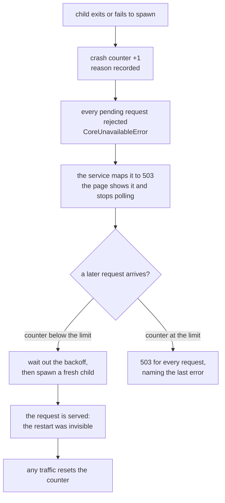

A restart loses the world: the new child starts empty. That is a consequence of
there being no persistence, and it is stated to the operator by the population
readout rather than hidden.

### 3.6 A theme or grid-width change repaints without a request

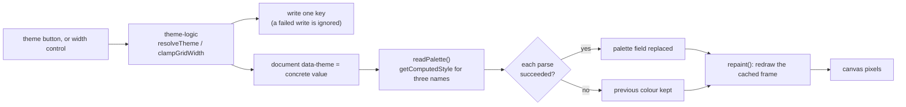

The loop is closed inside the page: it reaches the stylesheet, the storage and
the canvas, and it **never reaches the service or the core**, because nothing
about the world has changed. A person therefore sees the new palette in the same
frame they were already looking at.

The two exits from the parse step are the contract of
[interfaces.md](interfaces.md) §7.2: a colour that parses replaces its cached
value, and a colour that does not leaves the canvas painted in the theme it
already had rather than in a default.

### 3.7 A representation switch replaces the core and keeps the world

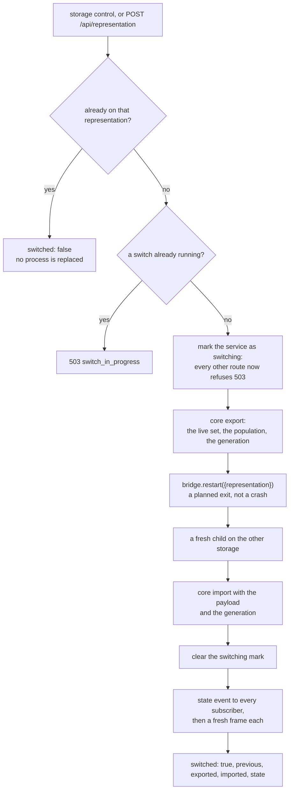

The generation travelling with the payload is what makes this a *world* transfer
rather than a cell transfer, and it is the property recorded first-hand in
[testing.md](testing.md) §5.2. Marking the service before the export is what
keeps the empty world between the restart and the import unobservable: a route
reached during that window is refused rather than answered from half a world.

Nothing about the world is written down during this. The payload lives in the
service's memory for the length of one request and is handed straight back.

## 4. Retention

| Question | Answer |
|---|---|
| Is anything written to disk by the **service**? | No. Responses stream from memory; the page is read from `public/` and never written |
| Is anything written to disk by the **core**? | Yes, when it was started with a history: one SQLite store, at the path the operator named, defaulting to `data/history.db` inside the repository, plus one transaction per recorded generation. An archive export is a second write, into the archive directory beside it. Nothing is written when the core was started with `--no-history` |
| Is there a session store? | One session per core process. The store holds the generations of the world the core is running; there is still no concept of more than one world |
| Is there a cache? | No. `cache-control: no-store` is set on every response the service writes |
| How long does a reply live? | Until the caller's promise settles, and no longer |
| How long does a frame live? | Until the page draws the next one; the page keeps the last frame only so it can be redrawn on resize, or on a theme, grid-width or language change |
| How long does the child's stderr live? | The last 8192 characters, replaced as it grows. It is for logs, and no route exposes it |
| What survives a service restart? | The page on disk, the four stored strings in a browser that reconnects, and the recorded generations in the core's store. The **running** world does not: it lives in the core's memory and nowhere else, so a restart begins from an empty world that can then be rolled back to any recorded generation |
| How long does an event stream live? | Until the client goes away, the service shuts down, or the connection drops. The hub holds one record per stream — a rectangle, an in-flight flag and a coalescing flag — and no history: a client that reconnects is told the current state, not what it missed. A stream that named no rectangle holds a `null` one and is sent `hello` only |
| What survives a representation switch? | The world: the live set, the population and the generation, carried through the core's `export`/`import`. The response's own payload is dropped as soon as the request settles, and no subscriber loses its subscription |
| What survives a page reload? | Four stored strings: the theme choice, the grid width, the language, and the world point the world route was last looking at. All are read at start-up, and the theme is read once more by the pre-paint script so the first paint is already correct. The language needs no pre-paint read because no text is rendered until the script fills it. The remembered point survives a canvas of a different size, because it is stored in world coordinates rather than in pixels |
| What survives the module being replaced? | The four storage strings, which are why they are namespaced and why a value from an older build is treated as no choice rather than as an error; and the core's store, whose schema version is checked when it is opened rather than assumed |

## 5. Failure, rollback and recovery

There is **rollback**, and it is the core's: the history store can restore any
recorded generation, and the service exposes that as a route. It is not a
transaction over the service's own state, because the service has none. What
remains is recovery, and it is uniform: **the surface stays up, the reason is
reported, and the state that could not be produced is not invented.**

| Failure | What the caller sees | What the module does | What recovers it |
|---|---|---|---|
| The interpreter is missing | `503 core_unavailable` naming the path and the bootstrap command; the page shows it | Spawns nothing; refuses to guess another interpreter | `scripts/bootstrap.ps1`, then any request |
| The core exits | `503` for the requests in flight; the page stops polling and says so | Increments the crash counter; a later request restarts after the backoff | The next request, until the crash limit is reached |
| The crash limit is reached | `503` naming the last recorded error | Stops respawning | A service restart |
| A request times out | `504 core_timeout` for that request only | Leaves the child running: a slow frame is not a dead core | The next request |
| A rectangle is refused | `400` naming the area, the population and what to do | Forwards nothing | Zooming in, or a falling population |
| A static path escapes `public/` | `403 forbidden` | Reads nothing outside the directory | A legitimate URL |
| A malformed body or query | `400` or `413` before the core is involved | Forwards nothing | A well-formed request |
| A frame cannot be decoded | The banner states why; the previous frame stays on screen | Does not paint | The next frame |
| The browser's storage is unavailable or throws | Nothing: the page starts, both controls work, and the choice is not remembered | Falls back to following the system, and ignores the failed write | — |
| A palette value cannot be parsed | Nothing visible beyond the palette that failed to change | Keeps the previous colour for that one value rather than painting a default | A stylesheet whose colours the parser understands |
| The page cannot reach the service | "service unreachable" in the status element | — | The service coming back, or a reload |
| The event stream drops | The page stops treating the stream as its source of changes, shows why, and goes back to polling on a timer | Closes the stream, clears the client id and the subscription key, and schedules a retry | The retry reconnecting, or the polling path carrying on. Nothing about the world is affected |
| The core refuses a pushed rectangle | An `error` event on the open connection, naming the area and the population | Leaves the connection open and stops asking for that rectangle until the viewport or the population changes | Zooming in, or a falling population. The previous frame stays on screen |
| Nothing has asked for a view yet | No frame at all: the page shows its empty state rather than a rectangle derived from a canvas nobody measured | Requests nothing. The world route waits for both the core's description and a canvas with a positive measured size, and the history preview waits for the same pair before it places a view | The core describing a world, the layout giving the canvas a size, or the person selecting a node |
| The live set is too large to send for a preview to centre on | The preview is drawn, centred on the core's bounding box, and the note beside it says so in the reader's language | Sends `truncated: true` with the population and the `bounds`, and no cells | A smaller population, or a zoom on the world route. The answer is coarser rather than wrong, and the difference is stated |
| The preview's frame cannot be drawn | The error banner names the reason, the note keeps its last text, and the tree is untouched | Does not paint; the previous frame stays on screen | The next frame, a smaller selection, or a working service |
| A switch cannot export or import | `502 export_failed` or `502 import_failed`, and the switching mark is cleared | Leaves the core as it is: a failed import does not leave the world empty silently, it reports that it could not carry the world | Retrying the switch, which starts again from the current world |
| A second switch arrives while one runs | `503 switch_in_progress` | Refuses it rather than queueing it, so pauses cannot accumulate | Retrying after the first completes |
| A route is called during a switch | `503 switch_in_progress`, not a partial world | Refuses before reading anything from the core | Retrying in a moment |
| The core has no history | `200` with `ok: false` and `error: no_history`, carrying the core's message | Forwards the refusal as a fact rather than as a failure; the page hides the timeline | Starting the service without `--no-history` |
| A rollback names a generation that was not recorded | The core's refusal, unchanged, in the banner | Does not move the world or the timeline | Asking for a recorded generation |
| An archive name is not a plain file name | `400` naming the requirement, and **nothing is written** | Refuses rather than repairing the name, because repairing it would still be choosing a path for the client | A plain `*.jsonl` name |
| An unhandled exception inside a route | `500` with the error's name and text; the process stays alive | — | — |
| Shutdown | The listening URL stops answering; the child is asked to `quit` and then killed if it must | Closes the listener, destroys idle sockets, stops the core before the store's files can be removed | Starting the service again, which starts an empty world that can be rolled back to any recorded generation |

Two recovery paths are deliberately absent. The module does not replay a failed
request, because a client that retries a `set` would double it; and it does not
restore a world automatically after a core restart, even though the recorded
generations are available, because a restart that silently rewound the clock
would be its own surprise. That decision is recorded as an open question in
[risks.md](risks.md) §3.

### 3.8 A language switch changes text and touches nothing else

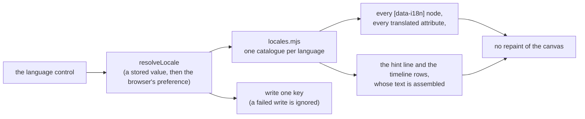

The canvas is not repainted because nothing about the world changed; the timeline
rows are re-rendered because their text is assembled from the table rather than
carried in an attribute.

### 3.9 Selecting a node moves the world, and can grow a branch

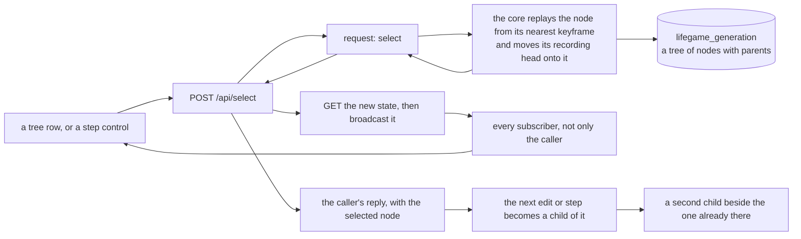

The broadcast is the point, as it was for a rollback. A select that only the
requesting client saw would leave one page showing generation 12 and another
showing generation 4 of the same world, and nothing in either page could tell
which was current.

The second point is what the tree added: **moving the head is what makes the next
record a sibling**. The node keeps whatever already descends from it, so a select
followed by an edit produces a second branch rather than replacing the first.
The observation is [testing.md](testing.md) §5.8.

`POST /api/rollback` is the same flow **without** moving the head: it loads a node
so a caller can look at it, and the next record still appends where the world was.
The page does not use it — a timeline is a tree, and a numbered list cannot
address a sibling — and it is kept for API callers.

### 3.10 An edit amends the head, or branches from it

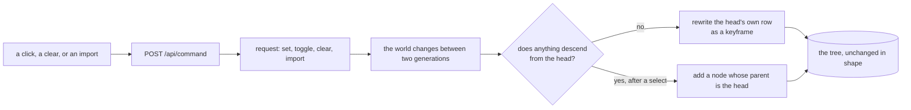

The store is built from steps, and an edit is not a step: without this the delta
at the current generation no longer describes where the next step starts, and a
later rollback replays a world that never existed. The core's own replay
validation is what caught it ([testing.md](testing.md) §7.7).

The branch is the second half. Amending the tip of a branch changes no history
anyone can reach, because nothing descends from it — so placing a cell on the tip
does not produce a second generation zero. When something *does* descend from the
head, which is exactly the case after selecting an older node, the edit becomes a
new node beside it. The distinction is the difference between editing the present
and editing the past, and it is the whole of §3.9's fork.

### 3.11 A page is composed from one table

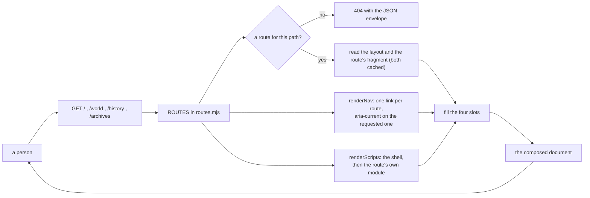

The table is the only declaration of what a page is, so the dispatch, the tab bar
and the script set cannot disagree: a route the navigation offers is a route the
service serves, and a page cannot be sent without the module that drives it.

Two details of the composition are load-bearing. **The script tags are written
shell first**, which is what makes "the shell is already listening" the common
order of the handshake in §3.12 rather than a case to hope for. And **a slot the
composer is not given throws**: emitting `{{content}}` into a page would produce a
document that looks broken in a browser and perfectly fine on the server.

The layout and the fragments are read once and cached, because they are files the
service ships rather than per-request data. A path no route claims is answered
`404` rather than by the world page, so a mistyped address cannot look like a
working one.

### 3.12 The shell hands a page its context

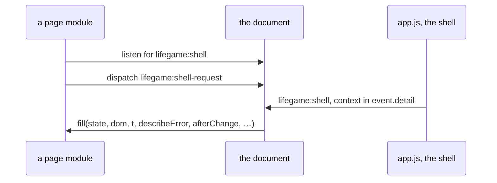

The two halves are named in one module, so they cannot end up on two spellings of
one handshake, and neither imports the other: the shell runs on import, so a page
that imported it would resolve a second copy that has already run and thrown its
state away.

**Both orders work.** In the order the layout produces — the shell's `<script>`
before the page's — the page's request is answered synchronously. If a page loads
first, its request is dispatched before the shell exists and is lost, and the
shell's own start-up publication is what connects it. Both paths deliver the same
context to the same module-level bindings, which is why a page module's functions
read `state` and `dom` exactly as they did when the interface was one file.

Nothing in this flow is checked beyond the handshake itself: the event names are
shared, but the fields inside the context are not, so a field the shell stopped
publishing fails at the page that reads it ([risks.md](risks.md) VWR-22).

### 3.13 Selecting a node reads the live set once and centres a preview

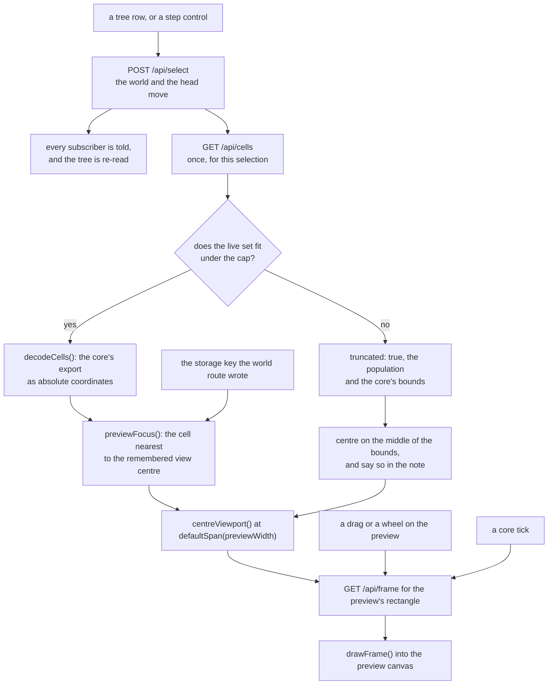

The live set is read **once per selection**, not once per frame and not once per
gesture: the centring is a decision about a generation, and everything after it —
dragging, zooming, a later tick — only changes which rectangle of that generation
is drawn. Three sources can decide the centre, in the order the person's own
context gives them: the live cell nearest to where the world route was last
looking, the middle of the core's `bounds` when the live set was too large to
send, and the centre of the world when there is nothing alive at all. The page
renders a different whole sentence for each, which is the contract of
[interfaces.md](interfaces.md) §11 and the reason `previewFocus` returns its
source beside its point.

The rectangle is requested from the same admission rule as everything else, with
the preview's own canvas as the aspect, so a preview cannot ask for a frame the
service would refuse; and the request is coalesced to one in flight, with the
newest rectangle winning, because a drag emits a move event per frame. That is
the traffic this flow costs: bounded by the round trip rather than by the
pointer's rate, and refreshed on a `tick` because a tick changes the generation
the preview is showing.

### 3.14 The live set degrades by declaration, not by silence

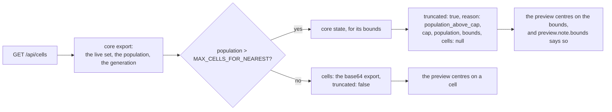

This is the only route in the service whose reply can be *smaller* than the core's
answer, and the reason it is allowed to be is that the page is told. The two
replies are distinguishable by `truncated` and by the presence of `cells`, so a
caller that is not this page can also tell a live set from a bounding box; and
the number that decides is declared once in
[public/shared.mjs](../../../src/viewer/public/shared.mjs), which the service
applies and the browser loads, so the cap and the sentence that reports it cannot
disagree. A page that centred on a bounding box while saying nothing would be
showing a coarser answer as if it were the same one — which is the failure this
shape exists to avoid, and it is recorded as a risk because only the stub
threshold has ever driven it ([risks.md](risks.md) VWR-25).

### 3.15 A rule change

The rule belongs to the core, and the page's editor is a front for one command.
The flow has three checks in it, and which one answers decides what the person is
told:

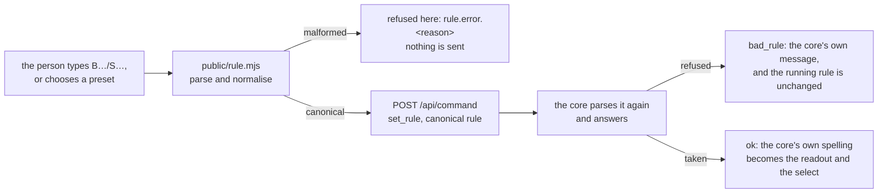

Arrow meaning: `A -->|"label"| B` reads "B follows from A by the label written on
the arrow". Current state only.

* **The first check is a courtesy and the second is the authority.** A malformed
  value is refused in the page and never reaches the network, which spares the
  person a round trip that would tell them the same thing; the core then parses
  the same text again and may still refuse it — a `B0`-class rule the running
  representation will not run is refused there and by nothing else. Two parsers of
  one grammar is the cost, and it is [risks.md](risks.md) VWR-29.
* **A refusal is a dead end, deliberately.** Nothing is written to `state.rule`,
  so the readout, the select, the frame and the world all go on describing what
  runs, and the person's text stays in the field to be corrected. The alternative —
  showing what was asked for — would make the page disagree with the core about the
  world.
* **A success re-states the rule from the reply, not from the request.** The
  core normalises, so `b3/s32` comes back as `B3/S23` and that is what the readout
  and the select then show; the field is rewritten to the same string.
* **Nothing about the world moves.** The command touches no cells and no
  generation counter, so the frame the page holds stays valid, no subscription
  update follows, and a running world keeps running under the new rule from its
  next generation. That is why this flow has no `invalidate` and no
  `broadcastState` edge, unlike the mutation flow of §3.1.

### 3.16 A second session is created and runs beside the first

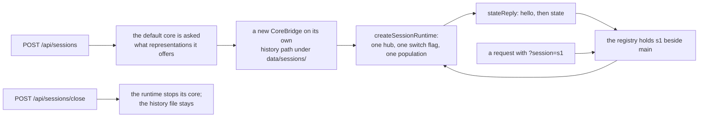

Arrow meaning: `A --> B` reads "A leads to B". The registry is the only place a
session id is resolved, and a route that does not name one resolves to `main`, so
every request written before sessions existed still means one core and one store.

* **Nothing per-session is shared.** The switch flag, the event hub, the
  population, the limits and the history flag live in one runtime; a switch in
  `s1` does not make `s2` answer `503`, and a crash counter in one bridge does not
  restart another. The core's own `clientId`s are therefore per hub, and a
  subscription must name the same session as its stream.
* **The id is the service's, not the core's.** `s1` names a runtime, not a
  `lifegame_session` row; the two are different identifiers, and the service does
  not pretend otherwise.
* **The history is per session because the store is per session.** A created
  session is started with its own path; closing the session stops the core and
  leaves the file, so a later service can still open it if it is asked to.
* **The registry is not persisted.** A restart starts again with `main`; a page
  holding `?session=s1` gets `404 unknown_session` rather than another core's
  world.
* **At the cap, a creation waits — up to a bound.** A service holds
  `MAX_SESSIONS` (64) sessions including `main`. A `POST /api/sessions` that
  arrives at the cap stays pending and closes over a slot when a session closes;
  at most `MAX_QUEUED_SESSIONS` (1024) wait, and one that arrives with the queue
  full is refused with `503 session_queue_full`. `GET /api/sessions` reports
  `queued` and `queueCap`, which is what the page shows. A shutting-down service
  answers a waiting creation with `503 service_closing` instead of leaving it
  open.

### 3.17 A pattern is placed, and the storage may follow

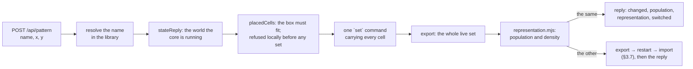

Arrow meaning: `A --> B` reads "A produces the input B consumes". The placement
is one `set` because the protocol already takes the whole coordinate list; the
storage decision is the only part that may add work, and it is taken on the whole
live set rather than on the pattern, because the same pattern placed into an
already-packed world is a different world.

* **The bounds are checked before the core sees them.** `set` is not atomic: a
  coordinate outside the world is refused after the cells before it have been
  applied. A placement that would leave the world is therefore a `400` with no
  command sent, which is why this flow has no partial-write recovery.
* **The choice has an opinion only above the measured crossover.** Below 4,000
  live cells the manual storage control stands, because the measurement says
  sparse wins by a small margin and taking a person's choice away for a block is
  not what the milestone asked for.
* **An unreadable export does not move the storage.** The reply still reports the
  placement, and the running representation is left in place rather than guessed.
* **The reply is the core's, plus what the service decided.** `changed` and
  `population` are the core's; `representation` and `switched` are the service's;
  `name`, `cells`, `width` and `height` say what was placed.

### 3.18 A view point is shared by link

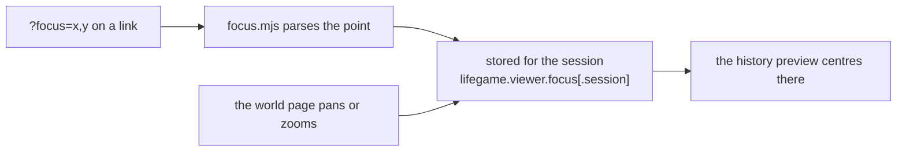

Arrow meaning: `A --> B` reads "A is the input B uses". The URL is the only
sharing mechanism: a session's stored point is private to it, and a link that
names one makes the sharing explicit. A malformed `focus` value is ignored rather
than repaired into the origin, and a session with no point falls back to the
world's middle.

### 3.19 An edit is undone without touching the timeline

The world page keeps the cell edits **it** made, newest last, and `undo` sends one
`toggle` for the last cell; a toggle is its own inverse, so the coordinate is the
whole entry. The stack is emptied when anything else moves the world — a step, a
run, a clear, a placed pattern, a selection, a rollback, or a generation that
changes without this page's toggle — because an inverse measured against a state
the person no longer sees would be wrong. A placed pattern and a clear are not in
the stack: the page cannot compute their inverse without the cells' prior state,
and the recorded timeline is the path for those.

### 3.20 A recorded world is saved and loaded through the archive

`POST /api/archive` has the core write the recorded session to a file inside the
archive directory; `POST /api/archive/import` has the core **open** it as a new
session and restore the world to that session's newest generation. The service is
a transport in both directions: it resolves a name to a path, forwards the
command, and broadcasts the state the core reports. Loading therefore does not
replay a delta in JavaScript, and the archive format has one implementation.

### 3.21 A collaborator's cursor, selection and view point

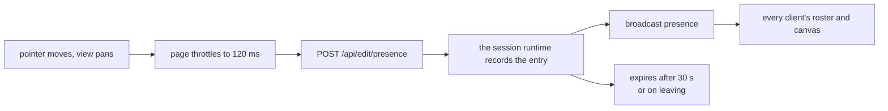

Arrow meaning: `A --> B` reads "A is the input B uses". The entry is ephemeral:
nothing about presence reaches a store, a history or an archive, and a client that
stops talking disappears on its own.

### 3.22 Two authors write, and one undoes

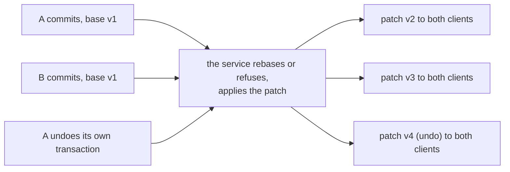

Arrow meaning: `A --> B` reads "A is the input B uses". The service is the only
serialiser: it decides the order, and the `version`/`hash` pair in every `patch`
event is what tells both clients they hold the same document. An undo is itself a
transaction, so it takes a version and reaches both clients like any other
commit.