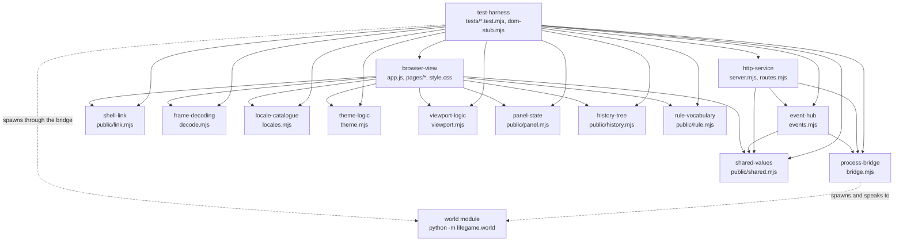
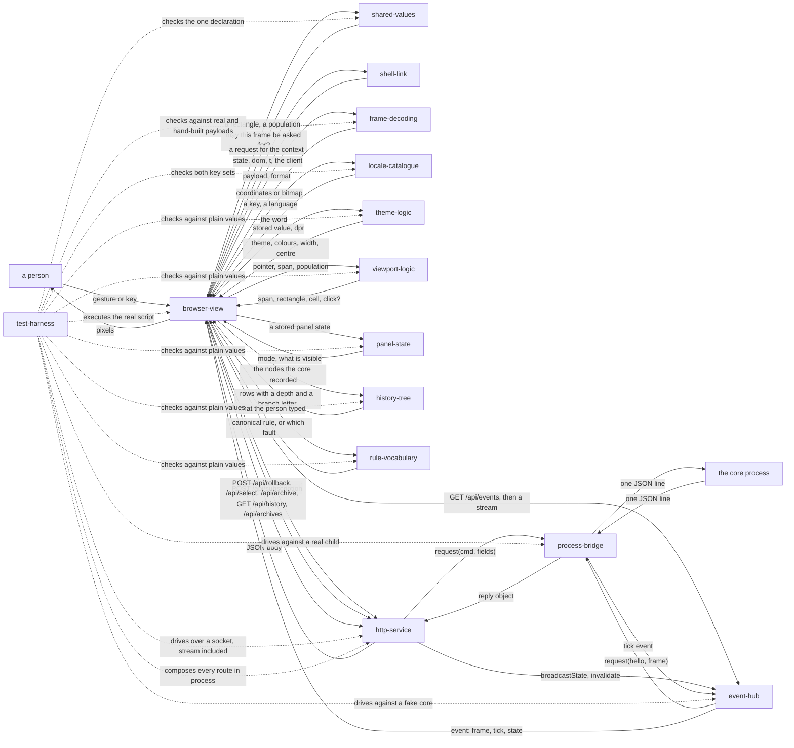

# viewer — internal components

> This file owns the component list, the allowed dependency direction between
> components and the current component flow, as required by
> [MODULE_COMPONENT_GUIDE.md](../../MODULE_COMPONENT_GUIDE.md) §2. The central
> index is owned by that guide's §4; this file is the detail it links to. The
> module's public contract is owned by [interfaces.md](interfaces.md).

## 1. Components

| Component | Source | Responsibility |
|---|---|---|
| `process-bridge` | [src/viewer/bridge.mjs](../../../src/viewer/bridge.mjs) | The core as a child process: spawn, one request in flight, `id` correlation, the request timeout, the crash counter and the bounded restart policy, the planned restart a representation switch uses, the `--history` and `--no-history` flags it passes on, and the two error classes the service maps to HTTP statuses |
| `http-service` | [src/viewer/server.mjs](../../../src/viewer/server.mjs), [src/viewer/routes.mjs](../../../src/viewer/routes.mjs) | The fourteen API routes, the static-file confinement, the JSON error envelope, the refusal of every route while a switch is running, the archive-name confinement that keeps an HTTP client from choosing a path, the ownership rule for the bridge it creates, and the CLI. Also the routed pages: `routes.mjs` is the **only route table**, and the service asks it for a page, answers 404 when it says null, and never composes one itself |
| `event-hub` | [src/viewer/events.mjs](../../../src/viewer/events.mjs) | The push transport: the per-client subscription, the `hello` then `frame` sequence, coalescing a slow subscriber, clipping a rectangle to the world, and the heartbeat |
| `shared-values` | [src/viewer/public/shared.mjs](../../../src/viewer/public/shared.mjs) | Every value the service and the browser must agree on, in one module both import: the frame budget and the admission rule that uses it, the cap above which the nearest-cell answer degrades to the reported bounds, and the reader that turns the core's `hello.limits` into the shape the page and the service use. **Not the default view**: that depends on a canvas measurement only the page can make, so it belongs to `viewport-logic`, and the module says so where a reader will look. Delivered from the plan's `shared-bounds` (see §4) |
| `shell-link` | [src/viewer/public/link.mjs](../../../src/viewer/public/link.mjs) | How the shell and a page module find each other **without importing**: it owns the two event names, `lifegame:shell` and `lifegame:shell-request`, and the handshake that works whichever of the two loads first. A page module must not import the shell — the shell runs on import, so a page that imported it by a plain path would resolve a second copy that has already run, found no data and thrown its state away. That is not hypothetical: it is why the history page drew nothing when this split was first attempted. Both sides import the names from here, so the two halves of one handshake cannot end up on two spellings of it |
| `frame-decoding` | [src/viewer/public/decode.mjs](../../../src/viewer/public/decode.mjs) | Both frame encodings, decoded: base64 to bytes, `cells` to absolute coordinate pairs, `bits` to a visited set or a bitmap. Free of DOM and canvas so it can be tested without a browser |
| `locale-catalogue` | [src/viewer/public/locales.mjs](../../../src/viewer/public/locales.mjs) | Every word the user can read, in one table per language, with identical key sets; the storage key and the precedence rule that resolves a stored choice against the browser's own preference; the hint line as segments; and the closed list of error codes the page has a label for. Free of the DOM so a language can be tested without a browser |
| `theme-logic` | [src/viewer/public/theme.mjs](../../../src/viewer/public/theme.mjs) | Theme precedence, colour parsing and rendering back to CSS, the grid width's range, the device-pixel geometry of a grid line, and storage access that never throws. Free of the DOM and of `localStorage` so it can be tested without a browser |
| `viewport-logic` | [src/viewer/public/viewport.mjs](../../../src/viewer/public/viewport.mjs) | Every decision the page makes about where it is looking: **the view a page opens with — one world cell per sixty CSS pixels of canvas width, centred on the world** — the zoom bound, the rectangle to request, the pointer-to-cell mapping, the zoom's fixed point, the drag translation, the click threshold, and the two-finger gesture: the midpoint a pinch scales about, the spread that decides its factor, and the state transition when a finger arrives or leaves. Free of the DOM, the canvas and the network |
| `panel-state` | [src/viewer/public/panel.mjs](../../../src/viewer/public/panel.mjs) | The right-hand panel's three states as pure functions: which of `normal`, `collapsed` and `wide` a stored value resolves to, what each control does to it, and whether the canvas and the panel are visible in each. Three states rather than two because "get it out of the way" and "let me read it properly" are different requests. Free of the DOM and of storage, which is what lets the resolution rule be tested without a browser |
| `rule-vocabulary` | [src/viewer/public/rule.mjs](../../../src/viewer/public/rule.mjs) | The rules the page can name and the one grammar it can check: the eight presets with locale keys rather than words, the six reasons a value is refused, the parser that normalises `b3/s23` to `B3/S23`, the mapping from a running rule to one of those presets or to the entry that carries the rule itself, and the reader for the rule a reply reports. It is the page's **first** check and never the last: the core decides what it will run, and this module cannot refuse something the core would accept on its behalf. Free of the DOM, the network and the canvas |
| `history-tree` | [src/viewer/public/history.mjs](../../../src/viewer/public/history.mjs) | The recorded history as a tree, as pure functions: the depth-first flatten that follows a node's **parent** rather than its generation number, the rule that indentation is **fork depth and not tree depth** so a linear run stays in one column, the cap on that indentation, the letters that name the children of a fork, and a recorded timestamp as a reader sees it. Free of the DOM, which is what lets the indentation rule be asserted without a browser |
| `pattern-library` | [src/viewer/patterns.json](../../../src/viewer/patterns.json), [src/viewer/patterns.mjs](../../../src/viewer/patterns.mjs) | The pattern library as data and one strict parser: the fifteen classic patterns in the Life community's RLE form, the parser that refuses a malformed pattern rather than shortening it, the document validation, and placement of a pattern's box at an origin inside a world. Free of the DOM, the network and the core; the page never sees RLE, because it names a pattern and the service resolves the cells |
| `representation-choice` | [src/viewer/representation.mjs](../../../src/viewer/representation.mjs) | The one rule in this module that is a measurement: the population crossover and the density boundary taken from the measured anchors, `chooseRepresentation` over a live set, the bounds and density it needs, and the fact that the measurement only has an opinion at or above the crossover. Free of the core, the socket and the DOM, which is what lets the choice be asserted as plain data |
| `focus-memory` | [src/viewer/public/focus.mjs](../../../src/viewer/public/focus.mjs) | The point in the world a person was last looking at: the per-session storage key, the `?focus=x,y` sharing form, the parse that treats an unreadable value as no memory rather than the origin, and the write that survives a page without storage. Free of the DOM, so the sharing rule is asserted as plain data |
| `snippet-library` | [src/viewer/snippets.mjs](../../../src/viewer/snippets.mjs) and the `/api/snippets` routes in [server.mjs](../../../src/viewer/server.mjs) | The published snippet library: the canonical cell encoding and content hash, one immutable object per hash, the versioned `index.json`, compare-and-swap publish with a pinned hash, the name rules, the 256/8192 limits, and the four routes that expose list, publish, read and delete. Free of the DOM and of the core; the page palette that will use it is planned |
| `edit-document` | [src/viewer/edit.mjs](../../../src/viewer/edit.mjs) | The editing document as a pure model: transaction validation and intent normalisation, the version and chain hash, the rebase rule for absolute intents, the inverse-transaction undo with per-cell attribution, redo, and the resync window. It talks to no core and no socket, which is what lets the merge and undo rules be asserted before the routes exist |
| `edit-runtime` | [src/viewer/edit-runtime.mjs](../../../src/viewer/edit-runtime.mjs) and the `/api/edit` routes in [server.mjs](../../../src/viewer/server.mjs) | The service around the document: enter/leave with pause and resume, the candidate patch handed to the core's atomic `patch`, the document record built from the cells the core actually changed, the `patch` broadcast, undo and redo, the resync view, and the `edit_active` refusal the server applies while the mode is open |
| `edit-tools` | [src/viewer/public/edit-tools.mjs](../../../src/viewer/public/edit-tools.mjs) and the editing surface in [world.js](../../../src/viewer/public/pages/world.js) | The page's editing arithmetic and controls: the gesture-to-cells rules for line and rectangle, the snippet transforms and their exact cell sets, the `stamp` operation, the closed tool and mode vocabularies, the explicit mode, the transaction boundary, the selection draft, publish, the palette and undo/redo |
| `browser-view` | the shell [src/viewer/public/app.js](../../../src/viewer/public/app.js), the stylesheet [src/viewer/public/style.css](../../../src/viewer/public/style.css), the `<select>` builder [src/viewer/public/options.mjs](../../../src/viewer/public/options.mjs), the shared layout [src/viewer/public/pages/layout.html](../../../src/viewer/public/pages/layout.html) with the three fragments beside it, and one module per route: [world.js](../../../src/viewer/public/pages/world.js), [history.js](../../../src/viewer/public/pages/history.js), [archives.js](../../../src/viewer/public/pages/archives.js) | The shell plus one module per route. The shell owns the DOM ids every page shares, the theme and the language, the status line, the error banner, the API client, the event stream and the panel; each page module owns what its own page draws — the canvas and its gestures, the tree, the archive manager — and **none of them imports the shell**, because they talk over `shell-link` instead. Also the layout and the fragments the service composes a page from, and the stylesheet |
| `test-harness` | [src/viewer/tests/](../../../src/viewer/tests/) — the twenty-three suites plus `dom-stub.mjs` | The twenty-three suites, the synthetic browser, the stub bridge used only for the admission rule, the in-process route composer, the ephemeral-port and teardown discipline that lets the suites run concurrently with a developer's own server, and the contract checks that hold the markup, the scripts, the stylesheet and the locale table together |

Every source file under `src/viewer/` belongs to exactly one component, and
every component is named for a responsibility rather than for a file.

`test-harness` is a component here although the `world` module treats its tests
as outside the module: the viewer's suites live **inside** the module directory
(`src/viewer/tests/`), so they are part of the module's file set and something
has to own them. The synthetic browser is part of it because nothing that ships
imports it.

[src/viewer/README.md](../../../src/viewer/README.md) belongs to no component. It
is the operator-facing note, it has no behaviour, and nothing imports it; giving
it a component would be a component that owns prose.

### 1.1 What each component must not do

| Component | Must not |
|---|---|
| `process-bridge` | Import anything from `http-service`, `event-hub`, `browser-view` or `frame-decoding`; know that HTTP exists; compute a generation; carry the world across a restart, because it has no access to the world and the sequence belongs to its caller; interpret a reply beyond matching its `id`; treat the core's stderr as protocol; decide where the history store lives, which is the operator's flag and the service's default |
| `http-service` | Import `frame-decoding` — decoding is the browser's job, and a service that decoded frames would be the second implementation of the encoding; restate the admission rule or a protocol bound instead of calling into `shared-values`; contain the rule, the world state or any simulation logic; rewrite a forwarded reply's `ok`, `error` or `message`; choose a path it writes, because a request names an archive and never a location; let a route read the world while a switch is running; hold a second list of routes or of navigation items beside the table, or compose a page somewhere other than the composer the table drives |
| `event-hub` | Decode a frame; compute a generation; queue more than one frame per client, because a subscriber that falls behind must coalesce rather than accumulate; send a rectangle to the core without clipping it to the world first; own a second copy of the admission rule, which is why the rule lives in `shared-values`, the module both this component and the page import |
| `shared-values` | Import anything from this module or any other: it is a leaf, and that is what lets two runtimes import one file. Hold a value the core declares: a bound the core publishes comes through `readLimits` or not at all, and a bound it did not declare is `null` rather than a plausible substitute. Know that a DOM, a socket or a core process exists |
| `shell-link` | Import the shell, or any page module: it is the contract *between* them and must stay importable from either side without dragging either in. Touch the DOM beyond dispatching and listening for its two events. Own a value — state, a DOM id, a translation — rather than the way the two sides find each other |
| `frame-decoding` | Import anything, from this module or otherwise. It is a leaf, and its freedom from the DOM is what makes the browser's decoding testable |
| `locale-catalogue` | Import anything, from this module or otherwise — it is a leaf. Touch the DOM or `localStorage`: the caller passes what was stored and the browser's own preference, and reads the resolved language back. Hold a key in one language and not the other, or an entry that is empty; a key set that differs between languages is the defect the suite exists to catch |
| `theme-logic` | Import anything, from this module or otherwise — it is a leaf for the same reason as `frame-decoding`. Touch the DOM, `localStorage` or `matchMedia`: the caller passes what was stored and reads the result, which is what keeps the precedence rule testable. Read a colour it cannot parse and return a guess instead of `null`. Return a line width or a line centre in device pixels when its contract says CSS pixels, or the reverse |
| `viewport-logic` | Import anything, from this module or otherwise — it is a leaf. Touch the DOM, the canvas or the network: it takes numbers and returns numbers, which is what lets the viewport arithmetic be asserted as equalities. Hold a copy of the world or of the live population: both are passed in per call. Invent a frame budget: the bound comes from `shared-values` |
| `panel-state` | Import anything, from this module or otherwise — it is a leaf for the same reason as the other logic modules. Touch the DOM or storage: the caller passes what was stored and applies the result, which is what keeps the resolution rule testable. Repair an unrecognised stored value into the nearest state: a value that names no state means the user has no preference that can be honoured, which is the same as no value at all |
| `rule-vocabulary` | Import anything, from this module or otherwise — it is a leaf, like the other logic modules. Touch the DOM, the network or the canvas: the page reads the field and writes the message, and this module only answers what a value means. Hold a user-visible word: the presets carry locale **keys** and the refusals are **codes**, so every sentence a person reads comes from `locale-catalogue`. Substitute the nearest preset for a rule it does not recognise: a value outside the list is reported as one outside the list, because the control must not claim a rule the core is not running. Decide what the core will accept: it normalises and refuses in the core's own module, and a page-side parser is a convenience rather than an authority |
| `history-tree` | Import anything, from this module or otherwise — it is a leaf, like the other logic modules. Touch the DOM: it takes the recorded rows and returns rows with a depth, which is what lets the indentation rule be asserted as data. Indent by tree depth rather than by fork depth, which walks a long linear run off the right edge of the panel while saying nothing the generation number does not already say. Trust a parent id that is absent from the rows: a window may have cut a branch's root, and such a node starts a branch rather than being dropped |
| `pattern-library` | Import the server, the bridge or a page module; know that a world exists beyond the width and height a placement is checked against. Repair a malformed pattern or an unknown kind into something placeable: a document that disagrees with its format is refused, not guessed at. Hold a user-visible word: it carries names and kinds as data, and the page's label for the control comes from the locale table. Be a second parser in the page: the page names a pattern and the service resolves the cells |
| `representation-choice` | Import the core, the bridge, the socket or the DOM: it takes cells and the representations offered, and returns a name. Know how to switch a core or read an export, which belong to `http-service`. Claim a winner inside the band between the two measured shapes: the measurement does not cover it, and the constant is a chosen value rather than a result. Decide below the crossover, where the population is not large enough for the rule to have an opinion |
| `browser-view` | Speak the line protocol; import `process-bridge`, `http-service`, `event-hub` or `routes.mjs`; compute a generation; draw a frame it could not decode; issue a second request while one is outstanding; poll while a stream is open, because that is the point of the stream; **import the shell from a page module**, which resolves a second copy that has already run and lost its state — the two talk over `shell-link` instead; carry a second copy of the theme precedence rule outside the pre-paint script that has to have one; carry a second copy of the panel's resolution rule outside `panel-state`; carry a second copy of the indentation rule outside `history-tree`; hold a user-visible string of its own, because a string that is not in the locale table cannot be translated; translate the core's `message`, which is a diagnostic and not copy; flatten the tree by generation number instead of by parent, because two branches share numbers; list a `<select>`'s options in markup, because the module that owns the list would then have a second copy of it |
| `test-harness` | Be the only caller of a path it tests, in a way that makes the path's real caller untested; leave a server, a child process, a port, a page timer or a locked history file behind; depend on a fixed port; install a stub that outlives its case, because the page reads some globals at fire time rather than at call time |

## 2. Allowed dependency direction

Arrow meaning: `A --> B` reads "A may import B". A dashed arrow is **not an
import**: it is a process edge, and it is drawn because the direction is part of
the contract. Current state only; the planned component state is §4.

| Allowed edge | Why it exists |
|---|---|
| `http-service` to `process-bridge` | The service issues requests and maps the two bridge error classes to `503` and `504` |
| `http-service` to `event-hub` | The service creates the hub, hands it the bridge and its population reader, and tells it to refresh when a mutation changed the world |
| `http-service` to `shared-values` | The routes apply `frameAdmission`, read the core's declared limits through `readLimits` and clamp the tick rate through `clampTicksPerSecond`, so no route invents a bound |
| `event-hub` to `process-bridge` | The hub issues `hello` and `frame` requests and subscribes to the core's `tick` events through `onEvent` |
| `event-hub` to `shared-values` | The hub applies the same `frameAdmission` the REST route applies. It has no default rectangle of its own: a stream that has not named one is sent `hello` and nothing else, because a frame of a view nobody is looking at is work with no reader |
| `browser-view` to `shared-values` | The page bounds its own zoom with the same rule, and reads the tick-rate range the core declared rather than a range of its own |
| `browser-view` to `shell-link` | The shell publishes the shared context and each page module asks for it, which is the only way the two talk: a page module that imported the shell would resolve a second copy of it, because the suite loads the shell under a fresh module URL per case |
| `browser-view` to `history-tree` | The history page asks it to flatten the recorded nodes into rows with a depth and a branch letter, so the indentation rule has one home and can be asserted as data |
| `browser-view` to `frame-decoding` | The page decodes every frame through it, including the `bits` fast path that fills its `ImageData` |
| `browser-view` to `locale-catalogue` | The page fills every `data-i18n` node and every translated attribute from the table, and resolves the language from what was stored and what the browser prefers |
| `browser-view` to `theme-logic` | The page resolves the theme, parses the three palette colours, clamps the grid width and computes every grid line's width and centre through it |
| `browser-view` to `viewport-logic` | The page asks it where the view may go, what rectangle to request, which cell a pointer names, where a zoom lands, whether a press was a click, and how a two-finger gesture moves the view |
| `browser-view` to `panel-state` | The page asks which of the three states applies, what a control does to it, and whether the canvas and the panel are visible in it. The page applies the answer; it does not decide it, which is why the resolution rule has one home |
| `browser-view` to `rule-vocabulary` | The page builds the preset `<select>` from the list, checks and normalises what a person typed through the one parser, asks which entry a running rule corresponds to, and reads the rule a reply reported. The page writes the DOM and sends the request; the module decides what a string means, which is why the grammar has one home |
| `test-harness` to the twelve above, and to `browser-view` | A suite imports what it tests: the service over a socket, the route table in process, the hub against a scripted bridge, the bridge against a real core, the shared values as plain data, the handshake's two event names, the decoders against real payloads, the locale table as a table, the theme, viewport, panel, history and rule modules against plain values, the layout and the fragments as text, and — through the synthetic browser — the shell and the page's own script |
| `process-bridge` to the core process | The only out-of-module edge. It is a pipe and a command line, not an import: the bridge knows the protocol's shape and nothing about Python |

No arrow points from `process-bridge` to anything in this module, from
`http-service` to `frame-decoding`, from any of the eight logic leaves to
anything at all, or from `browser-view` to anything but its eight leaves.

`shell-link` is a contract rather than a leaf: it imports nothing and holds no
value, and it exists so that the two halves of one handshake cannot be spelled
two ways. It sits here beside `shared-values` for the same reason that one does —
it is a boundary between two components, and a boundary needs one home.

`shared-values` is the first component in this module that a server-side and a
browser-side component both import. It is also the answer to the coupling that
used to be §2.1's second row: the frame budget and the rule that uses it are now
declared once, in a file both runtimes load, and the risk that the two copies
would drift is closed rather than recorded.

### 2.1 Couplings that are not imports

Seven interfaces cross a component boundary without an `import`, and each is real
enough to break something:

| Coupling | Between | How it is held |
|---|---|---|
| The HTTP contract, including the stream | `browser-view` and `http-service` | The page calls fourteen routes, reads one event stream, and branches on `503` and on `ok: false`. Nothing checks this at build time; the server suite exercises the routes and the stream, and the page suite drives the page's client against the stub's own `EventSource` |
| The layout slots | `http-service` and `browser-view` | `routes.mjs` declares `LAYOUT_SLOTS` and `layout.html` carries them as `{{…}}`; a slot the composer is not given **throws** rather than being emitted, so a page whose navigation says `{{nav}}` cannot reach a browser. A routes case compares the two sets in both directions |
| The shell context | the shell and every page module, both inside `browser-view` | The shell publishes `{state, dom, t, describeError, afterChange, refreshHistory, …}` on `lifegame:shell` and a page asks for it on `lifegame:shell-request`; the two names come from `shell-link` so they cannot drift. Nothing checks the context's *shape* at build time — a page reading a field the shell stopped publishing fails at the call, which the page suite would see as a thrown error rather than a quiet blank |
| The locale keys | the layout and the three fragments (inside `browser-view`) and `locale-catalogue` | The markup carries `data-i18n` keys and no prose; the table carries the words. A key in the markup and not in the table renders as nothing, and a key in one language and not the other is a silent fallback. Both are checked: the page suite asserts that a language switch changes the rendered text, and the catalogue suite asserts that the two key sets are identical with no empty entry |
| The DOM ids | the layout and the fragments on one side, the shell and the page modules on the other — all inside `browser-view` | The list is in [interfaces.md](interfaces.md) §7.1. It is intra-component, so a rename edits two files in one component. Which *page* declares an id is not free: the shell binds every route's ids and tolerates `null`, and a contract case asserts that every id a page's scripts read is declared by that page's markup — the check that would have caught the missing `#timeline` |
| The two storage keys | `theme-logic` and `locale-catalogue` own them; the pre-paint script in the layout reads the theme one, and the shell reads and writes all three | The scope of the pre-paint script is why this one crosses a component boundary: it cannot import, so it repeats the theme key. The locale key deliberately does **not** need a pre-paint block, because no text is rendered until the script fills it, so there is nothing to flash. A test compares the key the inline script uses with the key `theme-logic` exports |
| The three palette variable names | `style.css` and the shell, both inside `browser-view`, but the names are also listed by `theme-logic` as `CANVAS_PALETTE_KEYS` | The canvas reads them by name out of the computed style, so a rename in the stylesheet alone leaves the canvas on its previous colour. A test asserts all three exist in the stylesheet and can be parsed |
| The browser capability set | `browser-view` and `test-harness` | The page uses `document`, a canvas and its 2D context, `EventSource`, `fetch`, `matchMedia`, `getComputedStyle`, `navigator.language` and `localStorage`; the synthetic browser provides exactly those. A new capability in the page means a new stub, and the page suite fails rather than skipping the path |

The first and last are the reason `browser-view`, `http-service` and `event-hub`
are **not** independent despite sharing no browser-side import beyond
`shared-values`: the error envelope, the event vocabulary and the locale keys are
a contract, and the sides have to be edited together. The last is what keeps the
page suite honest: it is the only thing that makes an unrun page path fail loudly
instead of passing quietly.

## 3. Component flow

This is how one action moves through the components. Producer and consumer
paths, and the runtime flows for a click, a push, a refusal, a switch, a
rollback and a crash, are owned by [data-flow.md](data-flow.md).

Arrow meaning: `A -->|"label"| B` reads "A hands B the thing written on the
arrow". Dashed arrows are the test paths. Current state only.

Three loops are worth naming. The **theme, grid-width, language and panel loop**
reaches no other component: it goes out to `theme-logic`, `locale-catalogue` or
`panel-state` and back, and the page repaints the frame it already holds, or
re-renders its own text, or gives the canvas the space the panel gave up, because
the world did not change. The **change loop** is the opposite: a mutation enters
through `http-service`, which tells `event-hub` to refresh, and the frame that
comes back reaches the page on the stream rather than as the reply to the request
the page made — so the page learns about a change it did not ask about, which is
the whole point of the transport. The **history loop** is the only one that moves
the world to another state: the page selects a node, the core restores it and
moves its recording head there, and the service then tells **every** subscriber
the new state, because a select one client saw and another did not would leave
two pages showing two different generations of one world. Selecting is also the
one action that can make the history grow a branch: the next recorded generation
becomes a sibling of what already descends from the selected node.

### 3.1 Which tests exercise which component

| Component | Tests |
|---|---|
| `process-bridge` | [bridge.test.mjs](../../../src/viewer/tests/bridge.test.mjs), all eighteen cases; also exercised indirectly by every case in [server.test.mjs](../../../src/viewer/tests/server.test.mjs) that reaches a real core |
| `http-service` | [server.test.mjs](../../../src/viewer/tests/server.test.mjs), all thirty-eight cases — routing, confinement, traversal, forwarding, malformed input, admission including the band case, the `503` path with a deliberately absent interpreter, the stream, the subscription route, the representation switch, the history and select routes, the archive routes and the archive name confinement — and [routes.test.mjs](../../../src/viewer/tests/routes.test.mjs), all nine cases, which compose every route in process: each page's own fragment, one shared navigation with one `aria-current`, the script set per route, the layout slots in both directions, and `null` for a path nobody serves |
| `event-hub` | [events.test.mjs](../../../src/viewer/tests/events.test.mjs), all eleven cases, against a scripted bridge; plus the stream cases in [server.test.mjs](../../../src/viewer/tests/server.test.mjs), which read a real stream over a real socket |
| `shared-values` | [shared.test.mjs](../../../src/viewer/tests/shared.test.mjs), all ten cases: the admission rule on both sides of its boundary, the default subscription's shape, and the declared limits in each of the shapes a core can send |
| `shell-link` | No suite of its own: the handshake is exercised where it is used, by every case in [page.test.mjs](../../../src/viewer/tests/page.test.mjs) that executes a page module — each one connects, receives the context and then behaves, so a handshake that stopped working would fail the page suite rather than a contract case |
| `frame-decoding` | [decode.test.mjs](../../../src/viewer/tests/decode.test.mjs), all eight cases, plus the independent decoder inside [bridge.test.mjs](../../../src/viewer/tests/bridge.test.mjs) that cross-checks the same payloads |
| `locale-catalogue` | [locales.test.mjs](../../../src/viewer/tests/locales.test.mjs), all thirteen cases: identical key sets, no empty entry, both resolutions of a stored choice against a browser preference, an unknown stored value, and a catalogue entry substituted correctly |
| `theme-logic` | [theme.test.mjs](../../../src/viewer/tests/theme.test.mjs), all twenty-three cases: precedence, the closed theme set, width clamping and rounding, both colour notations, the device-pixel geometry at five ratios, and storage that throws |
| `panel-state` | [panel.test.mjs](../../../src/viewer/tests/panel.test.mjs), all seven cases: the three states resolve, an unrecognised stored value falls back rather than being repaired, each control's transition including the one from the other state, the cycle's order, and what is visible in each state |
| `viewport-logic` | [viewport.test.mjs](../../../src/viewer/tests/viewport.test.mjs), all twenty-nine cases, as equalities, including the pinch anchor, the transition when a finger arrives or leaves, and the default view at four canvas aspects |
| `history-tree` | [history.test.mjs](../../../src/viewer/tests/history.test.mjs), all ten cases: a linear run stays at one level however long it is, a fork puts its children one level in and equal to each other, a parent outside the window starts a branch rather than dropping the row, the cap holds against an absurd depth, the branch letters name a fork's children, and a timestamp is rendered in the reader's locale |
| `rule-vocabulary` | [rule.test.mjs](../../../src/viewer/tests/rule.test.mjs), all thirteen cases, as plain data: the preset list and its one home, every preset name and refusal reason having words in both languages, normalisation, both ends of the digit range, each of the six refusals, a rule matched to a preset by its own string, and the rule a reply reports read from the reply and then from its state. The page half — what the control sends and what it refuses — is in [rule-page.test.mjs](../../../src/viewer/tests/rule-page.test.mjs) under `browser-view` |
| `browser-view` | [page.test.mjs](../../../src/viewer/tests/page.test.mjs), all fifty-two cases, which **execute** the real shell and the real page modules against the synthetic browser and assert the pixels, the requests, the gestures, the language switch, the panel's three states on the stage, the archive manager, and the tree the history page renders with its forks and branch letters; [rule-page.test.mjs](../../../src/viewer/tests/rule-page.test.mjs) (eighteen cases), which executes the rule editor and asserts what a preset sends, what a typed rule sends, what each malformed shape refuses, and what a core refusal leaves alone; plus [dom-contract.test.mjs](../../../src/viewer/tests/dom-contract.test.mjs) (twenty cases) and [css-audit.test.mjs](../../../src/viewer/tests/css-audit.test.mjs) (thirteen), which check the markup, the scripts and the stylesheet against each other as text |
| `test-harness` | It is the twenty-three suites; its own discipline — ephemeral ports, teardown of servers, children, page timers, installed globals and the history store's three files — is visible in the suite results as the absence of residue |

## 4. Planned component state

Recorded separately, as required
([DOCUMENTATION_RULES.md](../../DOCUMENTATION_RULES.md) §8). Nothing in this
section exists in the tree.

| Planned component | What it would own | Owning milestone |
|---|---|---|
| `presence` | Shared view point, selection and cursor over the existing event stream | M01 in [phase-04](../../plan/phase-04-editing-mode/overview.md) |

The `shared-bounds` component this section used to plan is **delivered**, as
`shared-values` in §1. The plan predicted that such a component would be the
first that both a server-side and a browser-side component import, and that the
cost would be a shared module served as a static asset or a published value.
What was built takes the first route: the module lives in `public/`, so the
service reaches it by relative path and the browser loads the same bytes over
`/static/shared.mjs`. There is no build step and no second copy, and the
duplicated constant that motivated the plan is gone.

The `frame-stream` component this section used to plan is now `event-hub`, and it
did not sit where the plan guessed. The plan expected a component **beside**
`http-service`, holding the framing, the backpressure rule and the reconnection
behaviour, with the existing routes unchanged. What was built is smaller on the
server side and larger on the client side: the framing is Server-Sent Events
rather than a framing of this module's own, the backpressure is one in-flight
frame per client, the reconnection is the browser's own plus a polling fallback,
and what the plan called the reconnection rule turned out to be a page concern
that lives in `browser-view`. The predicted shape was wrong in a way that was
only visible after the core's tick behaviour was in hand.
