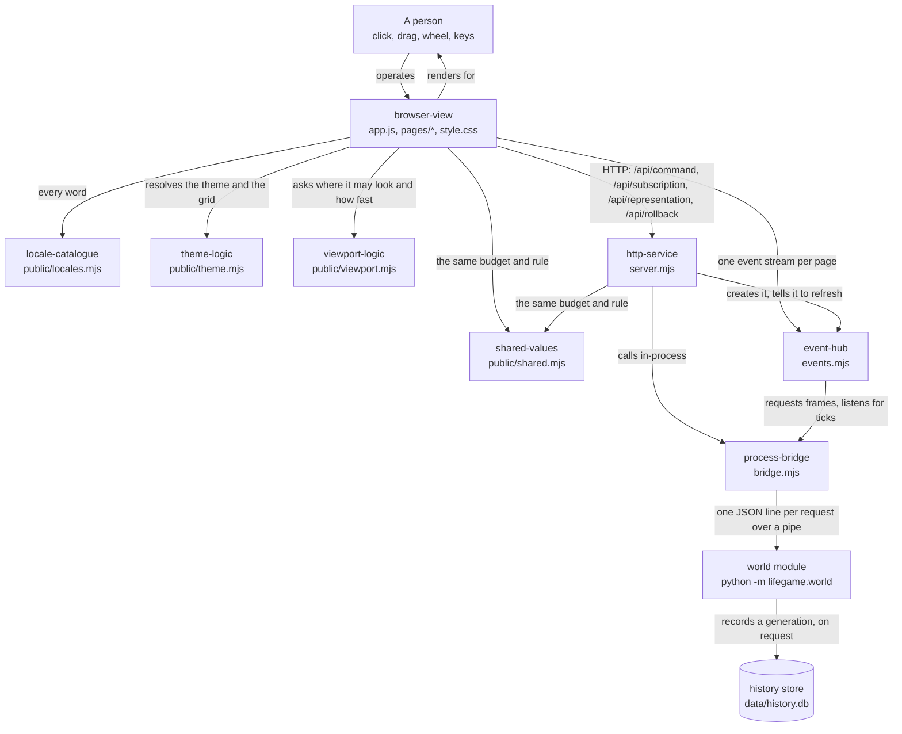

# viewer — overview

> **Owner of the viewer module contract.** This file and the eight beside it own
> what the `viewer` module promises. The structural decision behind it is
> [ADR 0007](../../adr/service-and-api/0007-viewer-service-delivered-in-phase-02.md);
> the line protocol it consumes is owned by
> [world/interfaces.md](../world/interfaces.md) §4; version state is owned by
> [VERSIONS.md](../../plan/VERSIONS.md); the component index is owned by
> [MODULE_COMPONENT_GUIDE.md](../../MODULE_COMPONENT_GUIDE.md) §4.

Status: Implemented

## Purpose

The `viewer` module is how a person sees and edits the world while it runs. It
is two halves of one surface: a NodeJS service that hosts the page and forwards
requests to the Python core, and a browser page that renders a viewport and
turns pointer and keyboard input into commands.

It exists because a world that can only be read by a benchmark is a world whose
representation decision cannot be checked by hand. Being able to click a cell
and watch a glider move is what makes the sparse representation reviewable
rather than merely asserted. [ADR 0007](../../adr/service-and-api/0007-viewer-service-delivered-in-phase-02.md)
records why the smallest conforming slice of the service phase is delivered
here, in the core phase, rather than after it.

Three properties define the module:

* **It is a transport, not a second implementation.** It never computes a
  generation, never reads the core's memory and never interprets a rule. It
  forwards requests and returns the core's replies unchanged, `ok`, `error` and
  `message` fields included, so a client sees exactly one authority for the
  world.
* **It has no package dependencies.** The service uses only Node's standard
  library (`node:http`, `node:child_process`, `node:path`, `node:url`,
  `node:fs`); the tests use `node:test`. Nothing is installed to run it and
  nothing is vendored to read it.
* **It writes one kind of file, and only when asked.** The service itself never
  opens a file for writing: responses stream from memory and the page is served
  read-only. The **core it starts** writes a SQLite history store and archive
  exports, at the operator's request, at a path the operator named — by default
  `data/history.db` inside the repository, and nothing at all under
  `--no-history`. That distinction is stated rather than smoothed over, because
  an earlier version of these files claimed the module wrote nothing at all.

## Where the module sits

Arrow meaning: `A -->|"label"| B` reads "A relates to B by the label written on
the arrow". This is a context view only: request paths are owned by
[data-flow.md](data-flow.md), component flow by
[internal-components.md](internal-components.md). Current state only. The store
is drawn because the module's operator has to know it exists; it is written by
the **core**, not by this module.

The module is the top of the product: nothing depends on it, and it depends on
the core only through a protocol another process speaks.

## Current state

| Aspect | State | Code entry point |
|---|---|---|
| HTTP service: twenty API routes plus four document routes and the static files, static-file confinement, the switch sequence, the history and select routes, the archive routes, the archive-name confinement, the session registry, the pattern routes, the CLI | Implemented | [src/viewer/server.mjs](../../../src/viewer/server.mjs) |
| The routed pages: one route table that the dispatch, the tab bar and the script set are all read from, the shared layout and the three fragments, a composer that fails on an unfilled slot, and `404` for a path nobody serves | Implemented | [src/viewer/routes.mjs](../../../src/viewer/routes.mjs) |
| Core bridge: starts the core on a chosen representation and with a history store, one request in flight, bounded restart policy, a planned restart that is not a crash | Implemented | [src/viewer/bridge.mjs](../../../src/viewer/bridge.mjs) |
| Push transport: one event stream per client, `hello` then `frame`, ticks forwarded, a slow subscriber coalesced, a rectangle clipped to the world | Implemented | [src/viewer/events.mjs](../../../src/viewer/events.mjs) |
| Every value the service and the page must agree on, in one module both import: the frame budget, the admission rule, the default view, and the reader for the core's declared limits | Implemented | [src/viewer/public/shared.mjs](../../../src/viewer/public/shared.mjs) |
| Browser shell: the DOM ids every page shares, the theme and the language, the status line, the error banner, the API client, the event stream and the panel's three states | Implemented | [src/viewer/public/app.js](../../../src/viewer/public/app.js) |
| One module per route: the canvas and its gestures, the recorded tree with its hover-and-focus detail, and the archive manager — none of them importing the shell, which is what `shell-link` is for | Implemented | [src/viewer/public/pages/](../../../src/viewer/public/pages/) |
| How the shell and a page module find each other without importing: the two event names, and a handshake that works whichever of the two loads first | Implemented | [src/viewer/public/link.mjs](../../../src/viewer/public/link.mjs) |
| The recorded history as a tree, as pure functions: the flatten that follows a parent rather than a generation number, indentation by **fork depth**, its cap and the branch letters | Implemented | [src/viewer/public/history.mjs](../../../src/viewer/public/history.mjs) |
| Building a `<select>` from the list that owns it, keeping the current value across a relabel or a rebuild | Implemented | [src/viewer/public/options.mjs](../../../src/viewer/public/options.mjs) |
| Client decoders for both frame encodings, free of DOM and canvas | Implemented | [src/viewer/public/decode.mjs](../../../src/viewer/public/decode.mjs) |
| Every user-visible string, in one table per language with identical key sets, plus the language precedence rule; free of the DOM | Implemented | [src/viewer/public/locales.mjs](../../../src/viewer/public/locales.mjs) |
| Where the page is looking, as pure functions, free of DOM and network | Implemented | [src/viewer/public/viewport.mjs](../../../src/viewer/public/viewport.mjs) |
| The rule vocabulary the page decides by itself: the eight presets, one parser with six named refusals, the mapping from a running rule to a preset or to the custom entry, and the rule a reply reports — free of DOM and network | Implemented | [src/viewer/public/rule.mjs](../../../src/viewer/public/rule.mjs) |
| Theme precedence, colour parsing, grid-width clamping and device-pixel line geometry, free of DOM and of storage | Implemented | [src/viewer/public/theme.mjs](../../../src/viewer/public/theme.mjs) |
| The panel's three states as pure functions, free of DOM and of storage | Implemented | [src/viewer/public/panel.mjs](../../../src/viewer/public/panel.mjs) |
| The shared layout and the three fragments, the tab bar they carry, both palettes, the appearance rules every control group shares, and the hover-and-focus reveal of a tree node's own numbers | Implemented | [src/viewer/public/pages/layout.html](../../../src/viewer/public/pages/layout.html), [src/viewer/public/style.css](../../../src/viewer/public/style.css) |
| Twenty-three test suites: the bridge against a real core, the service over a real socket with a real stream and a real history, the routed pages composed in process, the push hub without a socket, the shell and the page modules against a synthetic browser, the shared values and the locale table and the panel and tree and rule logic as data, the rule editor executed against the synthetic browser, the markup and the scripts and the stylesheet audited against each other, the decoders against real payloads, the theme and viewport logic against plain values, and the editing document, the editing runtime, the editing tools and the snippet store against plain data, a scripted core and a real filesystem | Implemented | [src/viewer/tests/](../../../src/viewer/tests/) |
| More than one session per service: a registry of session runtimes, each with its own core, its own history store, its own event hub and its own switch window; at most 64 sessions, with creations queued and counted beyond that | Implemented | [src/viewer/server.mjs](../../../src/viewer/server.mjs) |
| The pattern library as one data file and one strict RLE parser, and a placement that is one `set` of the resolved cells | Implemented | [src/viewer/patterns.json](../../../src/viewer/patterns.json), [src/viewer/patterns.mjs](../../../src/viewer/patterns.mjs) |
| The storage chosen from the measured shape of the live set, reconsidered after a placement | Implemented | [src/viewer/representation.mjs](../../../src/viewer/representation.mjs) |
| A recorded view point per session, shareable by a `?focus=x,y` link | Implemented | [src/viewer/public/focus.mjs](../../../src/viewer/public/focus.mjs) |
| A capabilities route naming the surfaces the editing mode exposes, with the mode implemented and roles planned | Implemented | [src/viewer/server.mjs](../../../src/viewer/server.mjs) |
| Undo of the last cell edit, distinct from a rollback, and a hint line that names the shortcuts | Implemented | [src/viewer/public/pages/world.js](../../../src/viewer/public/pages/world.js) |
| Saving a recorded world to an archive and loading it back from the archives page, without a command line | Implemented | [src/viewer/public/pages/archives.js](../../../src/viewer/public/pages/archives.js) |
| The published snippet library: content-addressed objects, a versioned index and the four publish/list/read/delete routes | Implemented (API); the page palette is planned | [src/viewer/snippets.mjs](../../../src/viewer/snippets.mjs), [src/viewer/server.mjs](../../../src/viewer/server.mjs) |
| The editing document model: transactions, the version and hash chain, merge of absolute intents, undo attribution and the resync window | Implemented (module) | [src/viewer/edit.mjs](../../../src/viewer/edit.mjs) |
| The single-machine editing API: enter/leave with pause and resume, the transaction and undo/redo routes, the resync window, and the `edit_active` guard | Implemented (API); roles are planned | [src/viewer/edit-runtime.mjs](../../../src/viewer/edit-runtime.mjs), [src/viewer/server.mjs](../../../src/viewer/server.mjs) |
| Real-time collaboration: ephemeral presence (cursor, selection, view point) over the event stream, merging in the service's commit order, and a cross-author undo that names its transaction and skips cells a later author wrote | Implemented | [src/viewer/edit-runtime.mjs](../../../src/viewer/edit-runtime.mjs), [src/viewer/server.mjs](../../../src/viewer/server.mjs), [src/viewer/public/pages/world.js](../../../src/viewer/public/pages/world.js) |
| The page's editing surface: an explicit mode, paint/erase/line/rectangle/select/stamp/pan tools, one transaction per gesture, undo/redo, selection drafts, publish, and a snippet palette with transforms and `overwrite`/`merge` | Implemented | [src/viewer/public/edit-tools.mjs](../../../src/viewer/public/edit-tools.mjs), [src/viewer/public/pages/world.js](../../../src/viewer/public/pages/world.js) |
Every row is `Implemented` in the sense of §3 of
[AI_DOCUMENTATION_GUIDE.md](../../AI_DOCUMENTATION_GUIDE.md): the code entry
point can be named.

### Validation state

The module's transport, decoding and presentation claims have been decided by
observation. The twenty-three suites pass against a real core process, a real socket,
a real event stream and a real history store, with the recorded run's total in
[testing.md](testing.md) §5, one end-to-end session was driven by hand over HTTP
and its replies are recorded in the same section, including a representation
switch that preserved the generation and the population across a real process
replacement, a **fork** that left the older branch in place, and a rollback that
restored a recorded generation, and the frame
costs in [performance.md](performance.md) §6 were measured on profile `M1`. The
phase criterion that names this module is B5 in
[phase-02-simulation-core/acceptance.md](../../plan/phase-02-simulation-core/acceptance.md);
the version `dev-log` entry it points at is named in
[VERSIONS.md](../../plan/VERSIONS.md), and version state is recorded only there.

The **browser probe** is the second opinion on top of the suite: it drives an
installed browser over the DevTools protocol against the shipped service and
checks that pages are served and that declared presses produce the requests they
should. It is what found VWR-28 — pressing the rule editor's button on a fresh page
issued no request while every suite was green — and after the fix the same press
issues the request. Both runs are recorded in [testing.md](testing.md) §5.10, and
the defect is §7.15. That pair is the clearest statement of what the two layers are
for.

The session, pattern and storage-choice claims are decided by observation too: two
sessions are created on a real service and each is asserted to keep its own world
and its own history file, a pattern's behaviour is stepped through a real core — a
still life unchanged, a glider displaced by one cell, the gun growing — and the
storage choice is asserted in both directions against a real process replacement
([testing.md](testing.md) §1, §4 and §5). The choice's **boundary between the two
measured shapes is not measured**; it is recorded as
[risks.md](risks.md) VWR-32.

Eight claims are explicitly **not** validated:

* what the page looks like: the synthetic browser records drawing calls and does
  not rasterise, so the geometry is asserted as arithmetic and the appearance is
  not ([risks.md](risks.md) VWR-10);
* that the stylesheet's selectors match at run time: the audit reads the
  stylesheet and the page as text and cannot evaluate a selector
  ([risks.md](risks.md) VWR-15);
* the stream's heartbeat interval, which no case waits out
  ([risks.md](risks.md) VWR-11), and a client whose first frame never arrives
  ([risks.md](risks.md) VWR-12);
* the cost of a representation switch on a large world
  ([risks.md](risks.md) VWR-13), and of listing a long history
  ([performance.md](performance.md) §7);
* the whole-world view at a population far above the measured one, and the
  `bits` path at the scale where its allocation matters
  ([performance.md](performance.md) §7);
* that the page is usable on a second browser or a second operating system, and
  the restart policy under a core that fails in ways other than exiting
  ([risks.md](risks.md) VWR-03);
* any language beyond the two the catalogue holds, and any layout consequence of
  a language that reads right to left
  ([risks.md](risks.md) VWR-16);
* end-to-end latency under a real network, since every measurement here is
  loopback.

One further caveat is recorded rather than hidden: a single whole-suite run
failed and was not reproduced, so the suite's stability is a claim about the runs
on record rather than an established property
([risks.md](risks.md) VWR-14, [testing.md](testing.md) §5.7).

## Owner

* **Contract owner.** This directory, `docs/model/viewer/`. A change to what the
  module promises is a change to these files, synchronised with the sources in
  the same work item ([DOCUMENTATION_RULES.md](../../DOCUMENTATION_RULES.md) §10).
* **Operating owner.** Whoever starts the service. The module has no
  configuration file; the one file it causes to exist is the core's history
  store, whose location is a command-line flag, so restarting the service and
  deleting that store is the whole recovery procedure
  ([data-flow.md](data-flow.md) §5).
* **Evidence owner.** The version `dev-log` entry named by
  [VERSIONS.md](../../plan/VERSIONS.md) for phase 02 milestone 02.

## Dependencies

### In (what this module needs)

| Dependency | Why | Failure behaviour |
|---|---|---|
| Node.js 24 or newer | The service and the page scripts, `node:test` for the suites | Nothing runs; no supported fallback |
| The world module's process | Every fact about the world comes from it | The API answers `503 core_unavailable` with the bootstrap hint, and the page keeps loading and says why |
| The project's own interpreter, `<repo>/.venv/.../python` | The bridge starts the core with it | `503 core_unavailable` naming `scripts/bootstrap.ps1`; the bridge refuses to guess a system interpreter ([bridge.mjs](../../../src/viewer/bridge.mjs)) |
| A browser with canvas, `fetch`, ES modules, `matchMedia` and `getComputedStyle` | The page, and the system preference and palette it resolves | The service still serves; the page cannot run. The synthetic browser covers the logic; a real browser is not in any test |
| `EventSource`, or a network that can hold a stream open | The push transport | The page falls back to polling on a timer and keeps working. Covered by the page suite, which deletes `EventSource` and separately drops a live stream |
| `localStorage`, optionally | Remembering the theme, the grid width and the language across loads | Not required: every access is wrapped, so a window whose storage throws keeps three working controls that forget, rather than a broken one |
| The repository's environment contract | Everything the module creates must stay in the tree ([AGENTS.md](../../../AGENTS.md) §1) | The service writes no file itself; the history store and the archive exports are written by the core at the operator's request, and both default to `data/` inside the repository rather than to a temporary directory |
| The core's declared limits | The tick-rate range, the step ceiling, the coordinate ceiling and the representations on offer | A core that declares nothing leaves the corresponding control **unavailable** rather than offering a value the core would refuse ([interfaces.md](interfaces.md) §6) |

### Out (who depends on this module)

| Consumer | What it takes | Coupling |
|---|---|---|
| A person at the browser | The viewport, the gestures, the controls and the readouts | The page's operator interface is documented in [interfaces.md](interfaces.md) §7 and is the only part of this module a human touches |
| The phase 02 acceptance record | Criterion B5, the browser page that renders and toggles and runs | The criterion is owned by [phase-02-simulation-core/acceptance.md](../../plan/phase-02-simulation-core/acceptance.md), not by this module |
| The repository verification suite | The suite command `node --test "src/viewer/tests/*.test.mjs"`, as one gate | A change to the command or to a test's expectation breaks the gate first ([AGENTS.md](../../../AGENTS.md) §4) |
| A second world beside this one | The service's routes, its event vocabulary and the protocol commands already forwarded | The session concept adds a second core beside `main`; the existing routes keep their shape and take an optional `?session=` ([interfaces.md](interfaces.md) §2.8) |

## What the module deliberately does not do

Even though it technically could:

* It does **not** compute a generation, apply a rule, or hold a copy of the
  world. Every pixel comes from a `frame` reply
  ([ADR 0007](../../adr/service-and-api/0007-viewer-service-delivered-in-phase-02.md)).
* It does **not** paraphrase the line protocol into a second authority. The
  protocol is defined by [bridge.py](../../../src/lifegame/world/bridge.py) and
  specified in [world/interfaces.md](../world/interfaces.md) §4; this module
  lists the commands it forwards and links there for their meaning.
* It does **not** persist anything itself. The service holds no persistent store and
  writes no log; the world lives in the core's memory. What *is* persisted is
  recorded by the core into a store the operator named, and it is a history of
  generations rather than the service's state: stopping the service still loses
  the running world until the store is rolled back into a new one
  ([interfaces.md](interfaces.md) §2.6).
* It does **not** persist a session. The session registry is in memory: a restart
  starts again with `main`, and a page holding `?session=s1` gets
  `404 unknown_session` rather than another core's world. Closing a session stops
  its core and **does not delete** its history file, which is the core's.
* It does **not** choose the storage below the measured crossover. A placement
  under 4,000 live cells leaves a person's manual choice alone; above it the
  measured shape decides ([representation.mjs](../../../src/viewer/representation.mjs),
  [risks.md](risks.md) VWR-32).
* It does **not** hold the pattern cells in the page. A placement names a pattern
  and the service resolves it, so there is one copy of the data and a client
  cannot place a shape the library does not contain.
* It does **not** translate the core's `message`. That string is a diagnostic
  written in English by the Python core, naming the field or bound that was
  wrong; what is translated is the **label** for a known error code, with the
  core's message appended as detail ([responsibilities.md](responsibilities.md) §3.6).
* It does **not** hold a user-visible string outside the locale table. A string in
  the markup or in the script is a string that cannot be translated, so the rule
  is total: the layout and the fragments carry structure and `data-i18n` keys, and
  the table carries every word ([interfaces.md](interfaces.md) §12).
* It does **not** invent a bound the core declares. The tick-rate range, the step
  ceiling, the coordinate ceiling and the list of representations come from
  `hello.limits`; a bound the core did not declare becomes `null`, and the
  control that would have used it is disabled rather than set to a plausible
  number ([interfaces.md](interfaces.md) §6).
* It does **not** interpret the core's `tick` events. It forwards them to
  whoever is subscribed and draws nothing from them: a tick says the world moved,
  and the frame that follows says how. The page never counts ticks to learn a
  generation.
* It does **not** install a runtime dependency, a bundler or a build step. The
  page is served as written.
* It does **not** bind anything but `127.0.0.1` by default, and it has no
  authentication: it is a local development surface, not a public one
  ([risks.md](risks.md) VWR-01).
* It does **not** decide what happens when the world grows past what the view
  can afford; it refuses the request and says so, and the page pulls the view in
  ([interfaces.md](interfaces.md) §3).
* It does **not** hold the palette in JavaScript. The two palettes live in the
  stylesheet, and the canvas reads the three colours it needs back out of the
  active one. A colour constant beside the stylesheet would be a second
  definition of the same theme, which is the defect that already cost this module
  one broken rendering path ([testing.md](testing.md) §7).
* It does **not** carry the theme precedence rule in the stylesheet. There is no
  `prefers-color-scheme` media query, because the rule would then exist twice —
  once in CSS for the page and once necessarily in script for the canvas, which
  cannot use CSS at all. The rule lives in
  [theme.mjs](../../../src/viewer/public/theme.mjs)
  ([interfaces.md](interfaces.md) §6.2).
* It does **not** decide version state. It links to
  [VERSIONS.md](../../plan/VERSIONS.md).

## Decisions that shaped it

One accepted decision creates this module, and it inherits the decisions that
shape the core it drives. The index is
[docs/adr/README.md](../../adr/README.md)
([DOCUMENTATION_RULES.md](../../DOCUMENTATION_RULES.md) §9):

* [ADR 0007](../../adr/service-and-api/0007-viewer-service-delivered-in-phase-02.md)
  — the viewer service is delivered in phase 02 as the smallest conforming slice
  of phase 03, holds no simulation logic, and keeps the protocol owned by the
  core.
* [ADR 0005](../../adr/simulation-core/0005-sparse-representation-at-target-scale.md)
  — the world is sparse, which is what makes a whole-world frame cheap enough to
  view and therefore what makes this module's zoom range meaningful.
* [ADR 0008](../../adr/simulation-core/0008-the-world-is-bounded-and-does-not-wrap.md)
  — the world is bounded and does not wrap, which is why the page clamps its
  viewport instead of offering a torus.
* [ADR 0009](../../adr/simulation-core/0009-sort-based-sparse-does-not-scale-to-the-target.md)
  — the core's scaling gap; the viewer displays the world it is given and does
  not compensate for it.

The remaining structural choices, with their rejected alternatives, are recorded
in [implementation.md](implementation.md) §6 and §7. That includes the two the
rule editor settled and did **not** record as decisions of their own: that the
page checks a rule before sending it while the core keeps the last word, and that
the preset control shows an entry naming the running rule rather than the nearest
preset. Neither changes an interface another module depends on — the command it
sends is the core's, unchanged — so both are mechanisms of this module rather
than ADR-shaped decisions.

## Document map

| File | Owns |
|---|---|
| [responsibilities.md](responsibilities.md) | claims, peer boundaries, failure behaviour, prohibited behaviour |
| [interfaces.md](interfaces.md) | the HTTP API including the history routes, the frame admission contract, the shared-value surface, the locale surface, the two JavaScript decoding and viewport surfaces, the theme surface, the operator interface, the CLI |
| [data-flow.md](data-flow.md) | request paths, ownership and lifetime of data, failure and recovery |
| [implementation.md](implementation.md) | layout, algorithms and complexity, environment, rejected alternatives |
| [performance.md](performance.md) | the oracle, the method, the measured frame costs, what is unmeasured |
| [testing.md](testing.md) | what is tested and not tested, how to run it, the last recorded result |
| [risks.md](risks.md) | the risks that are still open, with trigger, impact, mitigation and owning version |
| [internal-components.md](internal-components.md) | component list, allowed dependency direction, current component flow |
