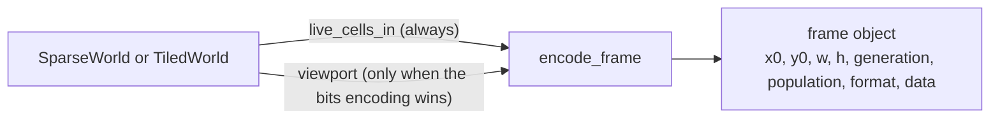
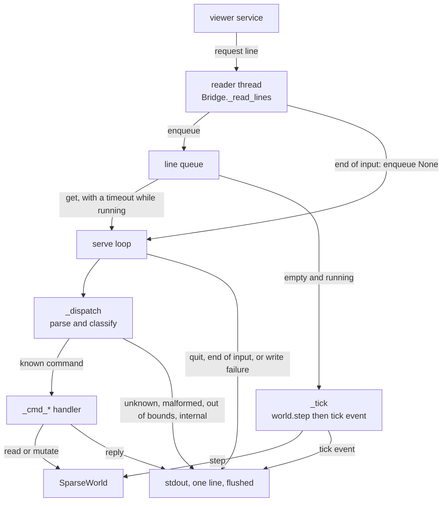
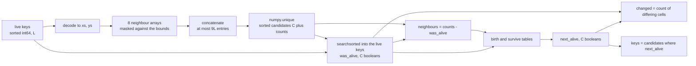
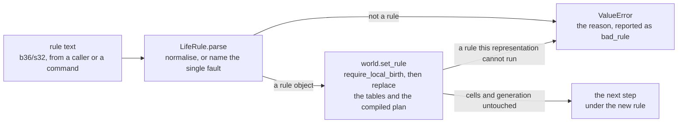
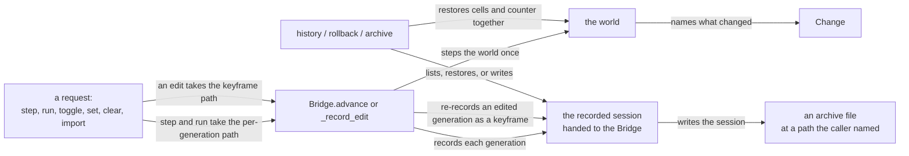

# world — data flow

> This file owns the module's producer and consumer paths, its runtime flow, the
> ownership and lifetime of every piece of data it holds, and its failure,
> rollback and recovery behaviour. It owns the flow diagrams. The surface itself
> is owned by [interfaces.md](interfaces.md); component internals by
> [internal-components.md](internal-components.md).

## 1. Ownership and lifetime

| Data | Owner | Lifetime | How it is replaced |
|---|---|---|---|
| The live set: a sorted, unique `int64` array of packed keys, one per live cell | `SparseWorld`, field `_keys` | from construction, or from the last `clear()`, to the next mutation | **Rebound**, never edited in place |
| The tile keys: a sorted, unique `int64` array of packed tile keys, tile row in the high 32 bits and tile column in the low, one per non-empty tile | `TiledWorld`, field `_keys` | same | **Rebound**, and a tile that becomes empty is dropped from it |
| The tile rows: a `(N, 64)` `uint64` array, one 64-cell word per tile row, parallel to `_keys` | `TiledWorld`, field `_rows` | same, and always the same length as `_keys` | Rebound alongside `_keys`; the two are written together or not at all |
| The active set and its working arrays, up to `(9N, 64)` words | `TiledWorld._step_once`, local to the call | one step | Garbage at the end of the step; nothing is retained between steps |
| The dense grid: a `bool` array of shape `(height, width)` | `DenseWorld`, field `_grid` | same | Rebound wholesale |
| Birth and survive decision tables: two `bool` arrays of length 9 | All three representations | from construction, or from the last `set_rule()`, to the next rule change | **Rebuilt together** by `set_rule`, from the rule object's tables; never edited in place |
| The rule's packed masks, and the tiled world's compiled plan | `TiledWorld`, fields `_network` and the rule it was compiled from | from construction, or from the last `set_rule()`, to the next rule change | Replaced wholesale: a plan is never patched, so no step can read a decision that belonged to the previous rule |
| Generation counter | All three representations | from construction or `clear()`; incremented once per applied step | Rebinding an integer |
| Rule object | The caller that constructed the world; the world holds a reference, field `_rule` | Immutable and effectively permanent; the world's **reference** to one is replaced by `set_rule` | Never edited; `set_rule` rebinds the reference and every value derived from it |
| The view returned by `SparseWorld.keys()` | The caller | The array stays readable and valid, but it is a **view** and stops tracking the world at the next mutation | The caller copies it if it needs a snapshot |
| The arrays returned by `viewport()` and `live_cells_in()` | The caller | Until the caller drops them; a fresh copy per call | Not replaced by the module |
| The iterator returned by `live_cells()` | The caller | A lazy snapshot over Python integers, unaffected by later mutations | Not replaced |
| The inbound line queue | `Bridge`, field `_requests` | For the process's lifetime | Filled by the reader thread, drained by the serve loop |
| The write lock | `Bridge`, field `_write_lock` | For the process's lifetime | Serialises the serve loop and the tick path onto one writer |
| The frame payload, a base64 string | Produced per request, handed to the caller | The request's lifetime | A new string per `frame` request; nothing is retained |
| The `Change` one `advance` produced: a count, a generation, and two `(M, 2)` `int32` coordinate arrays | The caller | The caller's lifetime; the world retains nothing | A new value per `advance`. `born` and `died` are the shared `EMPTY_CELLS` when the caller declined to record, so a caller must not write into them |
| The export payload, a base64 string of the whole live set | Produced per `export` request, handed to the caller | The request's lifetime | A new string per request; nothing is retained |

Four lifetime facts matter to a consumer and are easy to get wrong:

1. **Every mutation rebinds the array rather than editing it.** That is what
   makes an earlier `keys()` view stale-but-safe instead of corrupt, and it is
   what makes a failed operation leave the world untouched.
2. **`viewport()` never aliases the world.** All three representations return a
   copy, so a caller cannot corrupt the world by writing into a view it was
   given. The tiled world in particular cannot return a view: its cells are bits
   inside a word, so there is nothing to hand out.
3. **The tiled world's `_keys` and `_rows` are one value in two arrays.** They
   are rebound together and are always the same length. A consumer that reads one
   without the other is reading a torn state; the only public reads that keep them
   together are the ones in [interfaces.md](interfaces.md) §2.3.
4. **A rule change replaces derived values, not state.** The decision tables, the
   masks and the compiled plan are rebuilt from the new rule in one call; the
   live set and the generation counter are not touched at all. A consumer holding
   a `LifeRule` keeps a valid immutable value — what changes is which rule the
   world will apply to the next step, not the rule object it was given (§3.5).

## 2. Producer and consumer paths

| Producer | Data | Consumer | Path |
|---|---|---|---|
| The viewer's service | request lines | `Bridge._read_lines` | standard input, one JSON object per line |
| The viewer's service | `--representation` at start-up | `main`, then the `TiledWorld` or `SparseWorld` constructor | the process's command line, read once before the loop starts |
| The viewer's service, or a Python caller | a rule, as `B<digits>/S<digits>` text | `Bridge._cmd_set_rule`, then `LifeRule.parse`, then `world.set_rule` | a request line for the protocol, a direct call in process for Python |
| `Bridge.serve` | reply and event lines | The viewer's service | standard output, one JSON object per line, flushed |
| `SparseWorld.live_cells_in` | absolute coordinates inside a rectangle | `encode_frame` | in process |
| `TiledWorld.live_cells_in` | absolute coordinates inside a rectangle, unpacked from the tile words | `encode_frame` | in process |
| `SparseWorld.viewport` | a dense boolean rectangle | `encode_frame`, only for the `bits` encoding | in process |
| `TiledWorld.viewport` | a dense boolean rectangle, unpacked from the tile words | `encode_frame`, only for the `bits` encoding | in process |
| `encode_frame` | one frame object, base64 payload | The `frame` reply | in process |
| `SparseWorld.advance` / `TiledWorld.advance` / `DenseWorld.advance` | a `Change`: a count and the born and died coordinate arrays | The caller of the library, and through it the [store](../store/overview.md) module, which stores the two arrays as a generation's delta | in process |
| The [store](../store/overview.md) module, or a caller restoring a saved state | coordinates and a generation number | `restore`, then the world's live set and its counter | in process, through the world's public surface |
| `Bridge` `export` | the whole live set, base64 of `x`/`y` pairs | A consumer that wants to move the world, including to a core started on the other representation | one JSON line on standard output |
| `Bridge` `import` | the same payload, plus a generation number | `restore`, so the world is replaced rather than merged | one JSON line on standard input |
| The active representation's `step` | the new state and the number of changed cells | The `tick` event, the `step` reply, and any in-process caller | in process |
| `TiledWorld.tile_count` | the number of non-empty tiles | The measurement harness | in process, test-only |
| The measurement harness | timing samples | [performance.md](performance.md)'s record | in process, test-only |

`encode_frame` reaches into the world through exactly two public calls, whichever
representation it is handed. It never reads a private field:

Arrow meaning: `X -->|"label"| Y` reads "X produces what Y consumes, by the call
named on the arrow". This is current state only.

The frame path is the one place where the two representations' costs diverge
without diverging in behaviour: the same request returns the same bytes, and the
tiled world pays an unpacking step to produce them
([performance.md](performance.md) §7).

## 3. Runtime flow

### 3.1 The protocol loop (current)

Arrow meaning: `X -->|"label"| Y` reads "control or data moves from X to Y when
the label holds". Current state only.

Four properties of this flow are worth stating because they are not obvious from
the code's shape:

* **Every request is answered exactly once.** A reply is written for the
  success path and for every classified failure; a request that cannot be
  parsed still produces a line, without an `id`.
* **The reader is a daemon thread.** It blocks on standard input and pushes
  lines into the queue. When input ends it enqueues `None`, which the serve loop
  treats as "exit `0`".
* **Ticking is driven by the queue's timeout**, not by a separate timer thread.
  While running, the serve loop waits for a request with a deadline of the next
  tick; a request cancels the wait and is handled first, so a busy service still
  gets its replies between ticks.
* **One writer.** Every outgoing line goes through `_send`, which takes
  `_write_lock` and flushes. The tick path and the reply path therefore cannot
  interleave on the wire.

### 3.2 The sparse step (current)

The step is where the module's cost lives, and its data flow is the reason for
its complexity bound. With `L` live cells:

Arrow meaning: `X -->|"label"| Y` reads "Y is computed from X by the label
written on the arrow". Current state only.

Two details in this flow deserve their own record, because one of them was a
defect:

* **The bounds mask is applied per neighbour offset**, before a key is formed.
  That is where the bounded, non-wrapping boundary condition is enforced
  ([ADR 0008](../../adr/simulation-core/0008-the-world-is-bounded-and-does-not-wrap.md)).
  A cell whose neighbour would fall outside the world simply does not contribute
  one.
* **The self-entry is subtracted only from live candidates.** The candidate
  array holds a live cell once on its own account plus once per live neighbour,
  and a dead candidate once per live neighbour. Subtracting one
  unconditionally undercounts every birth by one; the subtraction must be
  `counts - was_alive`. This was the module's first real defect, and
  [testing.md](testing.md) §6 records it.

### 3.3 The dense step (current)

The oracle computes the same rule from the same inputs by a completely
different route: pad the grid with a dead border, sum eight shifted slices, and
look the count up in the same tables. It reads the whole world's area per step,
which is exactly why it is a baseline rather than a candidate at the target.

### 3.4 The tiled step (current)

With `M` active tiles, one array element per tile row, and 64 cells to a word:

```mermaid
flowchart LR
  Keys["tile keys<br/>sorted int64, N non-empty"]
  Border["border probe<br/>is any edge cell of this tile live?"]
  Active["active set<br/>N tiles plus the neighbours<br/>of every border tile"]
  Gather["gather the 8 neighbouring tiles' rows<br/>8 binary searches, zero where absent"]
  Window["66-row window<br/>own 64 rows, one borrowed above and below,<br/>left and right carry bits folded into the ends"]
  Planes["8 neighbour bit planes<br/>shifted slices of the window"]
  Adder["ripple-carry adder<br/>4 levels over the 8 planes"]
  Rule["apply the compiled rule<br/>a selection network over the four count planes,<br/>then next = (alive AND survive) OR (NOT alive AND born)"]
  Mask["mask a partial tile to the world's bounds"]
  Changed["changed = popcount(after XOR before)"]
  Drop["drop tiles that died"]

  Keys --> Border
  Border --> Active
  Keys --> Active
  Active --> Gather
  Gather --> Window
  Window --> Planes
  Planes --> Adder
  Adder --> Rule
  Rule --> Mask
  Mask --> Changed
  Changed --> Drop
  Drop -->|"new tile keys and rows"| Keys
```

Arrow meaning: `X -->|"label"| Y` reads "Y is computed from X by the label
written on the arrow". Current state only.

Five details carry the correctness of this flow, and each has its own test:

* **The active set is expanded before the step, not after.** A birth can appear
  in a tile that was empty, so the set of tiles to advance is the non-empty ones
  *plus the eight neighbours of any tile whose border is not empty*. The border
  probe is what keeps the expansion from costing nine times on a sparse shape
  ([test_tiled.py](../../../tests/world/test_tiled.py) covers both the straight
  and the diagonal seam birth).
* **The window is 66 rows, not 64.** A horizontal shift needs the bit that falls
  off the end, and the borrowed rows' own horizontal neighbours come from the
  diagonal tiles. That is why the diagonal tiles are gathered separately from the
  orthogonal ones.
* **The count is a popcount of the exclusive-or, not a count of differing
  elements.** One element is 64 cells, so an element count is wrong by up to a
  factor of 64. This was a real defect ([testing.md](testing.md) §6.3).
* **The bounds mask is re-applied every step.** When the world's size is not a
  multiple of 64, the last tile in a row or column has bits that are outside the
  world; they must be cleared before the tile is stored, or a padding cell could
  become live
  ([test_tiled.py](../../../tests/world/test_tiled.py)).
* **The rule the node applies is the one the world is holding, and it is applied
  as a compiled plan rather than as an expression.** The node above is where a
  rule change lands: `set_rule` replaces the plan before the next step reads it,
  and a plan is never patched in place, so this step can never run half of one
  rule and half of another (W17 in [responsibilities.md](responsibilities.md) §1,
  and §3.5 below for the change itself).

### 3.5 Changing the rule (current)

The rule is the one part of a world's identity that can be replaced, and the flow
is the same whether the request comes from Python or from the protocol.

Arrow meaning: `A -->|"label"| B` reads "B follows from A by the label written on
the arrow". Current state only.

* **Nothing on this path is state.** No branch writes `_keys`, `_rows`, `_grid`
  or the generation counter, so a rule change is not an edit, not an undo, and
  not something the recorded timeline has to be told about.
* **Every refusal happens before anything is replaced.** Each `set_rule` checks
  the rule first and assigns afterwards, so a refused rule leaves the world
  running exactly the rule it was running. That is what makes the `bad_rule`
  branch safe to reach from a text field (W18).
* **The plan is compiled once per change.** A step never compiles and never reads
  a plan that was not built for the rule the world is holding, which is what the
  wholesale replacement buys (W17).
* **A rule the protocol sends is parsed by the same `LifeRule.parse` a Python
  caller uses**, and the reply repeats the notation the core took rather than the
  text it was given ([interfaces.md](interfaces.md) §4.2.1).

### 3.6 The change record and the world payload (current)

Two flows exist so that a world can leave the process that built it.

```mermaid
flowchart LR
  World["the world<br/>SparseWorld or TiledWorld"]
  Advance["advance(record=True)"]
  Change["Change<br/>changed, generation,<br/>born, died"]
  Store["the store module<br/>stores born and died as a delta"]
  Export["export<br/>the whole live set"]
  Import["import<br/>restore(cells, generation)"]

  World -->|"one generation"| Advance
  Advance -->|"names the cells that changed"| Change
  Change -->|"born and died arrays"| Store
  Export -->|"coordinates, never a bitmap"| Import
  Import -->|"replaces cells and counter together"| World
```

Arrow meaning: `A -->|"label"| B` reads "A relates to B by the label written on
the arrow". Current state only.

The two flows are deliberately different shapes, and the difference is the point:

* **`advance` carries a difference.** It describes one transition, it is bounded
  by how many cells changed, and it is only meaningful next to the generation it
  came from. The store is what turns it into something durable, and the world
  keeps nothing.
* **`export` carries a whole state.** It has no parent, it does not depend on any
  previous request, and it is always coordinates. That is what makes it the
  mechanism for moving a world between representations: a bitmap would describe
  the rectangle a caller asked for, so importing one would import the area rather
  than the contents.

`import` is the only flow that replaces a world rather than advancing it, and it
sets the cells and the counter in one call. Neither `advance` nor `import`
retains anything: after the reply, the world is the only copy.

### 3.7 The recorded timeline (current)

A core started with `--history` records every generation and can be rolled back
and archived. The flow crosses the module boundary in one place, through an
object the protocol was handed:

Arrow meaning: `A -->|"label"| B` reads "A relates to B by the label written on
the arrow". Current state only.

Three properties of this flow are contract rather than implementation, and each
exists because of a way it can go wrong:

* **Stepping is per generation when a history is attached.** `step 10` records
  ten generations rather than one, because a timeline wants the nine
  intermediate states. A core without a history calls the world once and pays
  nothing for recording.
* **An edit re-records its own generation as a keyframe.** A mutation changes the
  world between two generations, so the delta that reached the current generation
  no longer describes where the next step starts. [testing.md](testing.md) §6.4
  is the defect that made this a rule.
* **A rollback replaces cells and counter together.** Restoring only the cells
  would leave the world claiming a generation it is not at, and the next recorded
  delta would name the wrong parent.

Nothing in this flow is retained by the world. It keeps no pointer to the
session, no generation list and no file handle; after a reply, the world is the
only copy and the session is the only history, which is why a core without
`--history` loses nothing by not having one.

### 3.8 The push transport (current, and the viewer's)

This section used to record a planned flow change: a push transport so the
browser stops polling. That transport now exists, and it is
[viewer](../viewer/overview.md)'s, not this module's.

The module's side of that boundary did not change and did not need to: the core
has always emitted a `tick` event after each automatic step, and a transport that
carries events to a browser consumes them. What the transport changed on this
side is only that ticking now goes through the recorded path when a history is
attached, so a pushed `tick` and a recorded generation are the same step.

No diagram in §3.1, §3.3 or §3.4 includes the transport, and none should: a
`tick` leaves the process as one line of JSON, whatever carries it afterwards.

## 4. Retention

Nothing is retained across requests except the world's own state and the
bridge's run flag, rate and queue. There is no history, no undo stack, no
recording and no cache:

| Question | Answer |
|---|---|
| Are previous generations kept? | No. A step replaces the live set; the previous generation is garbage. |
| Is a frame payload retained? | No. It is produced per request and dropped once written. |
| Is a request retained? | No. A line is handled and dropped; the queue holds only what has not been read yet. |
| What ends the process? | `quit`, end of input, or an unrecoverable write error. Nothing else. |

Two consequences follow. A consumer that wants history must keep it; and a
consumer that missed a `tick` cannot ask for it again, because `state` reports
the present only.

## 5. Failure, rollback and recovery

### 5.1 Per-operation atomicity

Every mutating operation computes its result into local variables and then
performs **one** rebinding of the live array:

| Operation | What is bound, and when |
|---|---|
| `toggle` | inserts or deletes one key, then rebinds |
| `set_alive` | inserts or deletes one key, then rebinds |
| `load` | concatenates and deduplicates, then rebinds |
| `clear` | binds an empty array |
| `SparseWorld._step_once` | computes candidates, counts, the next state and the change count, then rebinds |
| `TiledWorld._step_once` | computes the active set, the next rows, the bounds mask and the change count, then rebinds `_keys` and `_rows` together. The two arrays are the world's state, so they are bound in one statement each with nothing between them that can raise |

A failure inside the computation therefore leaves the world exactly as it was,
apart from one exception: `step(count)` increments the generation **after each
single application**, so if the third of five applications fails, the world is
consistent at generation 2 and the remaining two did not run. A single step is
atomic; a multi-step request is atomic per step and reports by raising, not by
returning a partial count.

### 5.2 Failure paths

| Failure | State afterwards | Recovery |
|---|---|---|
| `OutOfBoundsError` at the protocol edge | unchanged | A `out_of_bounds` error object; the next request is served normally |
| `bad_arguments` at the protocol edge | unchanged | An error object; the process continues |
| A malformed line | unchanged | A `bad_request` error object; the process continues |
| Any other exception in one handler | unchanged by that handler | An `internal` error object; the process continues |
| An unrecoverable write error | unchanged | None. The process ends; there is no channel left to report on |
| End of input | unchanged | The serve loop returns `0` and the process exits |

### 5.3 What a consumer must do after a failure

* Treat any reply with `ok: false` as a refusal: the world is unchanged, and the
  request may be corrected and resent.
* Re-read `state` after an `internal` error rather than assuming what happened.
  The module guarantees that the world is not left partially updated, but it
  does not promise that an `internal` error came from the command that reported
  it.
* Treat a closed stdout or a terminated process as terminal. There is no
  reconnect, no session resumption and no state recovery across a restart: a new
  process starts empty.
