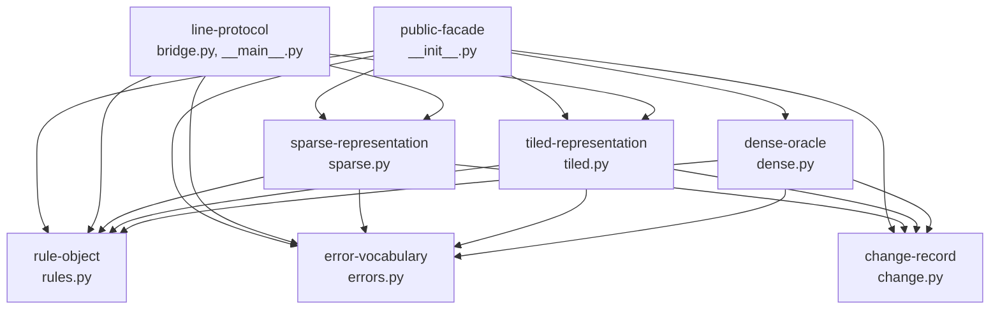
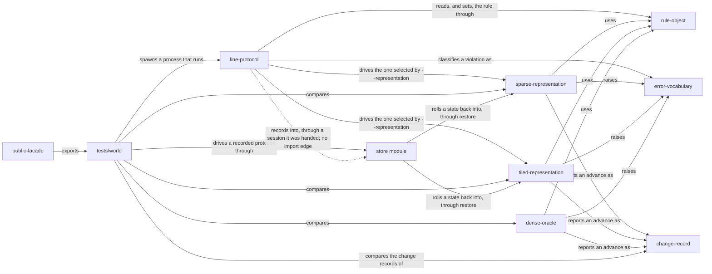

# world — internal components

> This file owns the component list, the allowed dependency direction between
> components and the current component flow, as required by
> [MODULE_COMPONENT_GUIDE.md](../../MODULE_COMPONENT_GUIDE.md) §2. The central
> index is owned by that guide's §4; this file is the detail it links to. The
> module's public contract is owned by [interfaces.md](interfaces.md).

## 1. Components

| Component | Source | Responsibility |
|---|---|---|
| `rule-object` | [src/lifegame/world/rules.py](../../../src/lifegame/world/rules.py) | The rule vocabulary: `LifeRule`, `CONWAY`, `MAX_NEIGHBOURS`, `require_local_birth`. Validates the counts, parses and prints the `B<digits>/S<digits>` notation as inverses of each other, derives the nine-entry decision tables and the packed masks every representation reads, answers the transition for one cell, and names the rules the two locality-based representations refuse |
| `error-vocabulary` | [src/lifegame/world/errors.py](../../../src/lifegame/world/errors.py) | The one error type for one condition, `OutOfBoundsError`, so a caller does not have to know which representation it holds |
| `change-record` | [src/lifegame/world/change.py](../../../src/lifegame/world/change.py) | `Change` and `EMPTY_CELLS`: what one advance produced, cell by cell — which cells were born and which died — as the `(M, 2)` `int32` coordinate arrays the protocol and the store both use |
| `sparse-representation` | [src/lifegame/world/sparse.py](../../../src/lifegame/world/sparse.py) | `SparseWorld`: packed 64-bit keys in a sorted unique array, sort-based neighbour counting, mutation under the sorted invariant, the viewport and rectangle reads, and `set_rule` for a rule change that touches no cell |
| `tiled-representation` | [src/lifegame/world/tiled.py](../../../src/lifegame/world/tiled.py) | `TiledWorld`, `TILE_BITS`, `TILE_CELLS`: 64 x 64 bit-packed tiles with only the non-empty ones stored, the active-set expansion, the windowed bit-parallel step, the partial-tile bounds mask, `tile_count`, and the compiler that turns a rule into the selection network the step applies |
| `dense-oracle` | [src/lifegame/world/dense.py](../../../src/lifegame/world/dense.py) | `DenseWorld` and `MAX_DENSE_CELLS`: one boolean per cell, the independent implementation used as the correctness oracle and the measured baseline, and the one representation whose `set_rule` accepts a rule that is not local |
| `line-protocol` | [src/lifegame/world/bridge.py](../../../src/lifegame/world/bridge.py), [src/lifegame/world/__main__.py](../../../src/lifegame/world/__main__.py) | The protocol: request parsing and classification, the nineteen commands including `set_rule` and the atomic `patch`, the `tick` event, the run loop, both frame encodings, the whole-world `export` and `import` payloads, the advertised limits, the recorded timeline (`history`, `select`, `rollback`, `archive`, `open`) driven through a session it is handed, and the process entry point |
| `public-facade` | [src/lifegame/world/__init__.py](../../../src/lifegame/world/__init__.py) | The documented import surface: re-exports exactly eleven names and defines `__all__` |

Every file under `src/lifegame/world/` belongs to exactly one component, and
every component is named for a responsibility rather than for a file. Eight
components cover nine files, because `line-protocol` owns both the protocol and
the process entry point. The facade is a component because it owns something real
— which names are public — and not merely because it exists.

The `change-record` component is a leaf like the two beside it: it holds one
frozen dataclass and one shared empty array, it imports nothing from this module,
and all three representations depend on it. It exists as a component rather than
as a field on the representations because the difference between two generations
is what a history layer needs
([store/interfaces.md](../store/interfaces.md) §2.4), and because a value that
crosses a module boundary should have an owner rather than being three parallel
tuples.

### 1.1 What each component must not do

| Component | Must not |
|---|---|
| `rule-object` | Import anything else in this module. It is a leaf, and all three representations depend on it |
| `error-vocabulary` | Import anything else in this module, or grow a second exception type without a second condition |
| `change-record` | Import anything else in this module. It is a leaf, and all three representations and the protocol depend on it. It may not gain behaviour: it describes a difference, it does not compute one |
| `sparse-representation` | Import `dense-oracle` or `tiled-representation`. The three representations must share nothing below the leaves — the rule object, the error type and the change record — or the oracle test stops being evidence ([testing.md](testing.md) §6.1) |
| `tiled-representation` | Import `sparse-representation` or `dense-oracle`, for the same reason. It may not reach into another component's storage, which is why it cannot borrow the sparse world's candidate-construction trick |
| `dense-oracle` | Import either shipped representation, or be presented as a candidate at the target scale |
| `line-protocol` | Import `dense-oracle`; **import the [store](../store/overview.md) module at module scope** — the session arrives as an argument and only the entry point may import it, because the store imports this module and the edge would become a cycle; reach into a private field of a world instead of using its public surface; or compute a generation itself |
| `public-facade` | Contain logic. It re-exports and nothing else |

The prohibition is symmetric and it is the module's central structural claim: the
three representations are three independent answers to the same question, and
agreement between them is evidence only while that stays true. They do share
three leaves — `rule-object`, `error-vocabulary` and `change-record` — and each
of those is a vocabulary rather than an algorithm: a rule, an exception, a
dataclass holding coordinates. Sharing a vocabulary cannot make two
implementations agree by construction; sharing a neighbour's step could. The rule
component carries one policy beside the vocabulary — the refusal of a rule that is
not local, which both locality-based representations must make identically — and
that is still a statement about rules rather than a step either of them takes.

## 2. Allowed dependency direction



Arrow meaning: `A --> B` reads "A may import B". No arrow points the other way,
and there is **no arrow between any two of `sparse-representation`,
`tiled-representation` and `dense-oracle` in either direction**. This is current
state only.

| Allowed edge | Why it exists |
|---|---|
| `public-facade` to the other seven | The facade re-exports the eleven public names, which come from six of the seven |
| `line-protocol` to `sparse-representation`, `tiled-representation` | The protocol constructs one of the two according to `--representation`, then reads and mutates it through the shared contract |
| `line-protocol` to `rule-object` | `hello`, `state` and `export` report the rule's notation, and `set_rule` parses a rule with `LifeRule.parse` and answers with the notation the core took |
| `line-protocol` to `error-vocabulary` | The out-of-bounds classification is the protocol's, and it names the module's own error type |
| All three representations to `rule-object` | Each builds its decision tables from the rule, in the constructor and in `set_rule`; the tiled world compiles the same rule's masks into its selection network. The compiler itself is inside `tiled-representation` and no other component can see it |
| All three representations to `error-vocabulary` | Each raises `OutOfBoundsError` for the same condition |
| All three representations to `change-record` | Each returns a `Change` from `advance`, and two of them return the shared `EMPTY_CELLS` when there is nothing to report |

`line-protocol` does **not** appear in the last row, and the absence is worth
noting: the protocol's `export` and `import` commands move a whole world through
coordinates, and neither needs to know what changed between two generations. The
change record reaches the caller of the library, not the consumer of the wire.

**There is also no edge from `line-protocol` to the history layer.** The
protocol records what it steps and can roll the world back and write an archive,
and it does all of that through an object it was **handed**, not through an
import:

```python
class Bridge:
    def __init__(self, world, reader, writer, history=None) -> None: ...
```

The rule is deliberately **not** a constructor argument, and the omission says
something rather than saving a line: the rule belongs to the world, which is
what the protocol reports, so a copy held here would agree with the world only
until someone changed one of the two — and it fails in the direction that says
nothing, with `hello` answering a rule no generation will ever run. The rule
reaches the core through the world instead: the protocol's `set_rule` calls the
world's own, and the recording is told the same rule.

`history` is duck-typed and is never named by type. The bridge calls `record`,
`amend_head`, `set_rule`, `nodes`, `head`, `id`, `node_at_generation`,
`checkout`, `rollback`, `archive` and `open_archive` on the session it was
handed, and asks an archive it has opened for `info`, `latest` and `state_at`.
`generations` is not called: the timeline reply is built from `nodes`, which is
the one that carries the parent links the tree needs. The import lives in
`main`:

```python
if arguments.history:
    from lifegame.store import Store
    ...
```

That is deliberate and it is the only direction that can work. The
[store](../store/overview.md) module imports this one — it reads a world through
`advance` and writes into one through `restore` — so an import from here to
there would be a cycle. Injecting the session keeps the dependency one-way and
keeps the console entry point as the single place allowed to know both modules.

The cost is that the coupling is invisible to a compiler and to an import
graph: nothing stops `line-protocol` from calling a method the store does not
have, and the protocol's own tests are what catch it. It is recorded as risk
WLD-11 in [risks.md](risks.md), with what has been closed and what has not.

### 2.1 One coupling that was fixed, and stays recorded

`line-protocol` used to reach `OutOfBoundsError` **through
`sparse-representation`**:

```python
from lifegame.world.sparse import OutOfBoundsError, SparseWorld
```

It worked because `sparse.py` imports the name into its own namespace, and it was
not a declared re-export: `sparse.py`'s `__all__` is `["SparseWorld"]`. The edge
that mattered was always `line-protocol` to `error-vocabulary`, routed through
another component, so removing that import from `sparse.py` would have broken the
protocol at import time. The protocol now imports what it means:

```python
from lifegame.world.errors import OutOfBoundsError
from lifegame.world.rules import CONWAY, LifeRule
from lifegame.world.sparse import SparseWorld
from lifegame.world.tiled import TiledWorld
```

The routed edge is recorded rather than deleted because it is the kind of
coupling this file exists to catch, and because it is the second component-level
defect this module has found and closed. The first was the missing
`tiled-representation` component itself, which existed as a plan in this file's
§4 until the code arrived.

## 3. Component flow

This is how one request moves through the components. Producer and consumer
paths, and each step's data flow, are owned by [data-flow.md](data-flow.md).



Arrow meaning: `A -->|"label"| B` reads "A relates to B by the label written on
the arrow"; a dotted arrow is a relationship that is **not** an import. Current
state only.

The three arrows into `Tests` are the point of the diagram: the test package
compares all three representations against **each other**, not against a stored
expectation, which is what makes a disagreement a failure regardless of which
one is wrong. The arrow into `Change` is the same idea one level down: the three
representations' change records are compared with each other, which is how a
change count taken over the wrong unit was caught
([testing.md](testing.md) §6.2).

The dotted edge is drawn because leaving it out would say something false. The
protocol records every generation and can roll the world back and write an
archive, so it plainly relates to the history layer — but it names no type from
it and imports nothing, because the session arrives as an argument and the
[store](../store/overview.md) module already imports this one. Drawing it solid
would put a cycle in an import graph that has none; drawing nothing would hide
the protocol's largest new dependency. It is the only non-import edge in this
file, and [risks.md](risks.md) WLD-11 says what that costs.

### 3.1 Which tests exercise which component

| Component | Tests |
|---|---|
| `rule-object` | [test_rules.py](../../../tests/world/test_rules.py); [test_rule_equivalence.py](../../../tests/world/test_rule_equivalence.py) for the mask-derived behaviour and the refusal of a non-local rule; read indirectly by all three representations in every other test |
| `error-vocabulary` | [test_world_contract.py](../../../tests/world/test_world_contract.py) (out-of-bounds cases, all three classes); [test_tiled.py](../../../tests/world/test_tiled.py) (the out-of-bounds refusals); [test_bridge.py](../../../tests/world/test_bridge.py) (the `out_of_bounds` error code) |
| `change-record` | [test_oracle_equivalence.py](../../../tests/world/test_oracle_equivalence.py) — `assert_same_change_count` compares what each representation's `advance` returns, including the born and died sets — and [test_world_contract.py](../../../tests/world/test_world_contract.py) for the shape of the value |
| `sparse-representation` | [test_world_contract.py](../../../tests/world/test_world_contract.py), [test_patterns.py](../../../tests/world/test_patterns.py), [test_oracle_equivalence.py](../../../tests/world/test_oracle_equivalence.py), [test_benchmark.py](../../../tests/world/test_benchmark.py) |
| `tiled-representation` | [test_tiled.py](../../../tests/world/test_tiled.py), plus the `tiled` parameterisation of the same four; [test_rule_equivalence.py](../../../tests/world/test_rule_equivalence.py) is what holds the compiled selection network to the oracle, rule by rule |
| `dense-oracle` | The same four, in their `dense` parameterisation; [test_rule_equivalence.py](../../../tests/world/test_rule_equivalence.py) uses it as the judge of every rule, and as the one representation that runs a rule the other two refuse |
| `line-protocol` | [test_bridge.py](../../../tests/world/test_bridge.py), which spawns a real child process — including one case parameterised over both selectable representations, the `export`/`import` round trip, the `set_rule` exchange with its normalisation and its refusal, and a `recorded` fixture that starts a core with `--history` and exercises `hello`'s limits, the timeline, rollback, an edit re-keyframing its generation, and the archive round trip |
| `public-facade` | Every test, since every one imports through it |

## 4. Planned component state

Recorded separately, as required
([DOCUMENTATION_RULES.md](../../DOCUMENTATION_RULES.md) §8). Nothing in this
section exists in the tree.

**No component of this module is planned.** The `tiled-representation` component
that this section used to describe is delivered, and it is listed in §1.

Two open items in this module are *not* components, and are recorded where they
belong rather than being given a component-shaped home:

| Open item | Why it is not a component | Where it is recorded |
|---|---|---|
| Choosing between the two shipped representations from the measured shape | It is a decision inside the existing `line-protocol` component or a new one, and the measurement that would decide it does not exist yet. Naming a component before knowing whether it owns a row or a policy would be a plan without a shape | [risks.md](risks.md) WLD-09, with the missing owner flagged in its §3 |
| A pattern file format | It is not this module's component at all any more: persistence is the [store](../store/overview.md) module, which reads a world through `advance` and writes into it through `restore` | [store/overview.md](../store/overview.md); this module's own residual is [risks.md](risks.md) WLD-05 |
