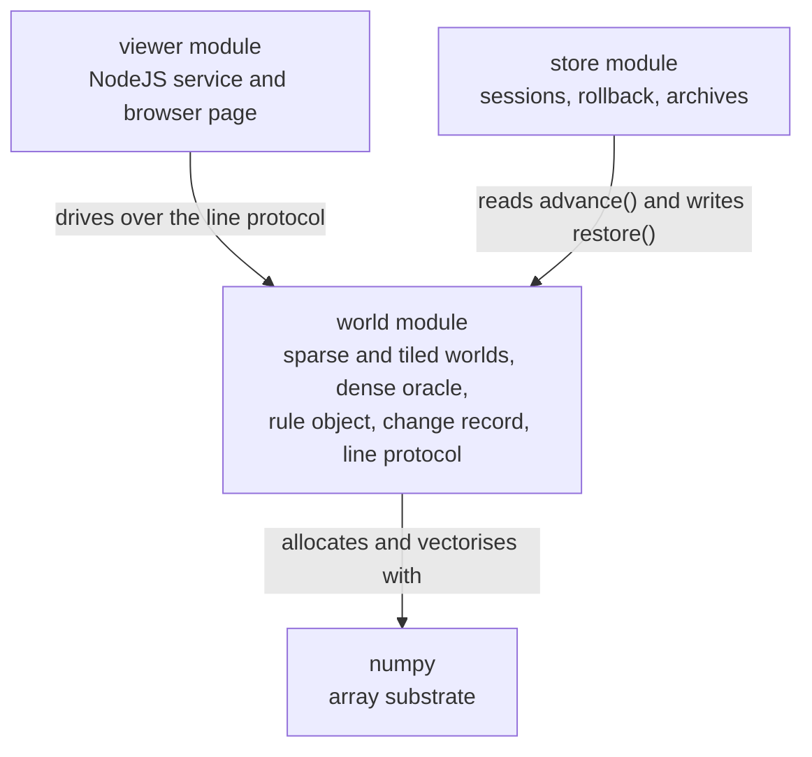

# world — overview

> **Owner of the world module contract.** This file and the eight files beside
> it own what the `world` module promises. The structural decisions behind it
> are owned by the accepted ADRs linked under *Decisions that shaped it*; version
> state is owned by [VERSIONS.md](../../plan/VERSIONS.md); the component index is
> owned by [MODULE_COMPONENT_GUIDE.md](../../MODULE_COMPONENT_GUIDE.md) §4.

Status: Implemented

## Purpose

The `world` module is the simulation core. It holds the state of one
Game-of-Life world, applies the rule to that state, and serves the result to the
rest of the system over a line protocol.

It exists because the design target is a world of 65536 x 65536 — 4.29e9 cells —
and the representation everyone reaches for first cannot hold it. One boolean
per cell is 4.29 GB before any step has run, and a step touches all of it.

Three representations are shipped, and the shape of the population decides which
of the two feasible ones wins:

* the **sparse** world stores only live cells, one packed 64-bit key each, so
  memory and step cost are proportional to the live population. It is the faster
  of the two while the population is scattered, and it is the default;
* the **tiled** world cuts the world into 64 x 64 bit-packed tiles and stores
  only the non-empty ones, so a step costs the number of *active tiles* and each
  word operation carries 64 cells. It wins by an order of magnitude once a
  pattern is clustered, and it is selected with `--representation tiled`;
* the **dense** world is the correctness oracle and the measured baseline. It
  refuses to construct above 64 million cells rather than consuming the machine.

Which is faster for which shape is measured, twice, on profile `M1`
([performance.md](performance.md) §4); it is not assumed from the shape of the
algorithms, because that is exactly the assumption the first version got wrong.

## Where the module sits

The module is the bottom of the product: the viewer's service drives it and
renders what it returns, and nothing below it is product code. Its only
third-party dependency is numpy, which is the vectorised substrate the measured
step is built on.

Arrow meaning: `X -->|"label"| World` reads "X is related to World by the label
written on the arrow". This diagram is a context view only: producer and
consumer paths are owned by [data-flow.md](data-flow.md), component flow by
[internal-components.md](internal-components.md). It is current state only.

Both arrows point **at** the world and neither points away, which is the shape of
the module's position: it is the thing others read from, and it does not know
either consumer exists. The store does not import this module; it reads a shape
([responsibilities.md](responsibilities.md) §2.6).

## Current state

| Aspect | State | Code entry point |
|---|---|---|
| Sparse world: packed 64-bit keys in a sorted unique array, bounded and non-wrapping | Implemented | [src/lifegame/world/sparse.py](../../../src/lifegame/world/sparse.py) |
| Tiled world: 64 x 64 bit-packed tiles, only non-empty tiles stored, one word per 64 cells | Implemented | [src/lifegame/world/tiled.py](../../../src/lifegame/world/tiled.py) |
| Dense reference world, used as the correctness oracle and the measured baseline | Implemented | [src/lifegame/world/dense.py](../../../src/lifegame/world/dense.py) |
| Rule object with `B<digits>/S<digits>` notation, the inverse `parse`, the nine-entry decision tables, the packed masks the bit-parallel step consumes, and the locality policy its callers enforce | Implemented | [src/lifegame/world/rules.py](../../../src/lifegame/world/rules.py) |
| One exception type for one out-of-bounds condition, shared by all three representations | Implemented | [src/lifegame/world/errors.py](../../../src/lifegame/world/errors.py) |
| `Change`: what one `advance` produced, cell by cell, as the coordinates the protocol and the store both use | Implemented | [src/lifegame/world/change.py](../../../src/lifegame/world/change.py) |
| `advance(count, record=...)`: a step that names the cells that were born and died, opt-in and free to decline | Implemented | [src/lifegame/world/sparse.py](../../../src/lifegame/world/sparse.py), [src/lifegame/world/tiled.py](../../../src/lifegame/world/tiled.py), [src/lifegame/world/dense.py](../../../src/lifegame/world/dense.py) |
| `restore(cells, generation)`: replace the live set and the generation counter together | Implemented | [src/lifegame/world/sparse.py](../../../src/lifegame/world/sparse.py), [src/lifegame/world/tiled.py](../../../src/lifegame/world/tiled.py), [src/lifegame/world/dense.py](../../../src/lifegame/world/dense.py) |
| `set_rule(rule)`: replace the rule without touching the cells or the generation counter, on all three representations | Implemented | [src/lifegame/world/sparse.py](../../../src/lifegame/world/sparse.py), [src/lifegame/world/tiled.py](../../../src/lifegame/world/tiled.py), [src/lifegame/world/dense.py](../../../src/lifegame/world/dense.py) |
| A rule compiled once per rule change into a bit-parallel selection network, so an arbitrary `B/S` rule costs a bounded constant per tile | Implemented | [src/lifegame/world/tiled.py](../../../src/lifegame/world/tiled.py) |
| Line protocol server: request/response over stdin and stdout, plus a ticking run loop | Implemented | [src/lifegame/world/bridge.py](../../../src/lifegame/world/bridge.py) |
| `export` and `import`: the whole live set as coordinates, so a world moves between processes and between representations | Implemented | [src/lifegame/world/bridge.py](../../../src/lifegame/world/bridge.py) |
| Representation selected at start-up: `--representation sparse` or `tiled` | Implemented | [src/lifegame/world/bridge.py](../../../src/lifegame/world/bridge.py) |
| An optional recorded timeline: `--history PATH`, and the `history`, `select`, `rollback`, `archive` and `open` commands driven through a session the entry point injects | Implemented | [src/lifegame/world/bridge.py](../../../src/lifegame/world/bridge.py) |
| The limits the protocol enforces, advertised in `hello` so no client keeps a copy | Implemented | [src/lifegame/world/bridge.py](../../../src/lifegame/world/bridge.py) |
| `set_rule`: adopt a rule for the generations that follow, answered in the core's normalised notation and refused as `bad_rule` with a reason while the running rule stays as it was | Implemented | [src/lifegame/world/bridge.py](../../../src/lifegame/world/bridge.py) |
| Process entry point `python -m lifegame.world` | Implemented | [src/lifegame/world/__main__.py](../../../src/lifegame/world/__main__.py) |
| Public facade and `__all__` | Implemented | [src/lifegame/world/__init__.py](../../../src/lifegame/world/__init__.py) |
| Choosing the representation from the measured shape of the population | Planned, **unowned** | No milestone declares it; the milestone that made the representation choosable made it choosable by a person. See [risks.md](risks.md) WLD-09 and its §3 |
| Pattern persistence | Implemented elsewhere | the [store](../store/overview.md) module, delivered as part of phase 02 milestone 02. This module supplies `advance` and `restore` to it and keeps no format of its own |

The last two rows are the only non-`Implemented` entries. Everything above them
is `Implemented` in the sense of §3 of
[AI_DOCUMENTATION_GUIDE.md](../../AI_DOCUMENTATION_GUIDE.md): the code entry
point can be named.

### Validation state

The module's central claims have been decided by observation, not by argument:
all three representations agree cell for cell on randomised states, **on the
number of cells a step reports as changed, and on the cells each advance names as
born or dying**
([testing.md](testing.md) §4 records the oracle test), the published Life
behaviours hold for all three, the protocol serves every documented command
against a real child process under both selectable representations, a whole world
survives an `export` and an `import`, a core with a recorded history reports a
timeline that rolls back to every generation it holds and writes an archive that
reads back, and the frontier between the representations has been measured on
profile `M1` over two population shapes ([performance.md](performance.md) §5).
The measured records are [dev-log/v0.2.0.md](../../../dev-log/v0.2.0.md) for the
representations' foundation and the later entries for what followed; the phase
criteria that name this module are B1, B2, B3, B4 and B6 in
[phase-02-simulation-core/acceptance.md](../../plan/phase-02-simulation-core/acceptance.md).
Whether those criteria count as `Validated` at a version boundary is version
state, and version state is recorded only in
[VERSIONS.md](../../plan/VERSIONS.md).

Since the rule became arbitrary the equivalence claim covers **fourteen** rules
rather than one: each is stepped in all three representations and the live sets,
the populations, the bounds and the reported change counts are compared against
the dense oracle, including states that straddle a tile seam and a world that
*switches* to a rule against one built with it
([testing.md](testing.md) §1). The rule the protocol reports is the core's, and a
rule the two locality-based representations cannot run is refused rather than
answered ([interfaces.md](interfaces.md) §3.1).

Four claims are explicitly **not** validated:

* That a representation is chosen for the caller. The protocol takes the choice
  as an argument and defaults to `sparse`, which is the better of the two for
  the scattered shape an interactive session produces, and a running core can be
  asked for the other one without losing the world. A scheduler that reads the
  measured shape and dispatches does not exist; it is [risks.md](risks.md) WLD-09
  and it is **unowned**.
* That the tiled world is fast to *query*. It wins on stepping and loses on
  reading: at 260,000 live cells a `state` request costs it about seven times
  what the sparse world charges, because a query unpacks the bit store
  ([performance.md](performance.md) §7). The measurement is recorded rather than
  smoothed over.
* That recording every generation is cheap. The claim is that naming the changed
  cells costs a comparison of two masks rather than a rescan, and nothing has
  measured what a recorded step costs against an unrecorded one
  ([performance.md](performance.md) §10).
* That every rule in the `B/S` space is correct. Fourteen rules have been run
  against the oracle; the rest of the space is covered by a compile-time bound on
  the size of a compiled plan, which is an argument and not a test, and the bound
  the test asserts is the **single-set** bound rather than the pair bound
  ([risks.md](risks.md) WLD-14).

## Owner

* **Contract owner.** This directory, `docs/model/world/`. A change to what the
  module promises is a change to these files, synchronised with the sources in
  the same work item ([DOCUMENTATION_RULES.md](../../DOCUMENTATION_RULES.md) §10).
* **Operating owner.** The repository maintainer. The module has no operator:
  it is a library plus a process that the viewer's service starts.
* **Evidence owner.** The version `dev-log` entry named by the phase criteria
  above, which are owned by
  [phase-02-simulation-core/acceptance.md](../../plan/phase-02-simulation-core/acceptance.md).

## Dependencies

### In (what this module needs)

| Dependency | Why | Failure behaviour |
|---|---|---|
| Python 3.14 | The language level the package is written against (`slots=True` dataclasses, `zip(..., strict=True)`) | Import fails |
| numpy | Every array in all three representations, and the arithmetic a step is built on: a sort in the sparse world, shifted slices in the dense world, a bit-parallel adder tree in the tiled world | Import fails; the whole module is unusable ([ADR 0006](../../adr/simulation-core/0006-numpy-is-the-vectorised-substrate.md)) |
| The rule object | All three representations read the birth and survive tables the rule builds, and the tiled world reads the packed masks it builds for the same rule | Constructed with a rule whose counts are outside `0..8`, `LifeRule` raises `ValueError`; constructed or switched to a rule the two locality-based representations cannot run, they raise `ValueError` naming the reason ([interfaces.md](interfaces.md) §3.1) |
| A 64-bit signed integer array (`numpy.int64`) | A packed key holds `y` in the high 32 bits and `x` in the low 32, so both coordinates are limited to 2^32 - 1 | A platform without 64-bit numpy integers is unsupported; the constructor enforces the coordinate limit |
| The viewer module's service | Not needed by the library; needed by the protocol to have a consumer | Nothing in this module fails; the process simply has no client |

### Out (who depends on this module)

| Consumer | What it takes | Coupling |
|---|---|---|
| The viewer's NodeJS service | The line protocol, its commands, its events, its two frame encodings, the whole-world `export` and `import` payloads, the limits `hello` advertises, the recorded-timeline commands, and the `--representation` and `--history` arguments it passes at start-up | The protocol is defined here, in [bridge.py](../../../src/lifegame/world/bridge.py), and restated in [interfaces.md](interfaces.md) § protocol. The service is a consumer and owns its own rendering contract |
| The [store](../store/overview.md) module | `advance()` and the `Change` it returns, `restore(cells, generation)`, and the world's readable shape (`width`, `height`, `rule.notation`, `population`, `generation`, `live_cells_in`) | A shape rather than an import: the store never imports this module. A change to `advance`, `restore` or a `Change` field is therefore a change to what the store can promise ([responsibilities.md](responsibilities.md) §2.6) |
| [tests/world/](../../../tests/world/) | The public facade only, all three representations through one parameterised contract | A change to the public surface breaks the shared contract test first |
| Future pattern persistence | `SparseWorld.keys()` and `live_cells()` | The packed encoding would become a file format, which is a decision this module has not taken |
| The measurement harness | `SparseWorld`, `DenseWorld`, `TiledWorld`, a stable population, and `TiledWorld.tile_count` | The harness asserts population stability, so a drifting world fails the measurement instead of being reported |

## What the module deliberately does not do

Even though it technically could:

* It does **not** render, and it does **not** own the browser page or the
  service that drives it. The viewer module owns those
  ([ADR 0007](../../adr/service-and-api/0007-viewer-service-delivered-in-phase-02.md)).
* It does **not** persist a world. There is no save format, no load path and no
  migration policy here; persistence is the [store](../store/overview.md) module,
  which reads this one through `advance` and writes into it through `restore`. The
  world supplies the two ends of that flow and owns neither the format nor its
  compatibility contract.
* It does **not** write a file unless it is asked to. A core started with
  `--history` opens a store, and the `archive` command writes one, both at a path
  its operator named. Nothing is written on start-up, on a step, or on any other
  request, and a core without `--history` writes nothing at all. That the core is
  the one place in this project that creates a file is a consequence of the
  protocol being the only surface that can ask it to.
* It does **not** wrap at the edges, and it does **not** offer a torus mode. The
  world is bounded, and a cell outside it is permanently dead
  ([ADR 0008](../../adr/simulation-core/0008-the-world-is-bounded-and-does-not-wrap.md)).
* It does **not** implement quadtree memoisation (HashLife). It is
  asymptotically the better answer for self-similar patterns and the wrong
  default for a general world; the reasoning is in
  [ADR 0009](../../adr/simulation-core/0009-sort-based-sparse-does-not-scale-to-the-target.md).
* It does **not** choose between the sparse and the tiled representation on the
  caller's behalf. The choice is an argument with a documented default, because
  the measurement shows the two split by population shape and a wrong automatic
  choice would be silently slow rather than wrong
  ([risks.md](risks.md) WLD-09).
* It does **not** resize a world. A world's bounds are fixed at construction in
  all three representations; growing one is a new world and a decision this
  module has not taken.
* It does **not** hide the boundary condition behind a configuration option.
  Three representations that disagreed about the edge would make the oracle test
  meaningless, so the choice is fixed in all three and recorded as a decision.
* It does **not** compute in the service. The service never advances a
  generation and never reads the core's memory; it sends requests and renders
  what comes back ([bridge.py](../../../src/lifegame/world/bridge.py)).
* It does **not** run a rule whose birth set contains zero in the sparse or the
  tiled world. Such a rule makes the next state depend on the world's area, which
  neither representation visits, so they refuse it instead of answering with the
  cells they happened to look at; the dense oracle runs it and is the
  representation that can ([interfaces.md](interfaces.md) §3.1).
* It does **not** offer an async or callback API to Python callers. The protocol
  is the only cross-process interface, and the in-process API is synchronous.
* It does **not** decide version state. It links to
  [VERSIONS.md](../../plan/VERSIONS.md).

## Decisions that shaped it

Five accepted decisions constrain this module, and the index is
[docs/adr/README.md](../../adr/README.md)
([DOCUMENTATION_RULES.md](../../DOCUMENTATION_RULES.md) §9):

* [ADR 0005](../../adr/simulation-core/0005-sparse-representation-at-target-scale.md)
  — the shipping representation is sparse, one packed 64-bit key per live cell,
  and a dense world is kept only as the oracle and the measured baseline.
* [ADR 0006](../../adr/simulation-core/0006-numpy-is-the-vectorised-substrate.md)
  — numpy is the vectorised substrate, and the native boundary it introduces is
  accepted deliberately.
* [ADR 0008](../../adr/simulation-core/0008-the-world-is-bounded-and-does-not-wrap.md)
  — the world is bounded and does not wrap, in all three representations.
* [ADR 0009](../../adr/simulation-core/0009-sort-based-sparse-does-not-scale-to-the-target.md)
  — the sort-based sparse step does not scale to the target at realistic
  density. The closing candidate it named, a tiled bit-parallel representation,
  is implemented in [tiled.py](../../../src/lifegame/world/tiled.py) and the
  frontier measurement shows it winning by an order of magnitude once a pattern
  is clustered. What the ADR assigned that is **not** yet delivered is choosing
  between the two without being told: that remains open as
  [risks.md](risks.md) WLD-09.
* [ADR 0010](../../adr/simulation-core/0010-tiled-bit-parallel-representation.md)
  — the tiled bit-parallel representation, adopted for clustered populations. It
  closes the gap ADR 0009 recorded **for that shape only**, and it is the reason
  the module ships two representations rather than one: the measurement says
  neither wins everywhere, and the ADR records the shape boundary rather than
  claiming a general speed-up.

The remaining structural choices, with their rejected alternatives, are recorded
in [implementation.md](implementation.md) §6 and §7. That includes the two the
rule work added and deliberately did **not** record as decisions of their own:
the rule's encoding as packed masks plus a compiled selection network, which is a
mechanism inside the representation [ADR 0010](../../adr/simulation-core/0010-tiled-bit-parallel-representation.md)
already chose and is reversible without changing any interface, and the
compile-once-per-rule-change policy that keeps its cost out of the step.

## Document map

| File | Owns |
|---|---|
| [responsibilities.md](responsibilities.md) | claims, peer boundaries, failure behaviour, prohibited behaviour |
| [interfaces.md](interfaces.md) | the public Python surface and the line protocol, in full |
| [data-flow.md](data-flow.md) | producer and consumer paths, runtime flow, lifetime, failure and recovery |
| [implementation.md](implementation.md) | layout, algorithms and complexity, environment, rejected alternatives |
| [performance.md](performance.md) | the oracle, the measurement method, the frontier, the phase profile, what is unmeasured |
| [testing.md](testing.md) | what is tested and not tested, how to run it, the last recorded result |
| [risks.md](risks.md) | the risks that are still open, with trigger, impact, mitigation and owning version |
| [internal-components.md](internal-components.md) | component list, allowed dependency direction, current component flow |
