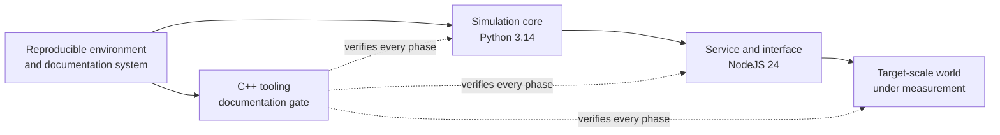

# ROADMAP

> **Derived discovery surface.** This file is navigation and direction only.
> It owns no version state and no acceptance criteria; version state lives in
> [VERSIONS.md](VERSIONS.md) and phase scope lives in the phase documents.

## Direction

lifegame is built outwards from a reproducible, evidence-disciplined base:

Arrow meaning: `A --> B` reads "B is built on top of A". Dashed arrows mean
"produces evidence for".

## Phase order

| Order | Phase | Purpose | Owning versions |
|---|---|---|---|
| 1 | [phase-01-foundation](phase-01-foundation/overview.md) | Environment isolation, documentation system, project skeletons | see [VERSIONS.md](VERSIONS.md) |
| 2 | [phase-02-simulation-core](phase-02-simulation-core/overview.md) | World representation, rule evaluation, update scheduling at target scale, and the first interactive viewer | see [VERSIONS.md](VERSIONS.md) |
| 3 | [phase-03-service-and-ui](phase-03-service-and-ui/overview.md) | A surface a person can use: localisation, one source per shared value, sessions, and the history made visible | see [VERSIONS.md](VERSIONS.md) |
| 4 | [phase-04-editing-mode](phase-04-editing-mode/overview.md) | Authoring: transactions over the world, a versioned document that can be edited collaboratively, and a reusable snippet library | see [VERSIONS.md](VERSIONS.md) |

Phases 1–3 have directories, and their version states are in
[VERSIONS.md](VERSIONS.md). Phase 04 has a design record and its own versions,
named in [VERSIONS.md](VERSIONS.md): its requirements, decisions and planned
work are written down so the direction is not forgotten.

Phase 03's scope is narrower than it was first written, because the smallest
conforming slice of its service — a static page, a push transport and a proxy to
the core — was delivered in phase 02 so that the world could be edited and
watched while it ran. The reason is recorded in
[ADR 0007](../adr/service-and-api/0007-viewer-service-delivered-in-phase-02.md).
What remains for phase 03 is the interface itself rather than the transport
underneath it.

## Standing constraints

* Everything is measured on profile `M1` or on a named alternative
  ([PERFORMANCE_ACCEPTANCE.md](PERFORMANCE_ACCEPTANCE.md)).
* No project artifact is written to the `C:` volume.
* C++ stays tooling unless a superseding ADR moves the boundary.
