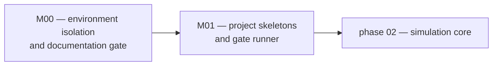

# Phase 01 — foundation

> **Owner of milestone relationships.** This file owns the milestone diagram
> for phase 01. Version state is not recorded here; see
> [../VERSIONS.md](../VERSIONS.md).

## Purpose

Make the project reproducible and self-verifying before any simulation code
exists. Everything built later inherits the environment contract and the
documentation gate established here, so both must be correct rather than
convenient.

## Scope

### In scope

* A Python 3.14 environment managed by uv, with the interpreter payload, the
  virtual environment, every package cache and every temporary file confined to
  the repository tree.
* NodeJS tooling configuration on the same isolation rule.
* A documentation system with a single authority per claim type and an
  executable conformance gate written in C++.
* The repository skeletons (Python package, Node package, tool layout) needed
  for phase 02 to start.

### Out of scope

* Any simulation behaviour. Phase 01 ships no Game of Life code.
* Any service endpoint or UI.
* Performance floors for simulation surfaces — those belong to phase 02.

## Milestones

Arrow meaning: `A --> B` reads "B cannot start before A is complete".

| Milestone | Delivers | Version |
|---|---|---|
| M00 environment isolation and documentation gate | repository-internal interpreter, caches and temporary files; documentation system; C++ conformance gate | see [../VERSIONS.md](../VERSIONS.md) |
| M01 project skeletons and gate runner | importable Python package, Node service package, one command that runs every gate | see [../VERSIONS.md](../VERSIONS.md) |

## Documents

| Document | Content |
|---|---|
| [milestones.md](milestones.md) | milestone detail and the version that delivers each |
| [tasks.md](tasks.md) | work items and their state |
| [acceptance.md](acceptance.md) | measurable acceptance criteria for the phase |
| [risks.md](risks.md) | phase risks, each with an owning version |
| [plans/](plans/) | one focused plan per version |
