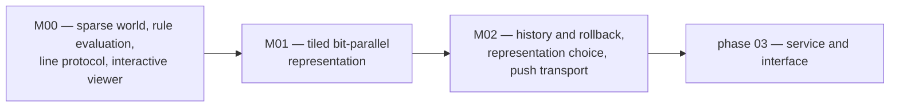

# Phase 02 — simulation core

> **Owner of milestone relationships.** This file owns the milestone diagram
> for phase 02. Version state is not recorded here; see
> [../VERSIONS.md](../VERSIONS.md).

## Purpose

Make a life world that can **exist at the design target** — 65536 x 65536, which
is 4.29e9 cells — and make it **observable and editable by hand** while it runs.
Everything after this phase inherits the world's representation, its boundary
condition and its rule contract, so those three must be right rather than
convenient.

## Scope

### In scope

* The world representation, and the memory and complexity argument that makes it
  possible at the target scale.
* Conway's rule (B3/S23) as a value object, with the transition it defines.
* The line protocol that lets another process drive the world.
* An independent correctness oracle, and the equivalence evidence it produces.
* A browser surface that renders a viewport, toggles cells on click, runs,
  pauses, steps, clears, zooms and pans.
* A measured frontier: where the shipped representation wins, where it loses,
  and what closes the gap it cannot close.

### Out of scope

* Update scheduling beyond one generation at a time, and any parallel or
  distributed execution.
* Persistence: saving and loading patterns. No format decision is taken here.
* Multiple rules as a user-facing feature. The rule object supports them; the
  protocol exposes Conway only.
* Streaming transports. The viewer polls; a push transport is phase 03's.
* Any native or accelerated representation. The gap it would close is measured
  and assigned, not silently assumed away.

## Milestones

Arrow meaning: `A --> B` reads "B cannot start before A is complete".

| Milestone | Delivers | Version |
|---|---|---|
| M00 sparse world and an interactive viewer | the world representation that fits the target scale, Conway's rule, the correctness oracle, the line protocol, and a browser page that can edit and run the world | see [../VERSIONS.md](../VERSIONS.md) |
| M01 tiled bit-parallel representation | the representation the measured frontier says is required for realistic density at the target scale, and the measurement that says which shape each representation is for | see [../VERSIONS.md](../VERSIONS.md) |
| M02 history, dispatch, push transport and browser coverage | a session that outlives its process and can be rolled back or archived, a representation chosen from the interface, a transport that does not poll, and browser behaviour that a test executes | see [../VERSIONS.md](../VERSIONS.md) |

## Documents

| Document | Content |
|---|---|
| [milestones.md](milestones.md) | milestone detail and the version that delivers each |
| [tasks.md](tasks.md) | work items and their state |
| [acceptance.md](acceptance.md) | measurable acceptance criteria for the phase |
| [risks.md](risks.md) | phase risks, each with an owning version |
| [plans/](plans/) | one focused plan per version |
