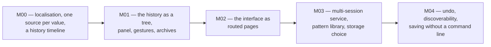

# phase-03-service-and-ui

> **Authority.** This file owns the milestone relationship of this phase.
> Version state is owned by [../VERSIONS.md](../VERSIONS.md); this phase never
> restates it.

## Purpose

Phase 02 built a world that can be stored two ways, a service that drives it, and
a page that edits it. This phase is about the interface a person actually uses:
one place for every string, one source for every shared value, and the history
that a store makes possible shown as something you can click.

The distinction matters because the previous phase's page grew one capability at
a time and accumulated the costs of that: an English-only surface, a title and a
label written by hand next to a component that also names itself, a limit copied
into the page that the core would refuse, and two style rules that applied to
some controls and not to others. None of those are bugs in a feature; all of them
are defects in a product.

## Milestones

Arrow meaning: `A --> B` reads "B cannot start before A is complete".

| Milestone | Delivers | Version |
|---|---|---|
| M00 localisation, one source per value, and a history timeline | a Chinese and English surface with one message catalogue, every shared number taken from the process that enforces it, one style rule per kind of control, and the recorded history as a timeline | see [../VERSIONS.md](../VERSIONS.md) |
| M01 the history as a tree | a recorded history with branches, a selection that can preview without destroying what came after it, a panel that gets out of the way, tablet gestures, and archive management | see [../VERSIONS.md](../VERSIONS.md) |
| M02 the interface as routed pages | one page per concern at its own path, the shared parts declared once, a test that can see a missing element and an audit that can see an orphaned rule, and the history as nodes revealed on hover or on focus | see [../VERSIONS.md](../VERSIONS.md) |
| M03 multi-session service and a pattern library | more than one world per service, named sessions, patterns placed by name, and a storage choice the service makes from measurement | see [../VERSIONS.md](../VERSIONS.md) |
| M04 the UI a second person can use | the smaller things that stop a person who was not told how it works: discoverability, undo of the last edit, and saving without a command line | see [../VERSIONS.md](../VERSIONS.md) |

## What this phase deliberately does not do

* **No rendering engine change.** The page draws a viewport of cells on a canvas
  and will keep doing that. A tile renderer, WebGL or an incremental damage
  rectangle is a measurement waiting to happen, not a milestone.
* **No framework.** The page is a few hundred lines of modules with no build
  step. A framework would trade a dependency and a build for a benefit this
  project has not measured.
* **No accounts, no server-side state beyond a store.** A session belongs to
  whoever opened it.

## Reading order

1. [milestones.md](milestones.md) — what each milestone is for;
2. [acceptance.md](acceptance.md) — how each is judged;
3. [tasks.md](tasks.md) — the work items;
4. [risks.md](risks.md) — what could go wrong and who owns it;
5. `plans/<version>/plan.md` — the focused plan for one version.
