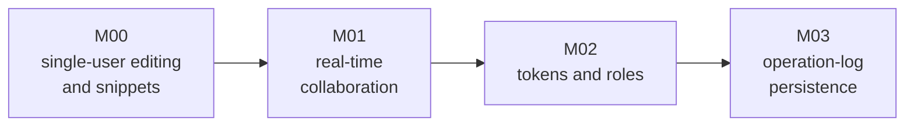

# Phase 04 — editing mode

Status: Partially Implemented
Version state: [../VERSIONS.md](../VERSIONS.md)
Design: [design.md](design.md)
Decisions: [ADR 0012](../../adr/simulation-core/0012-atomic-patch-in-the-core-protocol.md), [ADR 0013](../../adr/service-and-api/0013-editing-is-a-versioned-document.md), [ADR 0014](../../adr/data-and-formats/0014-snippets-are-content-addressed-objects.md)

This phase turns the viewer from a surface that observes and pokes a world into
one that **authors** it: transactions instead of single-cell writes, a versioned
document that can be edited collaboratively, and a snippet library that makes a
small region reusable with overwrite or merge semantics. M00 (single-user editing
and snippets) and M01 (real-time collaboration) are implemented; M02 (tokens and
roles) and M03 (operation-log persistence) are Planned.

## Why a phase

Phase 03 built the service and the interface around observing: sessions, history,
archives, patterns, storage choice, and the capabilities seam that names the
editing surfaces without describing them. The authoring gap it left is recorded
in [design.md](design.md) §1: nine pain points, and three missing layers — an
operation, an edit session, and editing as an API. They do not fit inside a
version of the observation surface, so they are their own phase.

## Milestones

`M00 -> M01 -> M02 -> M03`; each milestone is delivered by the version naming it
in [../VERSIONS.md](../VERSIONS.md). The milestones are strictly ordered: the
transaction model precedes collaboration, the author model precedes roles, and
the persistence decision follows a working collaboration surface.

Arrow meaning: `A --> B` reads "A is delivered before B". The milestones and exit
conditions are in [milestones.md](milestones.md); the work items are in
[tasks.md](tasks.md); the criteria that decide them are in
[acceptance.md](acceptance.md); the risks and the questions still open are in
[risks.md](risks.md).

## Scope

* M00: the core's atomic `patch`, an edit document with a version and a hash
  chain, a transaction API, the edit tools, the snippet library with drafts and
  publish, undo and redo, and resynchronisation.
* M01: presence, concurrent-transaction merge, and global undo across authors.
* M02: edit tokens, roles (observer, editor, owner), and an audit of who
  committed or undid what.
* M03: whether and how the operation log is persisted, and its format.

## Not in scope

* A separate draft document; editing is over the live world (design Q1).
* Editing while the world runs; entering the mode pauses it (design C1).
* A second world model, a build step or an npm dependency (design N1, N2).
* Text-style positional OT; absolute-write merging is the model (design §7).
* Real-time sharing outside collaboration; the `?focus=x,y` link is the
  observation-time sharing mechanism and is unchanged.

## Reading order

1. [design.md](design.md) — the pain points, requirements, the owner's answers,
   the model, the API and the limits;
2. [milestones.md](milestones.md) — what each milestone contains, its exit
   condition and its state;
3. [tasks.md](tasks.md) — the work items that deliver it;
4. [acceptance.md](acceptance.md) — the criteria and how each is judged;
5. [risks.md](risks.md) — the risks and the decisions deferred to a named
   version;
6. [plans/v0.4.0/plan.md](plans/v0.4.0/plan.md) — the focused plan for the first
   version.
